# Admin Console

<cite>
**Referenced Files in This Document**   
- [admin2000.php](file://admin2000.php)
- [recover_admin.php](file://recover_admin.php)
- [domain_check.php](file://domain_check.php)
- [repair_payment_db.php](file://repair_payment_db.php)
- [db.php](file://db.php)
</cite>

## Table of Contents
1. [Introduction](#introduction)
2. [Project Structure](#project-structure)
3. [Core Components](#core-components)
4. [Architecture Overview](#architecture-overview)
5. [Detailed Component Analysis](#detailed-component-analysis)
6. [Dependency Analysis](#dependency-analysis)
7. [Performance Considerations](#performance-considerations)
8. [Troubleshooting Guide](#troubleshooting-guide)
9. [Conclusion](#conclusion)

## Introduction
This document describes the hardened admin console for the VPR application, covering four entry points:

| File | Purpose |
|---|---|
| `admin2000.php` | Main admin dashboard with login, live pricing control, interest management, search analytics, search history, payment monitoring, and system health checks. |
| `recover_admin.php` | Email-based admin password recovery using a short-lived, single-use token. |
| `domain_check.php` | Readiness checklist for HTTPS, database writability, SQLite presence, and security files. |
| `repair_payment_db.php` | One-click verification that the V12.9 payment table schema is complete. |

The implementation follows the project-wide rules:

- Live search prices are stored in the `settings` table as `price_USD` and `price_ZIG`. A price of `0.00` means free and bypasses Paynow.
- Only server-side Paynow USD flows may release certificates; UI actions or return links are not payment proof.
- ZiG payments use a static Paynow link and do not auto-release certificates.
- Admin credentials and Paynow secrets are kept out of generated pages and version control.

## Project Structure
The admin console is intentionally small and focused. The four PHP files share common infrastructure through `db.php`, which provides session handling, CSRF protection, IP hashing, audit logging, settings access, Paynow helpers, and schema migration.

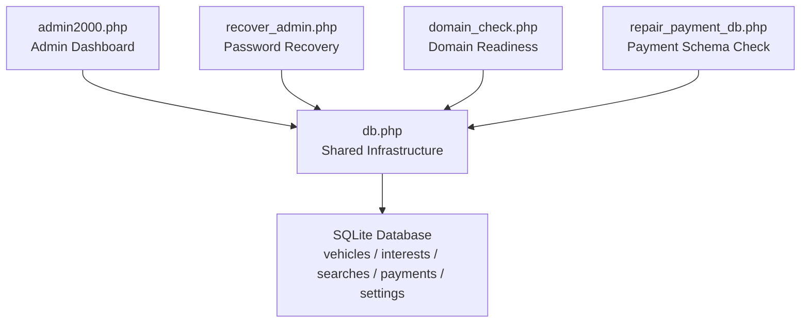

**Diagram sources**
- [admin2000.php:1-10](file://admin2000.php#L1-L10)
- [recover_admin.php:1-10](file://recover_admin.php#L1-L10)
- [domain_check.php:1-14](file://domain_check.php#L1-L14)
- [repair_payment_db.php:1-10](file://repair_payment_db.php#L1-L10)
- [db.php:24-41](file://db.php#L24-L41)

**Section sources**
- [admin2000.php:1-10](file://admin2000.php#L1-L10)
- [db.php:24-41](file://db.php#L24-L41)

## Core Components

### Hardened Login and Session Security
The admin login flow protects against brute force by combining:

- A protected IP fingerprint derived from the client IP and a secret hash key.
- A `login_attempts` table tracking attempts, first attempt time, and last attempt time.
- A configurable block threshold and window.
- Security email alerts after repeated failures and when blocked.
- Session regeneration on successful login.
- An admin session timeout enforced by `admin_session_valid()`.

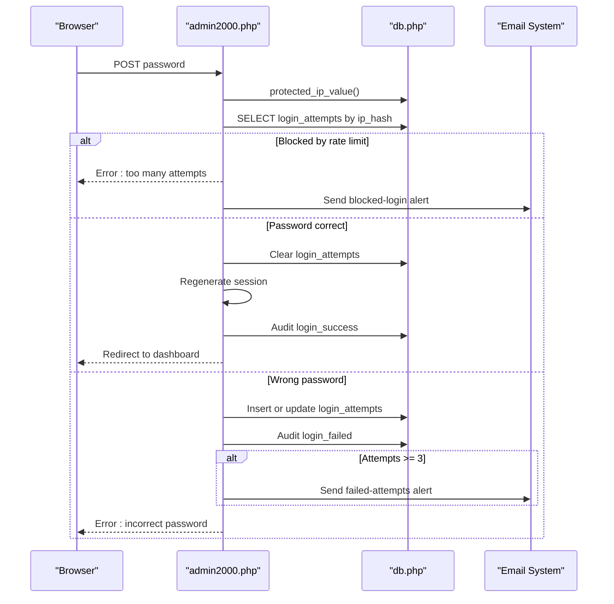

**Diagram sources**
- [admin2000.php:19-68](file://admin2000.php#L19-L68)
- [db.php:127-151](file://db.php#L127-L151)
- [db.php:179-210](file://db.php#L179-L210)

Key behaviors:

| Feature | Implementation Detail |
|---|---|
| IP protection | Uses HMAC-SHA256 over the client IP with a secret key. |
| Rate limiting | Blocks after reaching `VPR_MAX_LOGIN_ATTEMPTS` within `VPR_LOGIN_BLOCK_SECONDS`. |
| Audit trail | Every login event is recorded in `admin_audit`. |
| Session security | Strict mode, cookie-only sessions, HTTP-only cookies, secure flag under HTTPS, and admin session timeout. |
| CSRF protection | All mutating POSTs require a session-bound CSRF token. |

**Section sources**
- [admin2000.php:19-68](file://admin2000.php#L19-L68)
- [db.php:96-144](file://db.php#L96-L144)
- [db.php:116-133](file://db.php#L116-L133)

### Live Pricing Control
The dashboard exposes a form to set public search fees for USD and ZiG. On submit:

1. Both values must be numeric and non-negative.
2. Values are normalized to two decimal places.
3. Settings are persisted via `vpr_set_setting`.
4. The change is audited.
5. Public search flows read the live price from the `settings` table.

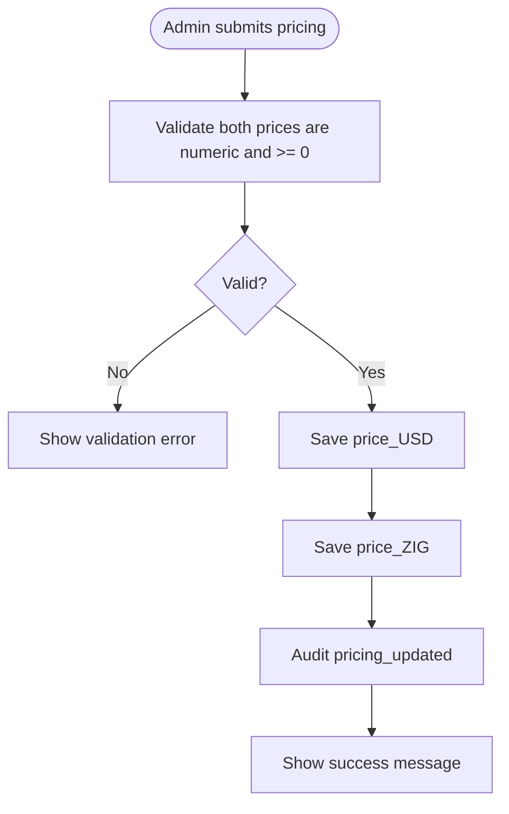

**Diagram sources**
- [admin2000.php:115-125](file://admin2000.php#L115-L125)
- [db.php:5-22](file://db.php#L5-L22)

Important notes:

- A price of `0.00` means free and bypasses Paynow.
- The fallback defaults in `config.php` are only used if no setting exists.
- Changes take effect immediately because public search logic reads `settings.price_USD` and `settings.price_ZIG`.

**Section sources**
- [admin2000.php:115-125](file://admin2000.php#L115-L125)
- [db.php:5-22](file://db.php#L5-L22)

### Add and Clear Interests
Interests represent banks, lenders, or secured parties associated with a vehicle registration. The dashboard supports:

- Adding an interest for an existing or new vehicle.
- Normalizing registration numbers and chassis numbers.
- Updating vehicle metadata when the record already exists.
- Marking new interests as `ACTIVE`.
- Clearing an interest by changing its status to `CLEARED` and recording `cleared_at`.

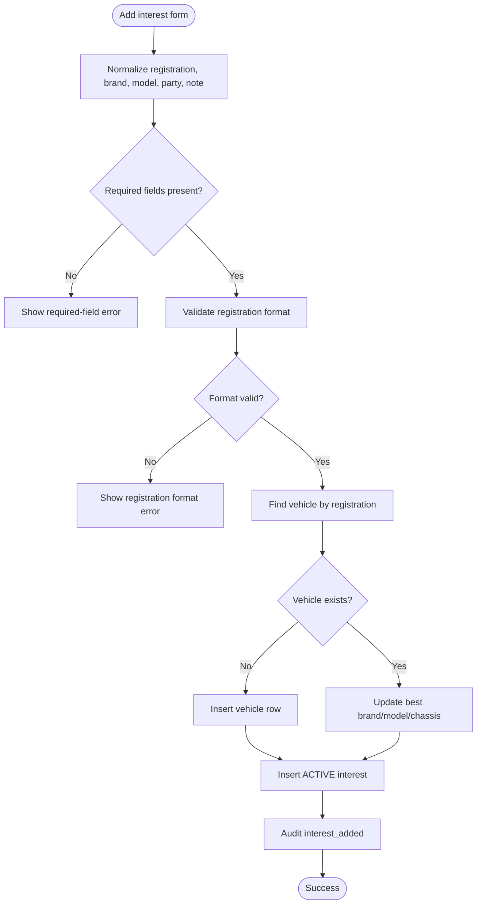

**Diagram sources**
- [admin2000.php:128-158](file://admin2000.php#L128-L158)

Clearing an interest is simpler: it updates the interest row to `CLEARED` and records the clearance timestamp.

**Section sources**
- [admin2000.php:128-168](file://admin2000.php#L128-L168)

### Search History
The dashboard can retrieve every recorded search for a given registration number. Results show:

- Date and time.
- Stored vehicle details.
- Search result text.
- Certificate number.
- A link to view the certificate.

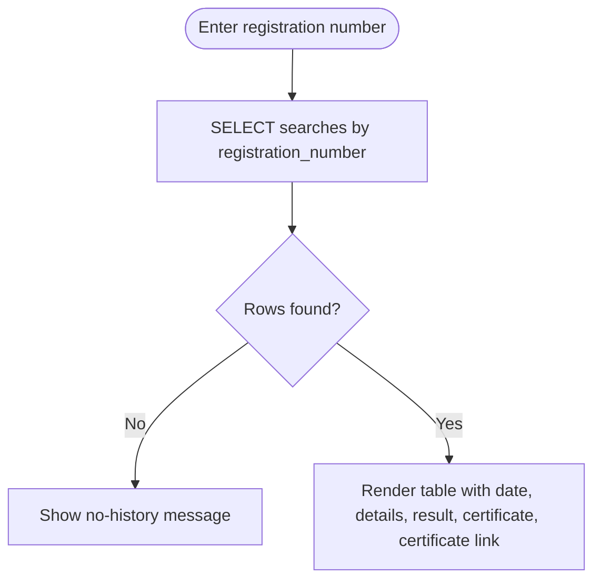

**Diagram sources**
- [admin2000.php:228-240](file://admin2000.php#L228-L240)
- [admin2000.php:374-418](file://admin2000.php#L374-L418)

**Section sources**
- [admin2000.php:228-240](file://admin2000.php#L228-L240)
- [admin2000.php:374-418](file://admin2000.php#L374-L418)

### Analytics
The analytics section reports:

- Searches today.
- Searches in the last seven days.
- Searches this month.
- Total searches since launch.
- Selected period counts for day, ISO week, or calendar month.
- Recent daily, weekly, and monthly search counts.
- Export links to Excel and PDF through `traffic_report.php`.

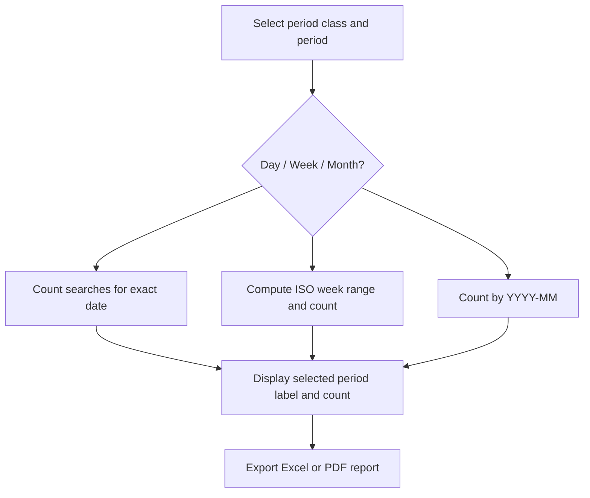

**Diagram sources**
- [admin2000.php:184-217](file://admin2000.php#L184-L217)
- [admin2000.php:295-337](file://admin2000.php#L295-L337)

**Section sources**
- [admin2000.php:171-217](file://admin2000.php#L171-L217)
- [admin2000.php:295-337](file://admin2000.php#L295-L337)

### Payment Monitoring
The dashboard shows recent Paynow transactions and summary metrics:

- Paid search count.
- Aggregated paid revenue.
- Recent rows including merchant reference, Paynow reference, registration number, amount, status, and last error.
- Links to the payment repair tool.
- Health indicators for PDO SQLite, cURL, `allow_url_fopen`, OpenSSL, Paynow integration ID, currency, and fee.

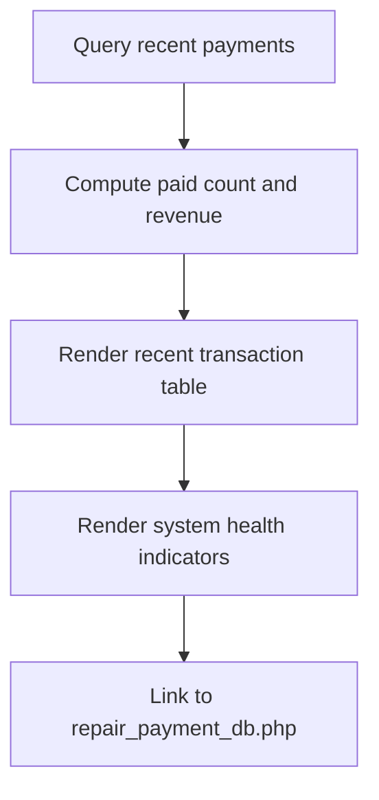

**Diagram sources**
- [admin2000.php:177-179](file://admin2000.php#L177-L179)
- [admin2000.php:426-457](file://admin2000.php#L426-L457)

**Section sources**
- [admin2000.php:177-179](file://admin2000.php#L177-L179)
- [admin2000.php:426-457](file://admin2000.php#L426-L457)

### Email-Based Password Recovery
The recovery page implements a secure reset flow:

1. The user requests recovery.
2. A random token is created and hashed before storage.
3. A one-time link is sent to the configured security email address.
4. The link is valid for a limited time and can be used once.
5. Resetting requires a minimum-length password and confirmation.
6. Successful resets mark the token used, clear login blocks, audit the action, and send a security notification.

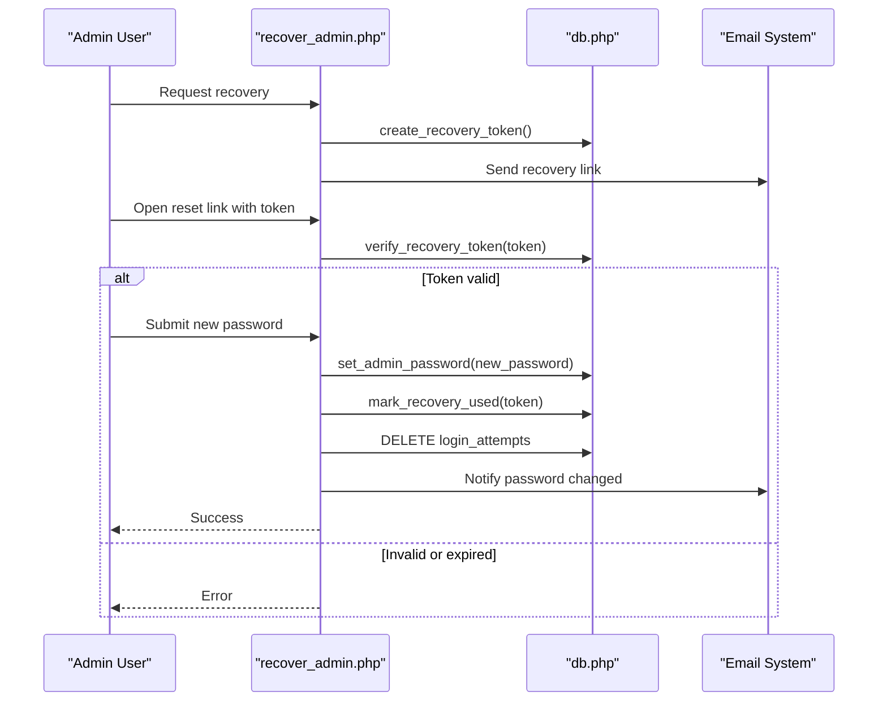

**Diagram sources**
- [recover_admin.php:11-52](file://recover_admin.php#L11-L52)
- [db.php:179-210](file://db.php#L179-L210)

**Section sources**
- [recover_admin.php:11-52](file://recover_admin.php#L11-L52)
- [db.php:179-210](file://db.php#L179-L210)

### Domain and Deployment Readiness Check
The domain readiness page verifies deployment conditions without contacting external services:

- Whether HTTPS is detected.
- Current domain.
- Database directory writability.
- SQLite database file presence.
- Data protection `.htaccess`.
- Application `.htaccess`.
- Computed secure base URL.

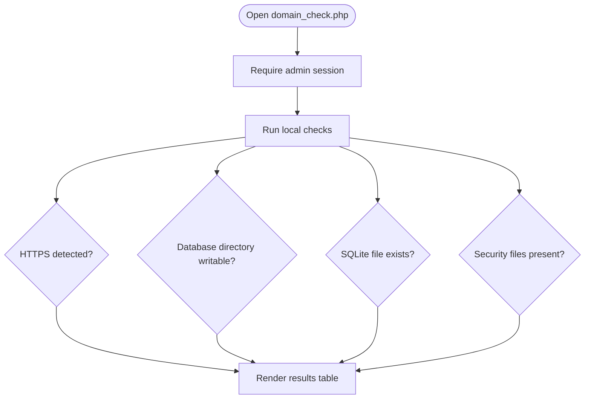

**Diagram sources**
- [domain_check.php:5-13](file://domain_check.php#L5-L13)
- [db.php:55-68](file://db.php#L55-L68)

**Section sources**
- [domain_check.php:5-13](file://domain_check.php#L5-L13)
- [db.php:55-68](file://db.php#L55-L68)

### Payment Database Repair Tool
The repair tool ensures the payment table has all expected V12.9 columns. It:

- Requires admin authentication.
- Opens the database through `db()`, which runs schema migrations.
- Reads current column names.
- Compares them against the required list.
- Reports success or lists missing fields.

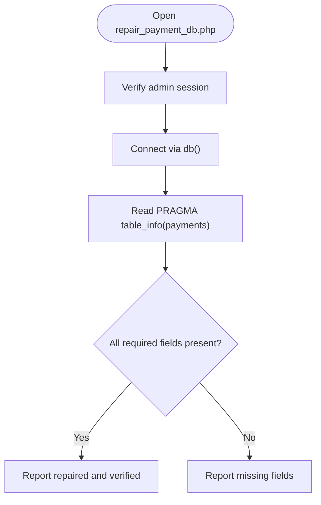

**Diagram sources**
- [repair_payment_db.php:4-11](file://repair_payment_db.php#L4-L11)
- [db.php:550-600](file://db.php#L550-L600)

**Section sources**
- [repair_payment_db.php:4-11](file://repair_payment_db.php#L4-L11)
- [db.php:550-600](file://db.php#L550-L600)

## Architecture Overview
The admin console separates presentation, business logic, and shared infrastructure:

- Presentation: HTML forms, tables, and messages in each admin page.
- Business logic: Validation, normalization, auditing, and data operations inside the pages and `db.php`.
- Shared infrastructure: Sessions, CSRF, IP hashing, settings, Paynow helpers, schema migration, and utility functions.

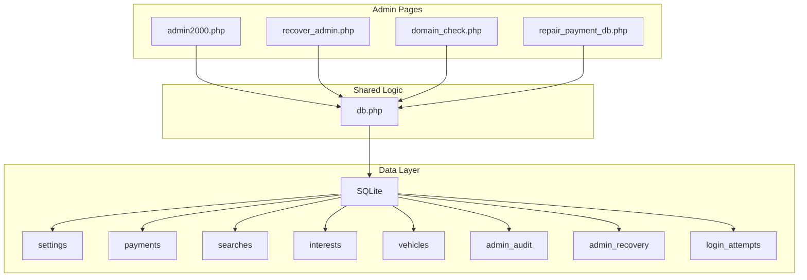

**Diagram sources**
- [admin2000.php:1-10](file://admin2000.php#L1-L10)
- [recover_admin.php:1-10](file://recover_admin.php#L1-L10)
- [domain_check.php:1-14](file://domain_check.php#L1-L14)
- [repair_payment_db.php:1-10](file://repair_payment_db.php#L1-L10)
- [db.php:458-609](file://db.php#L458-L609)

## Detailed Component Analysis

### Authentication and Security Model
The authentication model combines several layers:

| Layer | Responsibility |
|---|---|
| `secure_session_start()` | Configures strict, cookie-only, HTTP-only, secure, SameSite=Strict sessions. |
| `protected_ip_value()` | Hashes the client IP with a secret key so logs and tables do not store raw IPs. |
| `admin_session_valid()` | Enforces an idle timeout and refreshes the last-access timestamp. |
| `audit_admin()` | Records admin actions with sanitized details and the protected IP hash. |
| `csrf_token()` / `verify_csrf()` | Protects state-changing POST requests. |
| `security_headers()` | Applies content security, frame, referrer, MIME, and optional HTTPS redirect policies. |

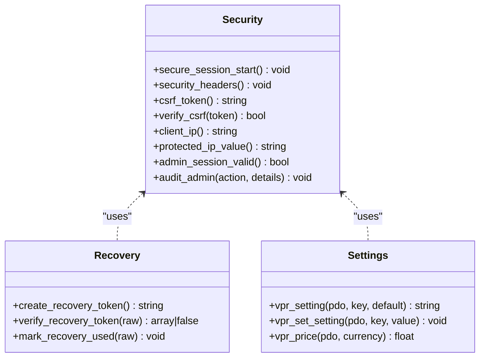

**Diagram sources**
- [db.php:70-151](file://db.php#L70-L151)
- [db.php:179-210](file://db.php#L179-L210)
- [db.php:5-22](file://db.php#L5-L22)

**Section sources**
- [db.php:70-151](file://db.php#L70-L151)
- [db.php:179-210](file://db.php#L179-L210)
- [db.php:5-22](file://db.php#L5-L22)

### Data Model Relationships Relevant to Admin Operations
The admin console interacts primarily with vehicles, interests, searches, payments, settings, audit logs, recovery tokens, and login attempts.

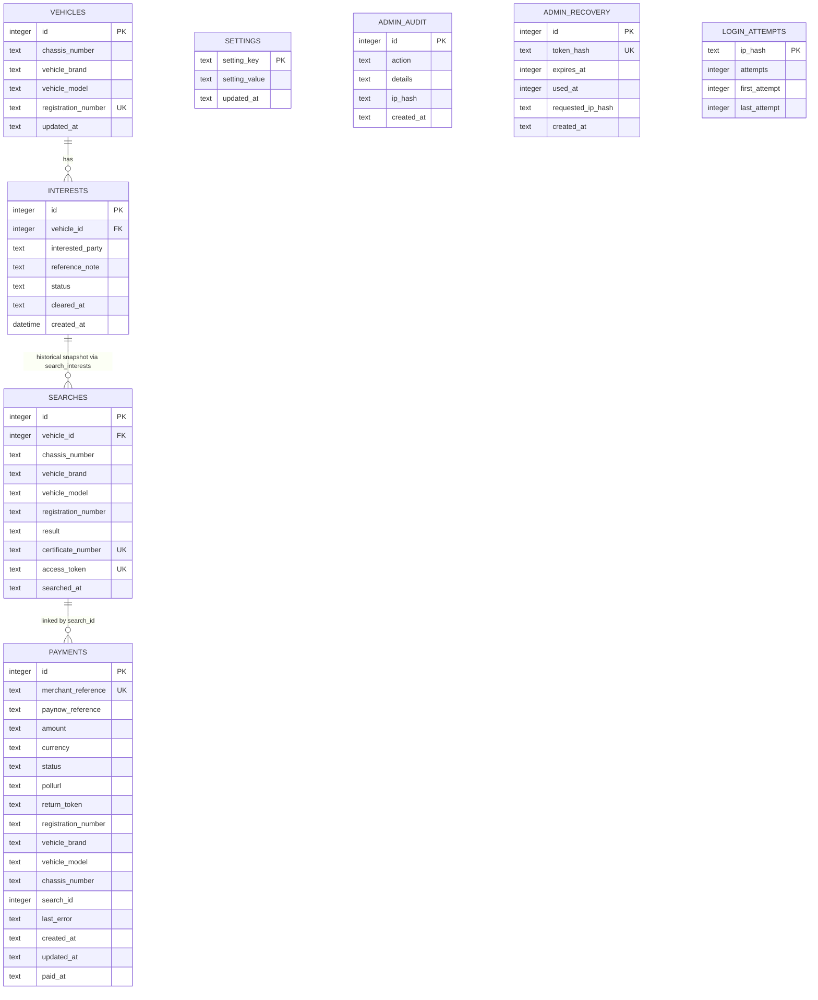

**Diagram sources**
- [db.php:458-609](file://db.php#L458-L609)
- [admin2000.php:141-158](file://admin2000.php#L141-L158)
- [db.php:357-442](file://db.php#L357-L442)

**Section sources**
- [db.php:458-609](file://db.php#L458-L609)

### Payment Finalization Flow
Only server-side Paynow USD flows should finalize a search and issue a certificate. The finalization function validates:

- Payment existence.
- Paid-like status.
- Amount match against the configured fee.
- Idempotency through transaction locking.
- Vehicle lookup or creation.
- Interest ordering.
- Search insertion.
- Certificate generation.
- Linking the search back to the payment.

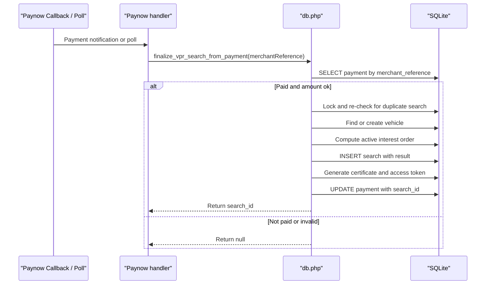

**Diagram sources**
- [db.php:357-442](file://db.php#L357-L442)

**Section sources**
- [db.php:357-442](file://db.php#L357-L442)

## Dependency Analysis
The admin pages depend on `db.php` for almost all cross-cutting concerns. There is minimal coupling between the four admin pages themselves.

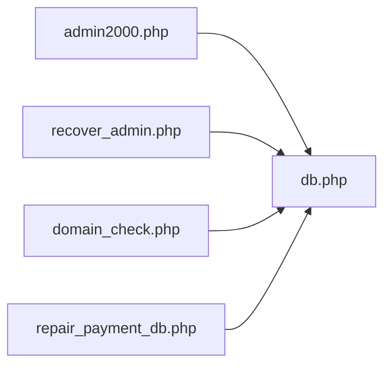

**Diagram sources**
- [admin2000.php:1-3](file://admin2000.php#L1-L3)
- [recover_admin.php:1-4](file://recover_admin.php#L1-L4)
- [domain_check.php:1-5](file://domain_check.php#L1-L5)
- [repair_payment_db.php:1-4](file://repair_payment_db.php#L1-L4)

Coupling observations:

- High cohesion within `db.php`: session, security, settings, recovery, Paynow helpers, and schema migration are centralized.
- Low coupling between admin pages: each page focuses on one responsibility.
- External dependencies include SQLite, PHP mail, cURL or `allow_url_fopen`, and Paynow.

**Section sources**
- [admin2000.php:1-3](file://admin2000.php#L1-L3)
- [recover_admin.php:1-4](file://recover_admin.php#L1-L4)
- [domain_check.php:1-5](file://domain_check.php#L1-L5)
- [repair_payment_db.php:1-4](file://repair_payment_db.php#L1-L4)

## Performance Considerations
The database layer applies performance and resilience settings:

- WAL journal mode allows concurrent readers and writers.
- `NORMAL` synchronous mode balances durability and speed.
- A busy timeout reduces blocking under load.
- Foreign keys are enabled.
- Temporary storage is moved to memory.
- Indexes exist for search dates, vehicle interests, certificate numbers, access tokens, payment status, and registration numbers.

Recommendations:

- Monitor SQLite WAL size and checkpoint behavior under heavy search traffic.
- Avoid long-running admin queries during peak hours.
- Use the analytics filters rather than scanning large unindexed ranges.
- Keep the database directory writable but restrict access at the hosting level.

[No sources needed since this section provides general guidance]

## Troubleshooting Guide

### Admin Cannot Log In
Likely causes:

- Too many failed attempts triggered the IP-based block.
- The admin session timed out.
- The wrong password was entered.
- The hosting account email delivery is broken, preventing recovery emails.

Actions:

- Wait until the login block window expires.
- Use `recover_admin.php` to request a recovery link.
- Confirm the security email address is reachable.
- Review the `admin_audit` table for login events.

**Section sources**
- [admin2000.php:19-68](file://admin2000.php#L19-L68)
- [db.php:135-151](file://db.php#L135-L151)
- [recover_admin.php:11-52](file://recover_admin.php#L11-L52)

### Recovery Email Not Received
Likely causes:

- PHP `mail()` is unavailable or misconfigured.
- The security email address is invalid.
- Hosting provider blocks outbound mail.
- The recovery token expired before use.

Actions:

- Verify server mail configuration.
- Check hosting provider restrictions.
- Ensure the recovery link is opened within its TTL.
- After a successful reset, login attempts are cleared automatically.

**Section sources**
- [recover_admin.php:11-52](file://recover_admin.php#L11-L52)
- [db.php:162-168](file://db.php#L162-L168)
- [db.php:179-210](file://db.php#L179-L210)

### Prices Are Not Changing
Likely causes:

- The submitted values were negative or not numeric.
- The browser cached the page.
- The settings table is not writable.
- A custom caching proxy is serving stale content.

Actions:

- Resubmit valid non-negative numeric prices.
- Clear browser cache or hard-refresh.
- Check the dashboard’s success message and audit log.
- Verify the database directory permissions.

**Section sources**
- [admin2000.php:115-125](file://admin2000.php#L115-L125)
- [db.php:5-22](file://db.php#L5-L22)

### Payment Table Is Missing Fields
Likely causes:

- The database predates V12.9.
- A partial upgrade left the payment table incomplete.
- Manual edits removed columns.

Actions:

- Open `repair_payment_db.php` while logged in as admin.
- Review the reported missing fields.
- If necessary, restore from backup and rerun the repair tool.

**Section sources**
- [repair_payment_db.php:4-11](file://repair_payment_db.php#L4-L11)
- [db.php:550-600](file://db.php#L550-L600)

### HTTPS or Domain Issues
Likely causes:

- Reverse proxy does not set HTTPS headers correctly.
- TLS is not enabled on the domain.
- The database directory is not writable.
- Required `.htaccess` files are missing.

Actions:

- Use `domain_check.php` to inspect HTTPS detection, database writability, SQLite presence, and security files.
- Configure the reverse proxy to forward `HTTPS` or `X-Forwarded-Proto`.
- Enable TLS on the domain.
- Restore missing security files.

**Section sources**
- [domain_check.php:5-13](file://domain_check.php#L5-L13)
- [db.php:55-68](file://db.php#L55-L68)

## Conclusion
The admin console provides a focused, hardened interface for managing VPR administration:

- Login is protected by IP-hash rate limiting, audit logging, secure sessions, and CSRF validation.
- Live pricing is controlled through the dashboard and persisted in the settings table.
- Interests can be added and cleared with normalized inputs and audit trails.
- Search analytics and per-registration search history support operational visibility.
- Payment monitoring and schema repair tools help maintain payment integrity.
- Email-based password recovery uses short-lived, single-use tokens and sends security notifications.

For production deployments, ensure:

- HTTPS is enabled and trusted by the web server.
- The database directory is writable but restricted.
- Email delivery is tested.
- Paynow integration credentials remain in the gitignored `config.php`.
- Backups are taken before importing Excel data or running repairs.

[No sources needed since this section summarizes without analyzing specific files]