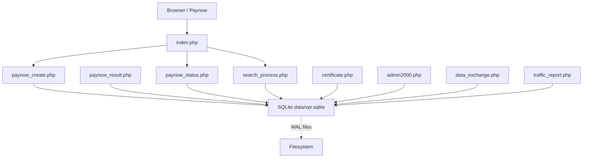
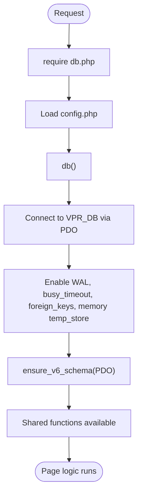
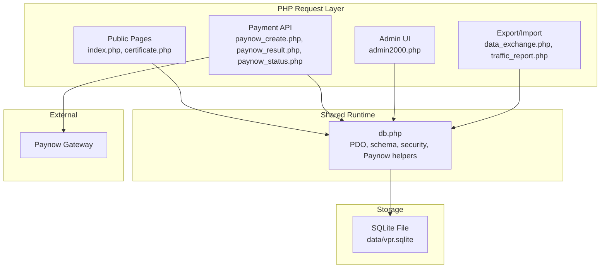
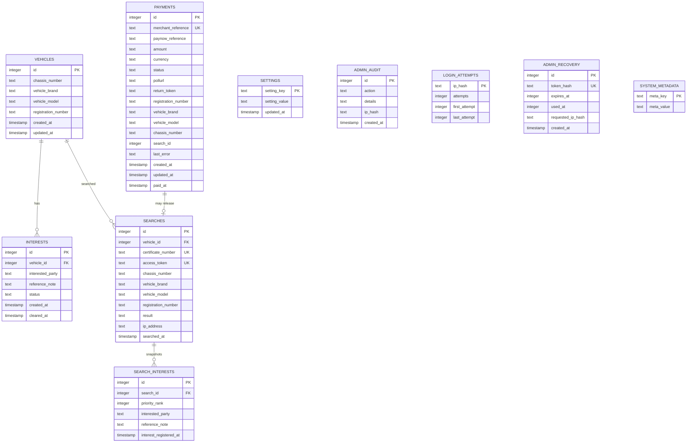
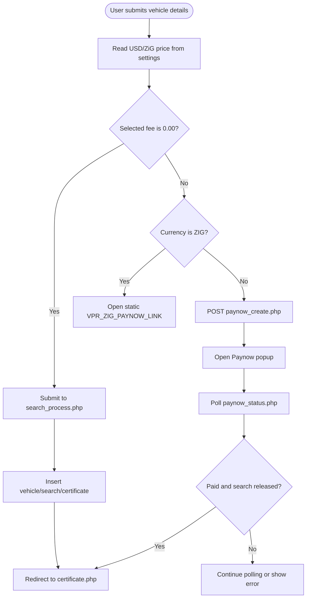
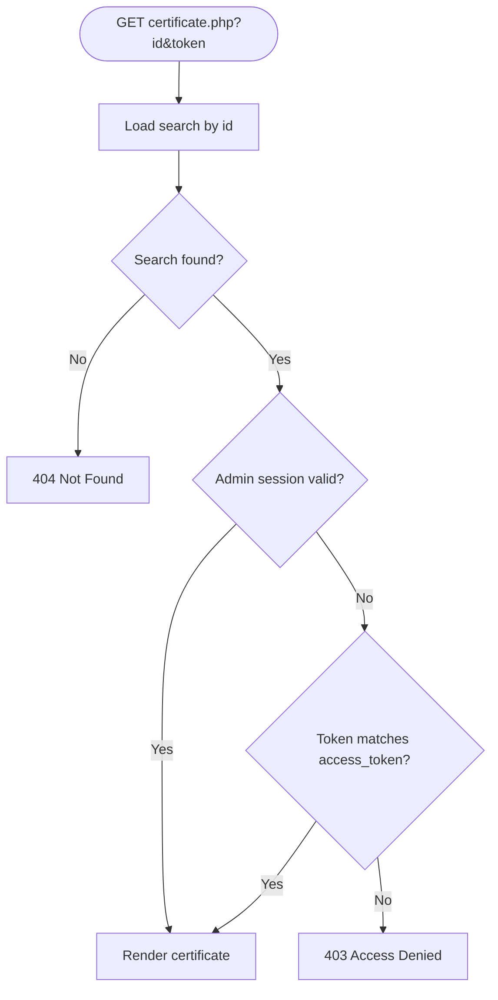
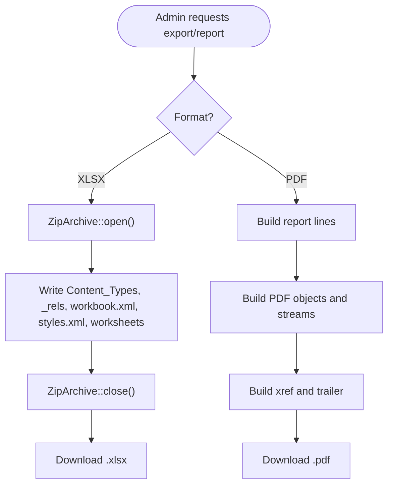
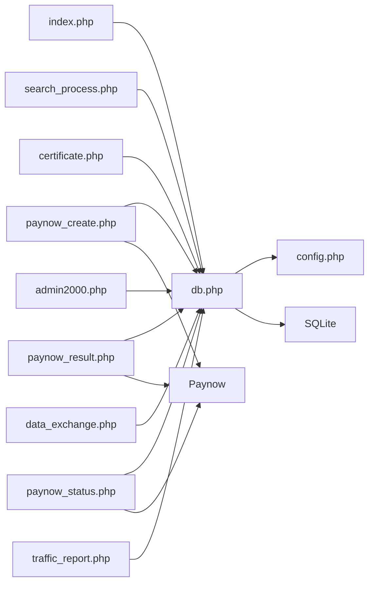

# Architecture Overview

<cite>
**Referenced Files in This Document**
- [db.php](file://db.php)
- [index.php](file://index.php)
- [search_process.php](file://search_process.php)
- [paynow_create.php](file://paynow_create.php)
- [paynow_result.php](file://paynow_result.php)
- [paynow_status.php](file://paynow_status.php)
- [certificate.php](file://certificate.php)
- [admin2000.php](file://admin2000.php)
- [data_exchange.php](file://data_exchange.php)
- [traffic_report.php](file://traffic_report.php)
</cite>

## Table of Contents
1. [Introduction](#introduction)
2. [Project Structure](#project-structure)
3. [Core Components](#core-components)
4. [Architecture Overview](#architecture-overview)
5. [Detailed Component Analysis](#detailed-component-analysis)
6. [Dependency Analysis](#dependency-analysis)
7. [Performance Considerations](#performance-considerations)
8. [Troubleshooting Guide](#troubleshooting-guide)
9. [Conclusion](#conclusion)

## Introduction
This is a flat, page-per-function PHP 8 application with no framework, no Composer, and no build step. Every public or administrative script begins by requiring `db.php`, which loads configuration, initializes the single SQLite database file, applies schema migrations, and exposes shared functions for security, sessions, Paynow integration, vehicle search logic, certificate generation, and admin helpers.

The app’s primary purpose is to let users check whether an active pledge interest is recorded against a Zimbabwean vehicle registration. Searches are either free (price 0.00), paid through a server-side USD Paynow flow, or initiated via a static ZiG Paynow link. Only verified USD payments may release a certificate; popup closure or return-to-site events are not payment proof.

## Project Structure
At the top level, each `.php` file is a self-contained request handler:

| File | Role |
|---|---|
| `db.php` | Shared runtime: config loading, PDO connection, schema migration, security, sessions, Paynow helpers, vehicle/search/certificate utilities |
| `index.php` | Public landing page and client-side payment modal |
| `search_process.php` | Free search processor when price is 0.00 |
| `paynow_create.php` | Server-side USD payment initiation |
| `paynow_result.php` | Paynow webhook result handler |
| `paynow_status.php` | Client polling endpoint for USD payment status |
| `certificate.php` | Printable A4 certificate viewer |
| `admin2000.php` | Admin login, pricing, interests, analytics, backup/import UI |
| `data_exchange.php` | Excel backup export and import using hand-rolled XLSX writer/reader |
| `traffic_report.php` | Traffic report export as PDF or XLSX |



**Diagram sources**
- [index.php:1-12](file://index.php#L1-L12)
- [search_process.php:1-79](file://search_process.php#L1-L79)
- [paynow_create.php:1-145](file://paynow_create.php#L1-L145)
- [paynow_result.php:1-41](file://paynow_result.php#L1-L41)
- [paynow_status.php:1-56](file://paynow_status.php#L1-L56)
- [certificate.php:1-43](file://certificate.php#L1-L43)
- [admin2000.php:1-108](file://admin2000.php#L1-L108)
- [data_exchange.php:1-12](file://data_exchange.php#L1-L12)
- [traffic_report.php:1-25](file://traffic_report.php#L1-L25)

**Section sources**
- [index.php:1-12](file://index.php#L1-L12)
- [db.php:1-41](file://db.php#L1-L41)

## Core Components
The application is organized around one shared runtime rather than classes or controllers.

### Shared Runtime (`db.php`)
`db.php` is the central dependency for every page. It:

- Loads `config.php` from the same directory.
- Exposes a singleton-style `db()` function that creates a PDO connection to `VPR_DB`.
- Enables WAL mode, normal synchronous behavior, a 5-second busy timeout, foreign keys, and in-memory temp storage.
- Runs `ensure_v6_schema()` on every startup to create tables, indexes, missing columns, duplicate registration consolidation, legacy token backfills, and payment table migrations.
- Provides settings accessors `vpr_setting()` and `vpr_set_setting()` backed by a `settings` table.
- Derives live prices through `vpr_price()`, falling back to constants only when the settings table does not yet contain a value.
- Implements security headers, HTTPS redirection, secure session configuration, CSRF tokens, IP hashing, admin session validation, audit logging, recovery tokens, and password management.
- Encapsulates Paynow hash creation/validation, HTTP POST fallback between cURL and `allow_url_fopen`, response parsing, amount checking, and the finalization routine that converts a paid USD transaction into a search and certificate.
- Normalizes registration numbers and chassis values, generates deterministic certificate references, and looks up vehicles by registration.



**Diagram sources**
- [db.php:1-41](file://db.php#L1-L41)
- [db.php:458-609](file://db.php#L458-L609)

**Section sources**
- [db.php:1-41](file://db.php#L1-L41)
- [db.php:55-94](file://db.php#L55-L94)
- [db.php:96-125](file://db.php#L96-L125)
- [db.php:135-151](file://db.php#L135-L151)
- [db.php:245-355](file://db.php#L245-L355)
- [db.php:357-442](file://db.php#L357-L442)
- [db.php:458-609](file://db.php#L458-L609)

### Entry Pages
Public entry points follow the same pattern: require `db.php`, call `security_headers()`, obtain `$pdo = db()`, then render HTML or redirect.

| Page | Responsibility |
|---|---|
| `index.php` | Renders the vehicle search form, shows current USD/ZiG prices, handles zero-fee submission directly, and opens the Paynow modal for paid searches |
| `search_process.php` | Validates input, creates or updates the vehicle record, records the search, snapshots active interests, assigns a certificate reference and access token, and redirects to the certificate |
| `certificate.php` | Loads a search, verifies access unless the viewer is logged in as admin, renders the A4 certificate, and supports browser print-to-PDF |

**Section sources**
- [index.php:1-12](file://index.php#L1-L12)
- [index.php:130-137](file://index.php#L130-L137)
- [search_process.php:1-79](file://search_process.php#L1-L79)
- [certificate.php:1-43](file://certificate.php#L1-L43)

### Payment Flow
The USD payment flow is intentionally strict: only the server-side Paynow integration can release a certificate.

```mermaid
sequenceDiagram
participant Browser as "Browser"
participant Index as "index.php"
participant Create as "paynow_create.php"
participant Paynow as "Paynow Gateway"
participant Status as "paynow_status.php"
participant Result as "paynow_result.php"
participant DB as "SQLite"
participant Cert as "certificate.php"
Browser->>Index : Submit vehicle details
alt Price is 0.00
Index->>SearchProcess : Redirect to search_process.php
SearchProcess->>DB : Insert vehicle/search/certificate
SearchProcess-->>Cert : Redirect to certificate
else Paid USD
Index->>Create : POST vehicle details + USD currency
Create->>DB : Create payment row
Create->>Paynow : Initialize payment
Paynow-->>Create : Return browserurl/pollurl
Create-->>Index : JSON with browserurl
Index->>Browser : Open Paynow popup
Browser->>Status : Poll paynow_status.php
Status->>DB : Read payment
Status->>Paynow : Poll pollurl
Paynow-->>Status : Confirmed status
Status->>DB : Update payment
Status->>DB : finalize_vpr_search_from_payment()
Status-->>Index : Paid + certificate URL
Index->>Cert : Redirect to certificate
end
```

**Diagram sources**
- [index.php:198-284](file://index.php#L198-L284)
- [paynow_create.php:36-145](file://paynow_create.php#L36-L145)
- [paynow_status.php:1-56](file://paynow_status.php#L1-L56)
- [paynow_result.php:1-41](file://paynow_result.php#L1-L41)
- [db.php:357-442](file://db.php#L357-L442)

**Section sources**
- [index.php:198-284](file://index.php#L198-L284)
- [paynow_create.php:36-145](file://paynow_create.php#L36-L145)
- [paynow_result.php:1-41](file://paynow_result.php#L1-L41)
- [paynow_status.php:1-56](file://paynow_status.php#L1-L56)
- [db.php:357-442](file://db.php#L357-L442)

### Admin and Reporting
Admin pages protect themselves with `secure_session_start()` and `admin_session_valid()`. They read/write live pricing, manage interests, display analytics, and drive backup/export/import operations.

| Feature | Implementation |
|---|---|
| Admin login | Session-based with failed-attempt tracking, optional blocking, and security emails |
| Pricing | Stored in the `settings` table via `vpr_set_setting()`; live prices affect both public pages and Paynow creation |
| Interests | Add, clear, and view ordered active interests per vehicle |
| Analytics | Daily/weekly/monthly search counts and revenue summaries |
| Backup | Export all core tables into a multi-sheet `.xlsx` workbook |
| Import | Validate required sheets, merge vehicles/interests/searches, preserve certificate numbers, and roll back on failure |
| Reports | Generate traffic reports as PDF or XLSX without external libraries |

**Section sources**
- [admin2000.php:1-108](file://admin2000.php#L1-L108)
- [admin2000.php:110-169](file://admin2000.php#L110-L169)
- [admin2000.php:171-462](file://admin2000.php#L171-L462)
- [data_exchange.php:1-12](file://data_exchange.php#L1-L12)
- [data_exchange.php:200-242](file://data_exchange.php#L200-L242)
- [data_exchange.php:244-380](file://data_exchange.php#L244-L380)
- [traffic_report.php:1-79](file://traffic_report.php#L1-L79)

## Architecture Overview
The system is intentionally minimal:

- **No framework:** Each script is a standalone request handler.
- **No Composer:** No autoloader or package manager.
- **No build step:** Frontend is plain HTML/CSS and vanilla JavaScript.
- **Single storage:** All state lives in one SQLite file referenced by `VPR_DB`.
- **Dependency-free exports:** XLSX files are built by writing XML parts into a ZIP archive using PHP’s built-in `ZipArchive`; PDFs are generated by writing raw PDF objects.
- **External dependencies:** The only outbound integration is Paynow, handled through cURL with a fallback to `allow_url_fopen`.



**Diagram sources**
- [db.php:1-41](file://db.php#L1-L41)
- [index.php:1-12](file://index.php#L1-L12)
- [paynow_create.php:1-145](file://paynow_create.php#L1-L145)
- [paynow_result.php:1-41](file://paynow_result.php#L1-L41)
- [paynow_status.php:1-56](file://paynow_status.php#L1-L56)
- [admin2000.php:1-108](file://admin2000.php#L1-L108)
- [data_exchange.php:1-12](file://data_exchange.php#L1-L12)
- [traffic_report.php:1-79](file://traffic_report.php#L1-L79)

## Detailed Component Analysis

### Database Schema and Migration Model
The intended schema is enforced at runtime by `ensure_v6_schema()`. The bundled `data/vpr.sqlite` predates later features and should be treated as legacy; the first request repairs it by creating missing tables, columns, indexes, and default values.

Key entities:

| Entity | Purpose | Important Notes |
|---|---|---|
| `vehicles` | Canonical vehicle record | Unique index on non-empty registration number; brand/model/chassis normalized on update |
| `interests` | Active or cleared pledges | Ordered by creation time and ID to determine “order of VPR registration” |
| `searches` | Per-search results | Stores vehicle snapshot, result, certificate number, access token, and IP hash |
| `search_interests` | Snapshot of active interests at search time | Preserves historical interest state even if interests change later |
| `payments` | USD Paynow transactions | Tracks merchant reference, status, amount, currency, poll URL, and linked search |
| `settings` | Live application settings | Holds `price_USD` and `price_ZIG` |
| `admin_audit` | Audit log | Records admin actions and protected IP hashes |
| `login_attempts` | Brute-force protection | Tracks attempts per hashed IP |
| `admin_recovery` | Recovery tokens | Hashed, time-limited, single-use tokens |
| `system_metadata` | Schema version marker | Set to `12` |



**Diagram sources**
- [db.php:458-609](file://db.php#L458-L609)

**Section sources**
- [db.php:458-609](file://db.php#L458-L609)

### Zero-Fee vs Paid Search Logic
The decision path is simple and explicit:



**Diagram sources**
- [index.php:198-284](file://index.php#L198-L284)
- [search_process.php:10-79](file://search_process.php#L10-L79)
- [db.php:18-22](file://db.php#L18-L22)

**Section sources**
- [index.php:198-284](file://index.php#L198-L284)
- [search_process.php:10-79](file://search_process.php#L10-L79)
- [db.php:18-22](file://db.php#L18-L22)

### Certificate Access Control
A certificate is identified by two pieces of information:

- `id`: the search record identifier.
- `token`: the access token stored on the search.

Non-admin viewers must supply both. Admin viewers bypass the token check after a valid admin session is established.



**Diagram sources**
- [certificate.php:6-27](file://certificate.php#L6-L27)
- [db.php:135-144](file://db.php#L135-L144)

**Section sources**
- [certificate.php:6-27](file://certificate.php#L6-L27)
- [db.php:135-144](file://db.php#L135-L144)

### XLSX and PDF Generation Without External Libraries
Both export paths avoid third-party packages:

- **XLSX:** Uses `ZipArchive` to assemble OpenXML parts: content types, relationships, workbook, styles, and worksheet XML. Text cells use inline strings; numeric cells use numeric values.
- **PDF:** Builds a minimal PDF-1.4 document by writing catalog, pages, fonts, page objects, content streams, xref, and trailer manually.



**Diagram sources**
- [data_exchange.php:49-97](file://data_exchange.php#L49-L97)
- [data_exchange.php:110-185](file://data_exchange.php#L110-L185)
- [traffic_report.php:28-58](file://traffic_report.php#L28-L58)
- [traffic_report.php:61-79](file://traffic_report.php#L61-L79)

**Section sources**
- [data_exchange.php:49-97](file://data_exchange.php#L49-L97)
- [data_exchange.php:110-185](file://data_exchange.php#L110-L185)
- [data_exchange.php:200-242](file://data_exchange.php#L200-L242)
- [traffic_report.php:28-58](file://traffic_report.php#L28-L58)
- [traffic_report.php:61-79](file://traffic_report.php#L61-L79)

## Dependency Analysis
The dependency graph is shallow and centered on `db.php`.



**Diagram sources**
- [db.php:1-41](file://db.php#L1-L41)
- [index.php:1-12](file://index.php#L1-L12)
- [search_process.php:1-79](file://search_process.php#L1-L79)
- [paynow_create.php:1-145](file://paynow_create.php#L1-L145)
- [paynow_result.php:1-41](file://paynow_result.php#L1-L41)
- [paynow_status.php:1-56](file://paynow_status.php#L1-L56)
- [certificate.php:1-43](file://certificate.php#L1-L43)
- [admin2000.php:1-108](file://admin2000.php#L1-L108)
- [data_exchange.php:1-12](file://data_exchange.php#L1-L12)
- [traffic_report.php:1-25](file://traffic_report.php#L1-L25)

**Section sources**
- [db.php:1-41](file://db.php#L1-L41)
- [paynow_create.php:281-337](file://db.php#L281-L337)

## Performance Considerations
The most important performance characteristics come from how SQLite is configured and how writes are structured.

- **WAL journal mode:** Allows readers and writers to operate concurrently with less blocking than rollback-journal mode.
- **Busy timeout:** Up to 5 seconds of retry before failing on temporary locks.
- **Foreign keys enabled:** Ensures referential integrity between vehicles, searches, and interest snapshots.
- **In-memory temp store:** Reduces disk pressure for temporary query structures.
- **Checkpoint helper:** `checkpoint_db()` is available for maintenance tasks but is wrapped in non-fatal error handling so normal requests continue even if checkpointing fails.
- **Idempotent schema migration:** `ensure_v6_schema()` runs on every startup and uses `IF NOT EXISTS`, column checks, and safe defaults.
- **Transaction-scoped payment finalization:** `finalize_vpr_search_from_payment()` wraps vehicle lookup/creation, search insertion, certificate assignment, and payment update in a transaction with a double-check lock to avoid duplicate search generation.

Recommended operational practices:

- Keep `data/vpr.sqlite` writable by the web server process.
- Do not delete SQLite WAL-related files while the site is running.
- Use the admin “Repair / Verify Payment Database” tool when payment tables need reconciliation.
- Avoid deleting backups during import; imports are transactional but still modify live data.
- Monitor Paynow health indicators in the admin panel, especially cURL availability and OpenSSL support.

**Section sources**
- [db.php:24-51](file://db.php#L24-L51)
- [db.php:357-442](file://db.php#L357-L442)
- [admin2000.php:446-458](file://admin2000.php#L446-L458)

## Troubleshooting Guide

### Certificate Shows 403 or 404
- **404:** The search `id` does not exist.
- **403:** Non-admin viewers must include the correct `token` matching the search’s `access_token`.
- Admin viewers bypass the token requirement after a valid admin session.

**Section sources**
- [certificate.php:6-27](file://certificate.php#L6-L27)

### USD Payment Never Releases a Certificate
Only verified USD payments may release a certificate. Common causes:

- The Paynow response signature could not be verified.
- The returned status is not considered paid.
- The amount does not match the expected USD fee.
- The gateway returned an empty or malformed response.
- The server cannot reach Paynow because neither cURL nor `allow_url_fopen` is available.

The admin panel displays recent payment rows, statuses, amounts, and last errors.

**Section sources**
- [paynow_create.php:95-139](file://paynow_create.php#L95-L139)
- [paynow_result.php:7-41](file://paynow_result.php#L7-L41)
- [paynow_status.php:18-38](file://paynow_status.php#L18-L38)
- [db.php:281-355](file://db.php#L281-L355)
- [admin2000.php:426-458](file://admin2000.php#L426-L458)

### ZiG Payment Does Not Auto-Release a Certificate
ZiG payments open a static Paynow link and cannot auto-release certificates until a provider API exists. Closing the popup or returning to the site is not payment proof.

**Section sources**
- [index.php:243-256](file://index.php#L243-L256)

### Excel Import Fails
Common causes:

- Missing required sheets: `Metadata`, `Vehicles`, `Interests`, `Searches`.
- Unsupported or invalid schema version.
- Invalid CSV-like structure inside uploaded sheets.
- Network or filesystem issues preventing ZIP creation.
- Partial failures during import trigger a transaction rollback.

**Section sources**
- [data_exchange.php:244-380](file://data_exchange.php#L244-L380)

### PDF Export Requires No Extra Libraries
PDF export is built by writing raw PDF objects. If it fails, inspect the output format parameter and ensure the server allows generating binary responses.

**Section sources**
- [traffic_report.php:28-58](file://traffic_report.php#L28-L58)

## Conclusion
The VPR application is a deliberately small, dependency-free PHP 8 system. Its architecture is defined by simplicity:

- Every page requires `db.php`.
- All state is stored in a single SQLite file.
- There is no framework, Composer, or build step.
- XLSX and PDF exports are generated by hand-rolled code using built-in PHP extensions.
- Security, sessions, CSRF, admin auditing, recovery tokens, and Paynow integration are centralized in `db.php`.
- The USD payment flow is the only path that releases a certificate, and it validates signatures, amounts, and status before creating a search and certificate.
- ZiG payments remain intentionally decoupled from automatic certificate release.

This design makes the application easy to deploy on low-cost shared hosting while keeping the critical business logic transparent and auditable.