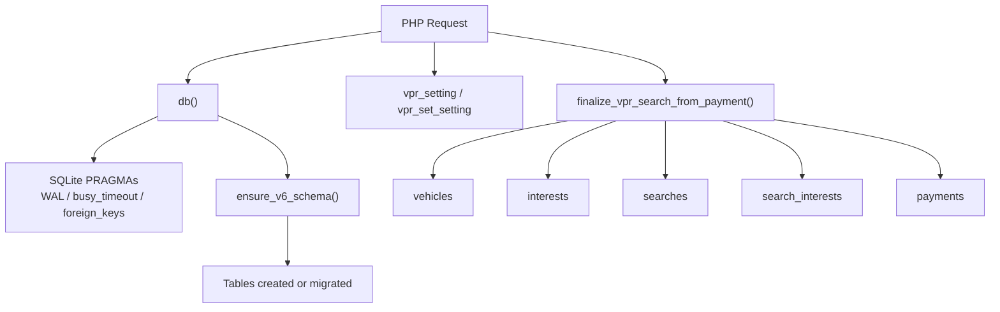
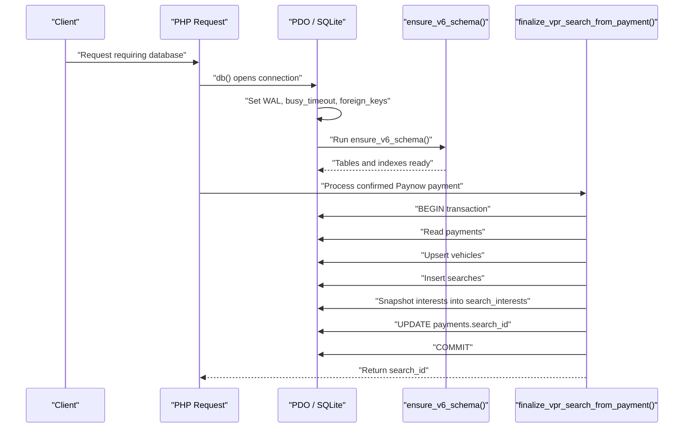
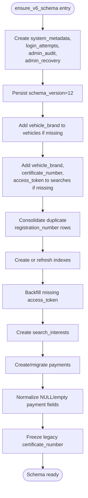
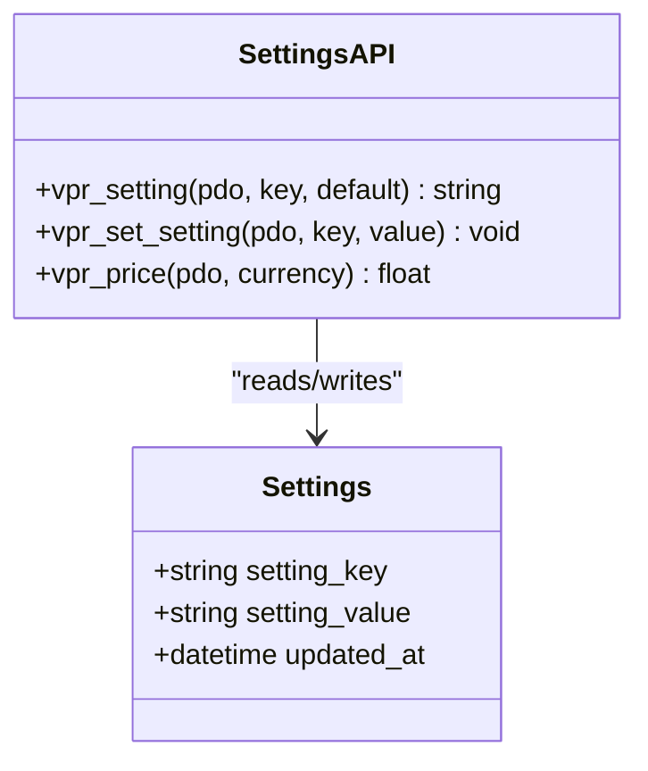
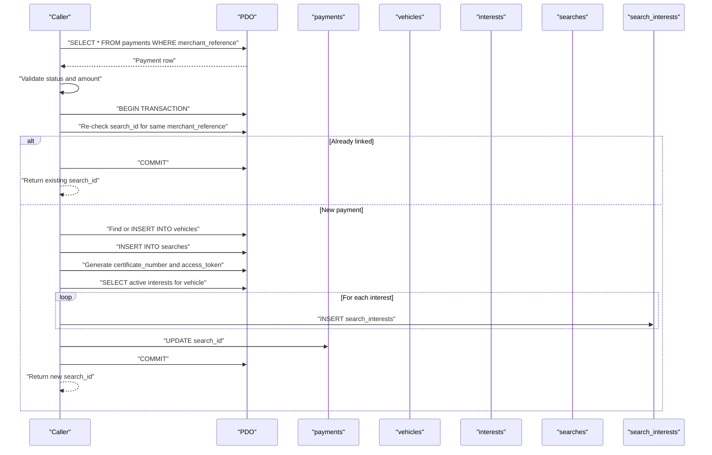
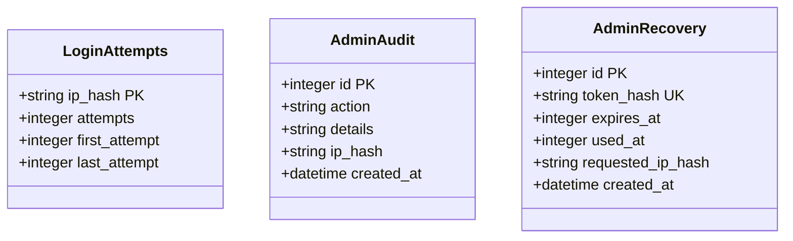
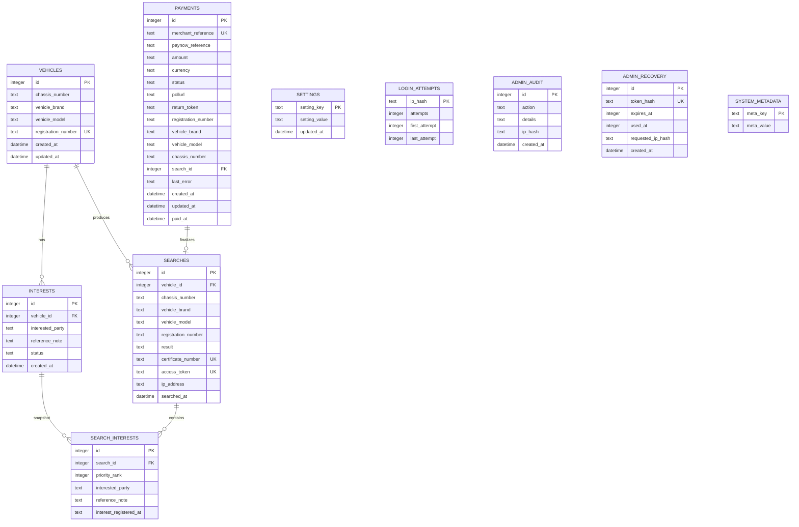

# Data Layer and Schema

<cite>
**Referenced Files in This Document**
- [db.php](file://db.php)
</cite>

## Table of Contents
1. [Introduction](#introduction)
2. [Project Structure](#project-structure)
3. [Core Components](#core-components)
4. [Architecture Overview](#architecture-overview)
5. [Detailed Component Analysis](#detailed-component-analysis)
6. [Dependency Analysis](#dependency-analysis)
7. [Performance Considerations](#performance-considerations)
8. [Troubleshooting Guide](#troubleshooting-guide)
9. [Conclusion](#conclusion)

## Introduction
This document explains the data layer for the VPR application, focusing on lazy schema bootstrap, SQLite tuning, and the complete logical schema: vehicles, interests, searches, search_interests, payments, settings, login_attempts, admin_audit, admin_recovery, and system_metadata. The authoritative implementation is in db.php; the bundled data/vpr.sqlite is a legacy artifact predating V12.9 and must not be treated as the current schema definition. On first use, db.php creates or migrates the database to the intended state through ensure_v6_schema.

The project author’s notes are important context:
- Application version 14.2 does not equal schema version 12.
- Live search prices are stored in the settings table (price_USD, price_ZIG); config.php fee constants are fallback defaults.
- Only the server-side Paynow USD flow may release a certificate; client-side closure or generic links are not payment proof.
- ZiG payments open a static Paynow link and cannot auto-release certificates.
- config.php is gitignored and contains live secrets.
- The bundled data/vpr.sqlite is intentionally self-healed by ensure_v6_schema.

## Project Structure
The data layer is implemented entirely within db.php. It provides:
- A shared PDO connection factory with SQLite WAL mode and concurrency tuning.
- Lazy schema creation and migration via ensure_v6_schema.
- Settings storage helpers that also create the settings table if missing.
- Payment finalization logic that writes into payments, vehicles, searches, and search_interests.
- Admin security tables: login_attempts, admin_audit, admin_recovery.
- System metadata tracking, including schema_version.

**Diagram sources**
- [db.php:24-40](file://db.php#L24-L40)
- [db.php:458-609](file://db.php#L458-L609)
- [db.php:357-442](file://db.php#L357-L442)

**Section sources**
- [db.php:24-40](file://db.php#L24-L40)
- [db.php:458-609](file://db.php#L458-L609)

## Core Components
- Shared SQLite connection: db() returns a single PDO instance per request lifecycle, enables exception mode, sets WAL journaling, NORMAL synchronous behavior, a 5-second busy timeout, foreign key enforcement, and memory-backed temporary storage.
- Lazy schema bootstrap: ensure_v6_schema runs once per connection and creates or migrates all required tables and indexes.
- Settings persistence: vpr_setting and vpr_set_setting create the settings table lazily and store key/value pairs used for live pricing.
- Payment-to-search finalization: finalize_vpr_search_from_payment validates a paid payment, ensures or updates the vehicle, records a search, generates a certificate number and access token, snapshots active interests into search_interests, and links the payment to the new search.
- Admin security: login_attempts tracks lockout state by IP hash; admin_audit logs administrative actions; admin_recovery stores one-time recovery tokens.
- System metadata: system_metadata stores schema_version and other system-level configuration.

**Section sources**
- [db.php:24-40](file://db.php#L24-L40)
- [db.php:5-17](file://db.php#L5-L17)
- [db.php:357-442](file://db.php#L357-L442)
- [db.php:146-151](file://db.php#L146-L151)
- [db.php:179-210](file://db.php#L179-L210)
- [db.php:458-484](file://db.php#L458-L484)

## Architecture Overview
The data architecture centers on a single SQLite database accessed through PDO. The application never directly constructs its own connections; it calls db(), which applies performance and resilience PRAGMAs and then ensures the schema is present. Business functions such as payment finalization operate inside transactions where needed and rely on foreign keys being enabled.

**Diagram sources**
- [db.php:24-40](file://db.php#L24-L40)
- [db.php:458-609](file://db.php#L458-L609)
- [db.php:357-442](file://db.php#L357-L442)

## Detailed Component Analysis

### Connection Factory and SQLite Tuning
The db() function:
- Creates a PDO connection to the configured SQLite file.
- Enables exception-based error handling.
- Sets journal_mode to WAL so readers do not block writers.
- Uses synchronous = NORMAL for reasonable durability under web workloads.
- Sets busy_timeout to 5000 milliseconds to reduce transient locking failures.
- Enables foreign_keys so referential integrity is enforced at the database level.
- Uses MEMORY for temp_store to reduce disk pressure for temporary operations.
- Calls ensure_v6_schema before returning the connection.

A checkpoint helper exists but is non-fatal; normal requests continue even if WAL checkpointing fails.

**Section sources**
- [db.php:24-40](file://db.php#L24-L40)
- [db.php:43-51](file://db.php#L43-L51)

### Lazy Schema Bootstrap: ensure_v6_schema
ensure_v6_schema is the central migration routine. It runs on every new PDO connection and performs idempotent operations:

1. Create core system tables:
   - system_metadata
   - login_attempts
   - admin_audit
   - admin_recovery

2. Persist schema_version:
   - Inserts or replaces meta_key 'schema_version' with value '12'.

3. Migrate existing tables:
   - Adds vehicle_brand to vehicles if missing.
   - Adds vehicle_brand, certificate_number, and access_token to searches if missing.

4. Consolidate duplicate registration numbers:
   - Finds duplicate vehicles with non-empty registration_number.
   - Keeps the lowest id.
   - Migrates related searches and interests to the kept vehicle.
   - Deletes duplicate vehicles.

5. Create or refresh indexes:
   - Unique partial index on vehicles(registration_number).
   - Index on searches(searched_at).
   - Index on interests(vehicle_id).
   - Unique partial indexes on searches(certificate_number) and searches(access_token).

6. Backfill missing access tokens:
   - Generates tokens for searches without an access_token.

7. Create search_interests:
   - Stores a snapshot of active interests linked to a search.
   - Includes a foreign key to searches with cascade delete.
   - Creates an index on search_interests(search_id).

8. Create and migrate payments:
   - Creates the payments table with fields for merchant_reference, paynow_reference, amount, currency, status, pollurl, return_token, registration_number, vehicle_brand, vehicle_model, chassis_number, search_id, last_error, timestamps, and paid_at.
   - Adds any missing columns from a migration map.
   - Normalizes NULL or empty values to safe defaults.
   - Creates indexes on status and registration_number.

9. Freeze legacy certificate numbers:
   - Regenerates certificate_number for searches that still lack one, using the search id and searched_at timestamp.

**Diagram sources**
- [db.php:458-609](file://db.php#L458-L609)

**Section sources**
- [db.php:458-609](file://db.php#L458-L609)

### Settings Storage
The settings table is created lazily by both vpr_setting and vpr_set_setting. It stores:
- setting_key: primary key.
- setting_value: text value.
- updated_at: timestamp updated on write.

Live search prices are read through vpr_price, which looks up price_USD or price_ZIG in settings and falls back to config.php constants when absent. A price of 0.00 means free and bypasses Paynow.

**Diagram sources**
- [db.php:5-22](file://db.php#L5-L22)

**Section sources**
- [db.php:5-22](file://db.php#L5-L22)

### Payment Finalization Flow
finalize_vpr_search_from_payment is the only server-side path that releases a certificate after a successful Paynow USD payment. Its responsibilities include:
- Loading the payment by merchant_reference.
- Validating that the payment status indicates payment and that the amount matches the expected fee.
- Returning early if already finalized.
- Starting a transaction to avoid race conditions.
- Re-checking whether another process already linked a search_id.
- Finding or creating the vehicle record.
- Recording a search with result text indicating whether interests were found.
- Generating certificate_number and access_token.
- Snapshotting active interests into search_interests.
- Updating payments.search_id.
- Committing the transaction.

**Diagram sources**
- [db.php:357-442](file://db.php#L357-L442)

**Section sources**
- [db.php:357-442](file://db.php#L357-L442)

### Admin Security Tables
- login_attempts: keyed by ip_hash, tracks attempts, first_attempt, and last_attempt timestamps.
- admin_audit: records action, details, ip_hash, and created_at for administrative changes.
- admin_recovery: stores hashed recovery tokens, expiration, usage state, requested_ip_hash, and created_at.

These tables support lockout tracking, auditability, and secure account recovery.

**Diagram sources**
- [db.php:463-483](file://db.php#L463-L483)
- [db.php:146-151](file://db.php#L146-L151)
- [db.php:179-210](file://db.php#L179-L210)

**Section sources**
- [db.php:463-483](file://db.php#L463-L483)
- [db.php:146-151](file://db.php#L146-L151)
- [db.php:179-210](file://db.php#L179-L210)

### System Metadata
system_metadata stores key-value pairs used by the system. Currently, ensure_v6_schema persists schema_version as '12'. This separates application version from database schema version.

**Section sources**
- [db.php:458-484](file://db.php#L458-L484)

## Dependency Analysis
The following diagram shows how the main data entities relate through foreign keys and business logic.

**Diagram sources**
- [db.php:458-609](file://db.php#L458-L609)
- [db.php:357-442](file://db.php#L357-L442)

Key relationships:
- vehicles is the canonical vehicle entity, with a unique partial index on registration_number.
- interests references vehicles and represents active claims or registrations.
- searches references vehicles and captures the result of a paid search.
- search_interests snapshots active interests for a specific search and deletes with the parent search.
- payments can eventually link to a search after successful payment processing.
- settings holds runtime configuration such as live prices.
- login_attempts, admin_audit, admin_recovery, and system_metadata support security and administration.

**Section sources**
- [db.php:458-609](file://db.php#L458-L609)
- [db.php:357-442](file://db.php#L357-L442)

## Performance Considerations
- WAL journal_mode reduces reader-writer contention during concurrent searches.
- busy_timeout = 5000 gives SQLite time to retry on transient locks instead of failing immediately.
- synchronous = NORMAL balances durability and write latency for web workloads.
- foreign_keys = ON enforces referential integrity at the database level.
- temp_store = MEMORY reduces temporary table disk I/O.
- Indexes exist on searches(searched_at), interests(vehicle_id), payments(status), and payments(registration_number).
- Partial unique indexes protect uniqueness for registration_number, certificate_number, and access_token while allowing NULL or empty values.

[No sources needed since this section provides general guidance]

## Troubleshooting Guide
Common issues and their likely causes:

- Database locked or busy errors:
  - Cause: Concurrent writes under heavy load.
  - Mitigation: Ensure WAL mode is active and busy_timeout is set. Check that the hosting filesystem supports SQLite WAL files. Use checkpoint_db when appropriate, but note it is non-fatal.

- Missing columns after upgrade:
  - Cause: Running against an older database file.
  - Mitigation: ensure_v6_schema adds missing columns such as vehicle_brand, certificate_number, access_token, and payments fields.

- Duplicate registration numbers:
  - Cause: Legacy data before unique enforcement.
  - Mitigation: ensure_v6_schema consolidates duplicates by migrating related searches and interests to the kept vehicle and deleting duplicates.

- Missing access tokens or certificate numbers:
  - Cause: Legacy searches created before these fields existed.
  - Mitigation: ensure_v6_schema backfills access_token and freezes certificate_number based on search id and searched_at.

- Payments not releasing certificates:
  - Cause: Incorrect status, wrong amount, or calling a client-side endpoint instead of the server-side flow.
  - Mitigation: Only finalize_vpr_search_from_payment should release certificates. Verify status and amount validation.

- Settings not persisting:
  - Cause: settings table missing or write failure.
  - Mitigation: vpr_setting and vpr_set_setting create the table lazily; check database permissions and WAL file availability.

**Section sources**
- [db.php:24-40](file://db.php#L24-L40)
- [db.php:43-51](file://db.php#L43-L51)
- [db.php:458-609](file://db.php#L458-L609)
- [db.php:357-442](file://db.php#L357-L442)
- [db.php:5-17](file://db.php#L5-L17)

## Conclusion
The VPR data layer is intentionally simple and resilient. A single PDO connection factory applies WAL and busy-timeout tuning, then ensure_v6_schema bootstraps and migrates the schema on demand. The logical schema covers vehicles, interests, searches, search_interests, payments, settings, login_attempts, admin_audit, admin_recovery, and system_metadata, with clear relationships and defensive migrations. Certificate release is restricted to the server-side payment finalization path, and live pricing is driven by the settings table rather than hardcoded constants.

[No sources needed since this section summarizes without analyzing specific files]