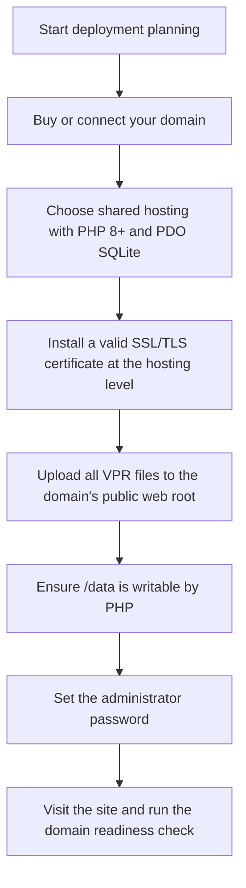
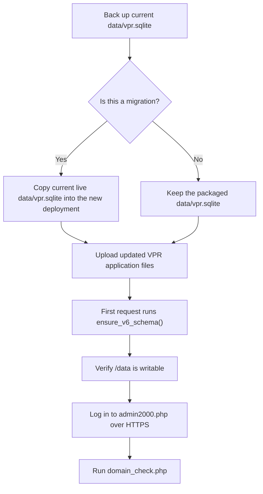
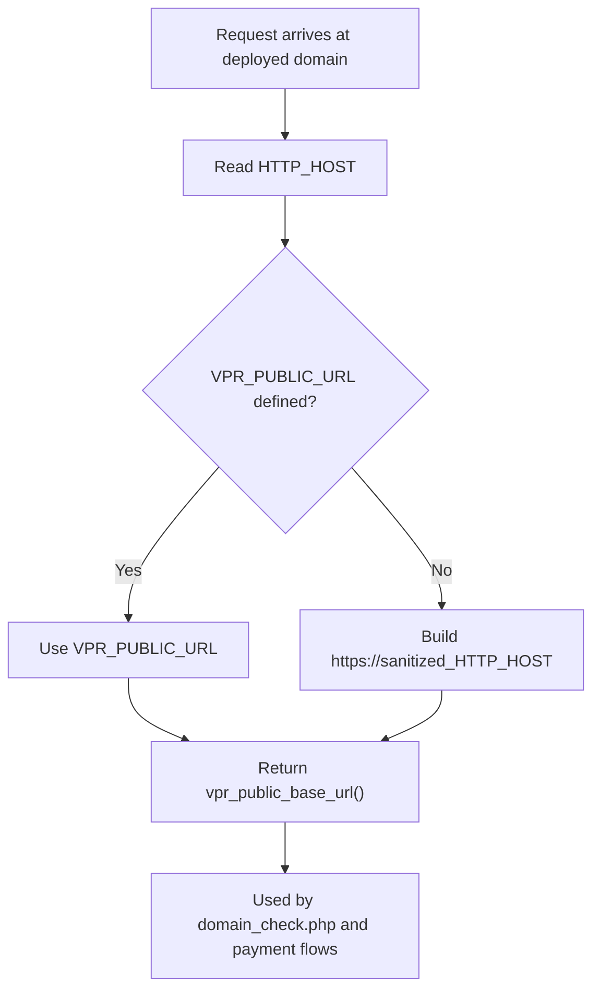
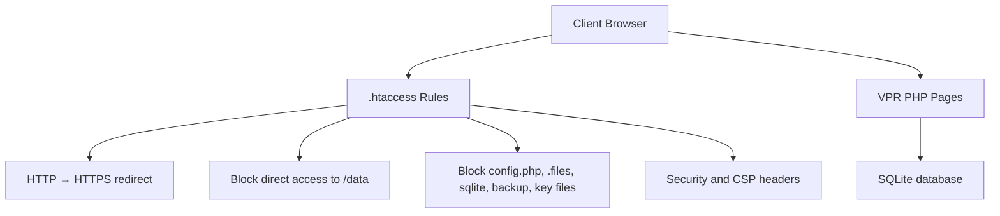
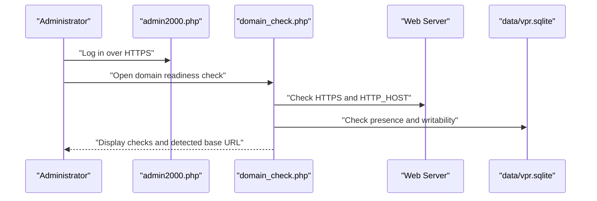

# Deployment and Operations

<cite>
**Referenced Files in This Document**
- [README.txt](file://Documentation/README.txt)
- [DEPLOY_NEW_DOMAIN_V14.txt](file://Documentation/DEPLOY_NEW_DOMAIN_V14.txt)
- [db.php](file://db.php)
- [domain_check.php](file://domain_check.php)
- [.htaccess](file://.htaccess)
- [.htaccess (data)](file://data/.htaccess)
</cite>

## Table of Contents
1. [Introduction](#introduction)
2. [Hosting Requirements](#hosting-requirements)
3. [New Installation Steps](#new-installation-steps)
4. [Upgrade and Migration Steps](#upgrade-and-migration-steps)
5. [Domain Portability and Base URL](#domain-portability-and-base-url)
6. [Security and File Protection](#security-and-file-protection)
7. [Deployment Verification](#deployment-verification)
8. [Operational Notes](#operational-notes)
9. [Troubleshooting](#troubleshooting)
10. [Conclusion](#conclusion)

## Introduction
This document consolidates the hosting requirements, installation steps, upgrade guidance, and domain portability behavior for VPR version 14.2. It is based on the repository’s documentation files and current application code.

Key points:
- VPR is a small PHP + SQLite application designed for low-cost shared hosting without requiring MySQL or server administration.
- The package enforces HTTPS-only operation at both the web-server level and the application level.
- The public base URL is derived from the deployed domain rather than being hard-coded, making deployment to a new domain straightforward.
- The live registry data lives in `data/vpr.sqlite`; this file must be preserved across upgrades and migrations.

**Section sources**
- [README.txt:1-6](file://Documentation/README.txt#L1-L6)
- [DEPLOY_NEW_DOMAIN_V14.txt:1-18](file://Documentation/DEPLOY_NEW_DOMAIN_V14.txt#L1-L18)

## Hosting Requirements
VPR requires ordinary shared web hosting that supports:
- PHP 8+
- PDO with SQLite support
- Apache `.htaccess` rewrite and header rules
- A valid SSL/TLS certificate installed at the hosting/domain level

The package does not require you to rent or administer a VPS/server. However, a domain by itself is only an address; PHP execution and TLS termination still depend on the hosting provider.

**Diagram sources**
- [README.txt:33-46](file://Documentation/README.txt#L33-L46)
- [DEPLOY_NEW_DOMAIN_V14.txt:34-44](file://Documentation/DEPLOY_NEW_DOMAIN_V14.txt#L34-L44)

**Section sources**
- [README.txt:3-6](file://Documentation/README.txt#L3-L6)
- [README.txt:33-50](file://Documentation/README.txt#L33-L50)
- [DEPLOY_NEW_DOMAIN_V14.txt:34-37](file://Documentation/DEPLOY_NEW_DOMAIN_V14.txt#L34-L37)

## New Installation Steps
For a fresh installation on a new domain:

1. Buy or connect your domain, such as `vpr.co.zw`.
2. Use shared web hosting that supports PHP 8+ and PDO SQLite.
3. Upload all files and folders to the domain’s public web root (`public_html` or equivalent).
4. Ensure the `/data` folder and `vpr.sqlite` are writable by PHP. Typical permissions are:
   - `data` folder: `755` or `775`
   - `vpr.sqlite`: `664`, or `666` only if required by your host
5. Open `config.php` and change `VPR_ADMIN_PASSWORD`.
6. Visit `https://your-domain/`.
7. Access the private admin page at `https://your-domain/admin2000.php`.

Important:
- Do not serve the production site without a valid HTTPS certificate.
- Do not expose `config.php` or `data/vpr.sqlite`.
- Rotate any payment integration secret that has previously been shared outside secure server configuration.

**Section sources**
- [README.txt:33-46](file://Documentation/README.txt#L33-L46)
- [DEPLOY_NEW_DOMAIN_V14.txt:34-50](file://Documentation/DEPLOY_NEW_DOMAIN_V14.txt#L34-L50)

## Upgrade and Migration Steps
When upgrading or moving VPR to a new domain:

### Preserve the database
- The live registry data is stored in `data/vpr.sqlite`.
- If migrating a live VPR registry, replace the packaged `data/vpr.sqlite` with your current live database file so existing vehicle interests, searches, certificates, and payment records move with you.
- Do not delete or overwrite `data/vpr.sqlite` unless you intentionally want to lose the registry.

### Apply the new application files
- Upload the complete contents of the updated VPR package to the new domain’s public web root.
- Keep the existing `data/vpr.sqlite` intact during the upload.
- Ensure PHP can write to the `data` directory while HTTP access to `/data` remains blocked.

### Schema evolution
- The bundled `data/vpr.sqlite` predates later schema changes and may contain legacy columns.
- On first request, the application runs `ensure_v6_schema()` to create missing tables, add columns, consolidate duplicate registration numbers, generate missing certificate/access tokens, and set the schema metadata version to `12`.
- Treat the intended runtime schema as authoritative, not the stale bundled file.

**Diagram sources**
- [DEPLOY_NEW_DOMAIN_V14.txt:38-43](file://Documentation/DEPLOY_NEW_DOMAIN_V14.txt#L38-L43)
- [db.php:38-39](file://db.php#L38-L39)
- [db.php:458-609](file://db.php#L458-L609)

**Section sources**
- [DEPLOY_NEW_DOMAIN_V14.txt:38-43](file://Documentation/DEPLOY_NEW_DOMAIN_V14.txt#L38-L43)
- [db.php:38-39](file://db.php#L38-L39)
- [db.php:458-609](file://db.php#L458-L609)

## Domain Portability and Base URL
Starting with V14, VPR is no longer hard-coded to a single domain. The public base URL is derived from the deployed domain, which makes the package suitable for a new domain without editing application links.

How the base URL works:
- `vpr_public_base_url()` returns an HTTPS URL built from the active `HTTP_HOST`.
- If `VPR_PUBLIC_URL` is defined and non-empty, it overrides automatic detection.
- The function sanitizes the host to safe characters before constructing the URL.
- `domain_check.php` displays the detected secure base URL for verification.
- Payment flows use `vpr_public_base_url()` when building Paynow-related URLs.

**Diagram sources**
- [db.php:55-61](file://db.php#L55-L61)
- [domain_check.php:19](file://domain_check.php#L19)
- [paynow_create.php:58](file://paynow_create.php#L58)

**Section sources**
- [DEPLOY_NEW_DOMAIN_V14.txt:15-18](file://Documentation/DEPLOY_NEW_DOMAIN_V14.txt#L15-L18)
- [db.php:55-61](file://db.php#L55-L61)
- [domain_check.php:19](file://domain_check.php#L19)

## Security and File Protection
VPR includes multiple layers of protection:

- HTTPS enforcement:
  - Plain HTTP requests are permanently redirected to HTTPS.
  - HSTS is sent on HTTPS responses.
  - Content Security Policy includes `upgrade-insecure-requests`.
- Private file blocking:
  - Direct web access to `/data` is blocked.
  - Hidden files and directories are blocked.
  - Sensitive filenames such as `config.php`, `*.sqlite`, backups, logs, keys, and certificates are denied.
- Administrative pages receive restrictive cache and indexing headers.
- Application-level security headers include clickjacking protection, MIME sniffing protection, restrictive permissions policy, and cross-origin policies.

**Diagram sources**
- [.htaccess:1-11](file://.htaccess#L1-L11)
- [.htaccess:13-39](file://.htaccess#L13-L39)
- [.htaccess:41-49](file://.htaccess#L41-L49)
- [data/.htaccess:1-3](file://data/.htaccess#L1-L3)

**Section sources**
- [DEPLOY_NEW_DOMAIN_V14.txt:7-13](file://Documentation/DEPLOY_NEW_DOMAIN_V14.txt#L7-L13)
- [.htaccess:1-11](file://.htaccess#L1-L11)
- [.htaccess:13-39](file://.htaccess#L13-L39)
- [.htaccess:41-49](file://.htaccess#L41-L49)
- [data/.htaccess:1-3](file://data/.htaccess#L1-L3)

## Deployment Verification
After uploading files and setting the administrator password:

1. Visit the site over HTTPS.
2. Log in to `admin2000.php`.
3. Open `/domain_check.php` from the dashboard.
4. Confirm:
   - HTTPS request is active
   - Current domain is correct
   - Database is present and writable
   - Data protection file exists
   - Application security file exists
   - Detected secure base URL matches the deployed domain

**Diagram sources**
- [domain_check.php:1-19](file://domain_check.php#L1-L19)

**Section sources**
- [DEPLOY_NEW_DOMAIN_V14.txt:42-44](file://Documentation/DEPLOY_NEW_DOMAIN_V14.txt#L42-L44)
- [domain_check.php:1-19](file://domain_check.php#L1-L19)

## Operational Notes
- The application version is 14.2, while the exported data schema version is `12`. These are not the same sequence.
- Live search prices are stored in the settings table (`price_USD`, `price_ZIG`). The `config.php` fee constants are fallback defaults. A price of `0.00` means free and bypasses Paynow entirely.
- Only the server-side Paynow USD flow may release a certificate. Popup closure, return-to-site, or generic payment links must not be treated as payment proof.
- ZiG payments open a static Paynow payment link and cannot auto-release certificates.
- `config.php` is gitignored and contains live secrets. Never reproduce its values in generated pages.
- The bundled `data/vpr.sqlite` predates V12.9 and should be replaced with the live database during migration.

**Section sources**
- [README.txt:48-62](file://Documentation/README.txt#L48-L62)
- [DEPLOY_NEW_DOMAIN_V14.txt:46-50](file://Documentation/DEPLOY_NEW_DOMAIN_V14.txt#L46-L50)
- [db.php:458-609](file://db.php#L458-L609)

## Troubleshooting
Common deployment issues and their likely causes:

| Symptom | Likely Cause | Action |
|---|---|---|
| Site redirects to HTTPS but browser shows certificate error | No valid SSL/TLS certificate installed at hosting level | Install a valid certificate through your hosting provider |
| Admin login fails after upgrade | Old `data/vpr.sqlite` lacks expected schema or admin state | Preserve and migrate the live `data/vpr.sqlite`; allow `ensure_v6_schema()` to run |
| `/data` is not writable | Incorrect filesystem permissions | Set `data` folder to `755` or `775`; adjust `vpr.sqlite` only if required |
| Public links point to the wrong domain | Custom subdirectory or proxy configuration changed `HTTP_HOST` | Review `vpr_public_base_url()` behavior or define `VPR_PUBLIC_URL` |
| Private files are accessible | `.htaccess` rules are ignored or misconfigured | Ensure Apache allows `.htaccess` and that sensitive files are blocked |
| Domain readiness check reports missing protection files | `.htaccess` files were not uploaded | Upload both root `.htaccess` and `data/.htaccess` |

**Section sources**
- [README.txt:33-46](file://Documentation/README.txt#L33-L46)
- [DEPLOY_NEW_DOMAIN_V14.txt:34-44](file://Documentation/DEPLOY_NEW_DOMAIN_V14.txt#L34-L44)
- [.htaccess:13-39](file://.htaccess#L13-L39)
- [data/.htaccess:1-3](file://data/.htaccess#L1-L3)
- [db.php:55-61](file://db.php#L55-L61)

## Conclusion
Deploying VPR 14.2 is designed to work on ordinary shared hosting with minimal setup. The critical operational rule is to preserve `data/vpr.sqlite` across upgrades and migrations. Domain portability is handled automatically through `vpr_public_base_url()`, and the domain readiness check provides a quick verification path. Always deploy behind HTTPS, protect private files, and treat the live database as the source of truth.

[No sources needed since this section summarizes without analyzing specific files]