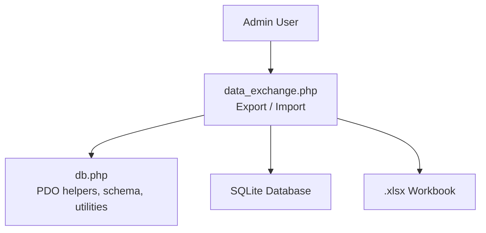
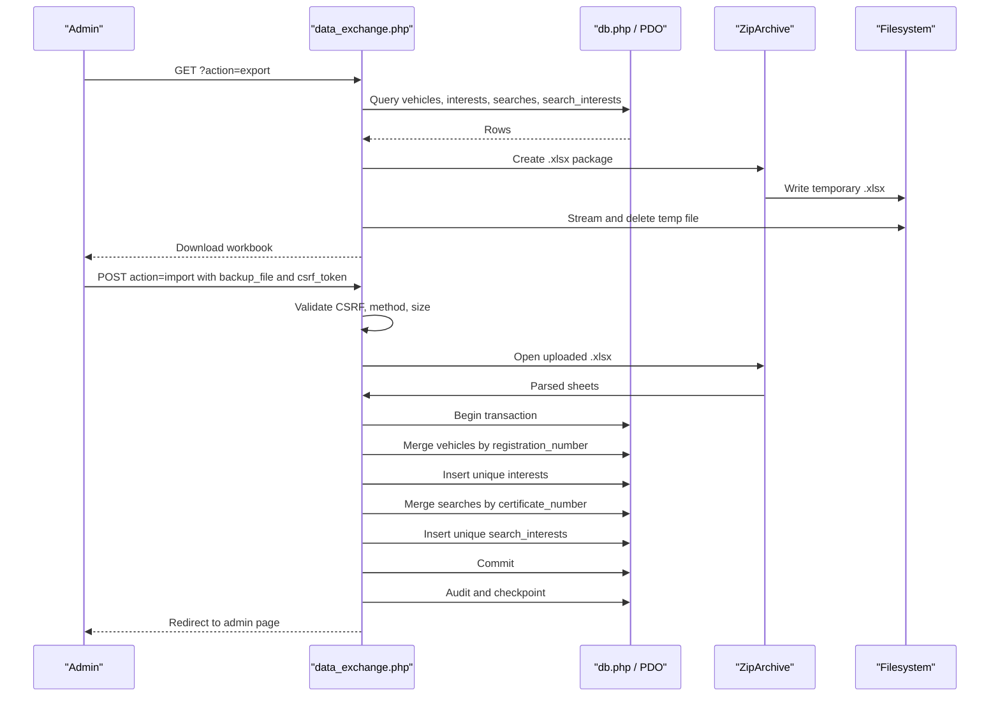
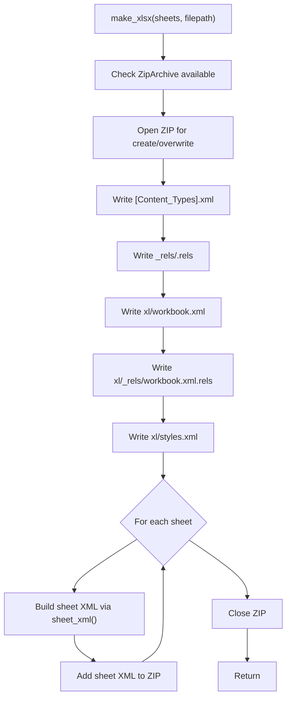
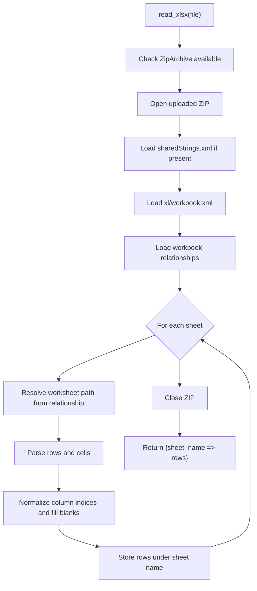
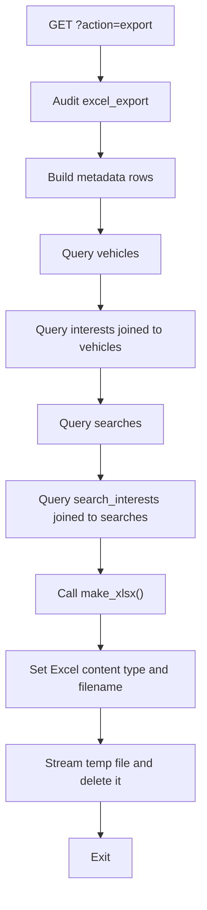
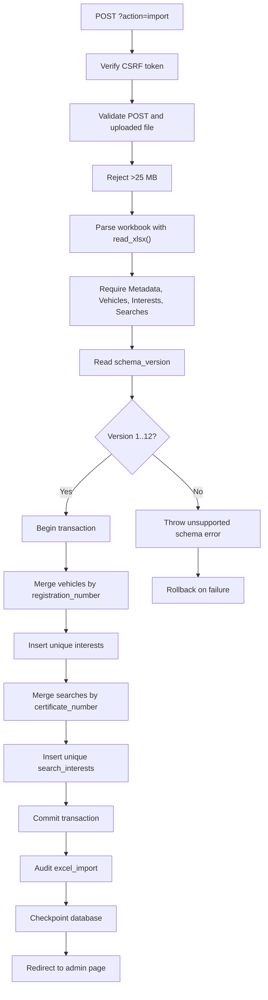
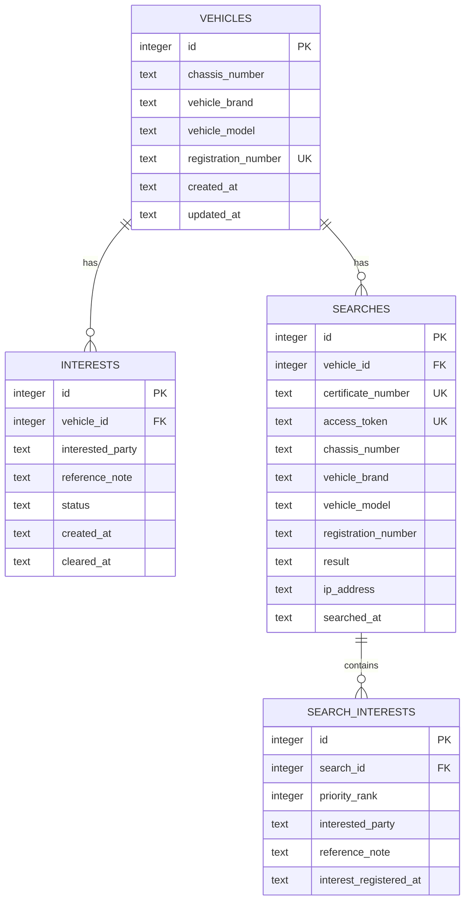
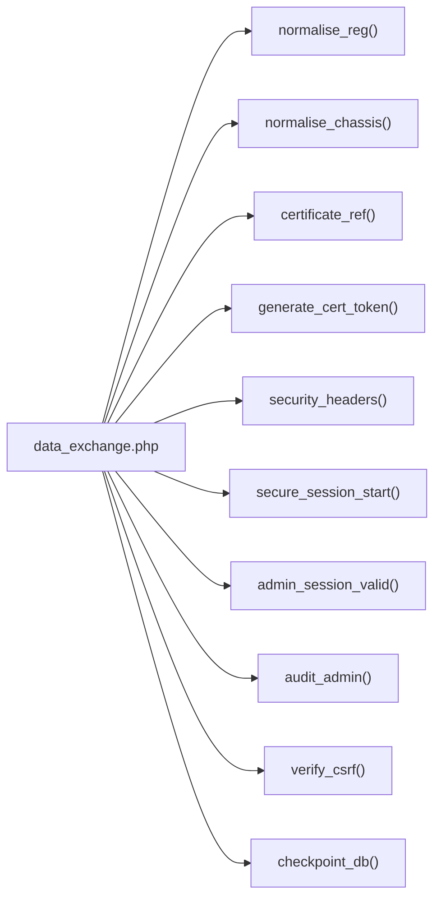

# Excel Backup and Migration

<cite>
**Referenced Files in This Document**   
- [data_exchange.php](file://data_exchange.php)
- [db.php](file://db.php)
</cite>

## Table of Contents
1. [Introduction](#introduction)
2. [Project Structure](#project-structure)
3. [Core Components](#core-components)
4. [Architecture Overview](#architecture-overview)
5. [Detailed Component Analysis](#detailed-component-analysis)
6. [Dependency Analysis](#dependency-analysis)
7. [Performance Considerations](#performance-considerations)
8. [Troubleshooting Guide](#troubleshooting-guide)
9. [Conclusion](#conclusion)

## Introduction
This document explains the hand-rolled XLSX backup and migration feature implemented in `data_exchange.php`. It covers:

- The 5-sheet VPR backup workbook format: Metadata, Vehicles, Interests, Searches, SearchInterests.
- How the writer generates a valid `.xlsx` package without external libraries.
- How the reader parses an uploaded workbook back into structured rows.
- Import merge semantics keyed by registration number for vehicles and by certificate number for searches.
- Versioning through the exported `schema_version`, which is 12 even though the application version may differ.

The feature is admin-only, audited, transactional during import, and designed to preserve certificate numbers independently of internal database IDs.

## Project Structure
At the scope of this documentation, only two files are directly relevant:

| File | Role |
|---|---|
| `data_exchange.php` | Admin endpoint that exports or imports a VPR Excel backup workbook. Implements the XLSX writer, reader, export logic, and import merge logic. |
| `db.php` | Database helper layer providing shared normalization functions, schema self-healing, certificate reference generation, and audit/session helpers used by the exchange script. |

**Diagram sources**
- [data_exchange.php:1-11](file://data_exchange.php#L1-L11)
- [data_exchange.php:200-241](file://data_exchange.php#L200-L241)
- [data_exchange.php:244-379](file://data_exchange.php#L244-L379)
- [db.php:453-456](file://db.php#L453-L456)
- [db.php:617-625](file://db.php#L617-L625)

**Section sources**
- [data_exchange.php:1-11](file://data_exchange.php#L1-L11)
- [db.php:453-456](file://db.php#L453-L456)
- [db.php:617-625](file://db.php#L617-L625)

## Core Components
The exchange script implements three major subsystems:

| Subsystem | Responsibility | Key Behavior |
|---|---|---|
| XLSX Writer | Builds a valid OpenXML `.xlsx` file from arrays of rows. | Uses `ZipArchive`, writes `[Content_Types].xml`, relationships, workbook, styles, and per-sheet XML. Numbers are written as values; text is written as inline strings. |
| XLSX Reader | Reads an uploaded `.xlsx` file into an associative array of sheet names to row arrays. | Parses shared strings, workbook relationships, and each worksheet’s cells. Empty rows are skipped when converting to associative rows. |
| Import Merge Engine | Translates workbook rows into database inserts/updates inside a transaction. | Vehicles merged by normalized registration number; interests deduplicated by vehicle plus party plus note plus created time; searches merged by certificate number; search interest snapshots deduplicated by search, rank, and party. |

**Section sources**
- [data_exchange.php:18-97](file://data_exchange.php#L18-L97)
- [data_exchange.php:110-198](file://data_exchange.php#L110-L198)
- [data_exchange.php:244-379](file://data_exchange.php#L244-L379)

## Architecture Overview
The data exchange endpoint supports two actions controlled by the `action` query parameter:

| Action | HTTP Method | Authentication | Output / Result |
|---|---:|---|---|
| `export` | GET | Admin session required | Downloads a `.xlsx` backup file named `VPR_Backup_YYYY-MM-DD_HHMMSS.xlsx`. |
| `import` | POST | Admin session required + CSRF token | Validates, reads, merges, commits, audits, checkpoints, and redirects to the admin page. |

**Diagram sources**
- [data_exchange.php:6-12](file://data_exchange.php#L6-L12)
- [data_exchange.php:200-241](file://data_exchange.php#L200-L241)
- [data_exchange.php:244-379](file://data_exchange.php#L244-L379)

## Detailed Component Analysis

### XLSX Writer
The writer constructs a minimal but valid OpenXML spreadsheet package:

1. Requires `ZipArchive`; otherwise throws an exception.
2. Creates or overwrites the target file path.
3. Writes `[Content_Types].xml` declaring XML, relationships, workbook, styles, and worksheet parts.
4. Writes `_rels/.rels` pointing to the workbook.
5. Writes `xl/workbook.xml` listing sheets and their relationship IDs.
6. Writes `xl/_rels/workbook.xml.rels` mapping relationship IDs to worksheet and style targets.
7. Writes a basic `xl/styles.xml` with fonts, fills, borders, and cell formats.
8. Writes one worksheet XML per sheet using inline string cells and numeric value cells.
9. Closes the archive.

The helper `sheet_xml()` iterates rows and columns, assigning Excel-style references such as `A1`, `B3`, and writing either `<v>` for numbers or `<is><t>` for text.

**Diagram sources**
- [data_exchange.php:49-97](file://data_exchange.php#L49-L97)
- [data_exchange.php:28-47](file://data_exchange.php#L28-L47)

**Section sources**
- [data_exchange.php:18-47](file://data_exchange.php#L18-L47)
- [data_exchange.php:49-97](file://data_exchange.php#L49-L97)

### XLSX Reader
The reader reconstructs sheet data from an uploaded `.xlsx`:

1. Requires `ZipArchive`; otherwise throws an exception.
2. Opens the uploaded file.
3. Loads `xl/sharedStrings.xml` if present and builds an index of shared text values.
4. Loads `xl/workbook.xml` and registers spreadsheet and relationship namespaces.
5. Loads `xl/_rels/workbook.xml.rels` and maps relationship IDs to worksheet paths.
6. Iterates declared sheets, resolves their worksheet paths, and parses each row and cell.
7. Converts column letters to zero-based indices and stores values in sparse arrays.
8. Fills missing columns with empty strings so every row has consistent width.
9. Returns an associative array keyed by sheet name.

The `assoc_rows()` helper converts raw sheet rows into associative arrays by treating the first non-empty row as headers and skipping completely empty rows.

**Diagram sources**
- [data_exchange.php:110-185](file://data_exchange.php#L110-L185)
- [data_exchange.php:187-198](file://data_exchange.php#L187-L198)

**Section sources**
- [data_exchange.php:110-198](file://data_exchange.php#L110-L198)

### Export Workflow
The export action produces a VPR backup workbook containing five sheets:

| Sheet | Purpose | Key Columns |
|---|---|---|
| Metadata | Backup metadata and schema version | `key`, `value` |
| Vehicles | Vehicle records | `id`, `chassis_number`, `vehicle_brand`, `vehicle_model`, `registration_number`, `created_at`, `updated_at` |
| Interests | Interest records joined to vehicles | `id`, `vehicle_id`, `registration_number`, `interested_party`, `reference_note`, `status`, `created_at`, `cleared_at` |
| Searches | Search records | `id`, `vehicle_id`, `certificate_number`, `access_token`, `chassis_number`, `vehicle_brand`, `vehicle_model`, `registration_number`, `result`, `ip_address`, `searched_at` |
| SearchInterests | Snapshot interests attached to searches | `id`, `search_id`, `certificate_number`, `priority_rank`, `interested_party`, `reference_note`, `interest_registered_at` |

The metadata sheet always includes:

- `system_name`: Vehicle Pledge Registry.
- `schema_version`: 12.
- `exported_at`: Timestamp at export time.
- `purpose`: VPR Excel backup and future migration file.
- `certificate_note`: Certificate numbers are preserved independently of internal database IDs.

**Diagram sources**
- [data_exchange.php:200-241](file://data_exchange.php#L200-L241)

**Section sources**
- [data_exchange.php:200-241](file://data_exchange.php#L200-L241)

### Import Workflow and Merge Semantics
The import action validates input, parses the workbook, checks required sheets, reads metadata, and performs a transactional merge.

#### Validation Rules
- Requires a valid admin session.
- Requires a valid CSRF token.
- Requires POST method.
- Requires a non-empty uploaded file.
- Rejects files larger than 25 MB.
- Requires the workbook to contain the `Metadata`, `Vehicles`, `Interests`, and `Searches` sheets.
- Requires `schema_version` between 1 and 12 inclusive.

#### Merge Rules

| Entity | Merge Key | Behavior |
|---|---|---|
| Vehicles | Normalized `registration_number` | If a vehicle already exists, update selected fields while preserving existing brand/model unless the incoming value is newer or more complete. If not found, insert using normalized chassis, default brand, provided model, normalized registration, and timestamps. |
| Interests | Vehicle identity plus `interested_party`, `reference_note`, and `created_at` | Skip duplicates. Normalize status to `ACTIVE` or `CLEARED`; default to `ACTIVE` if invalid. |
| Searches | `certificate_number` | If absent, generate a deterministic certificate reference from the original search ID and date. If a search with the same certificate already exists, reuse its ID. Otherwise insert with normalized chassis, default brand, normalized registration, generated access token if missing, and default result. |
| SearchInterests | `search_id`, `priority_rank`, `interested_party` | Skip duplicates. Clamp rank to at least 1. |

**Diagram sources**
- [data_exchange.php:244-379](file://data_exchange.php#L244-L379)

**Section sources**
- [data_exchange.php:244-379](file://data_exchange.php#L244-L379)

### Data Model Relationships
The backup workbook mirrors the following database relationships:

**Diagram sources**
- [db.php:486-548](file://db.php#L486-L548)
- [data_exchange.php:211-225](file://data_exchange.php#L211-L225)

**Section sources**
- [db.php:486-548](file://db.php#L486-L548)
- [data_exchange.php:211-225](file://data_exchange.php#L211-L225)

## Dependency Analysis
The exchange script depends on shared helpers in `db.php` rather than reimplementing them:

| Dependency | Used By | Purpose |
|---|---|---|
| `normalise_reg()` | Import vehicle and interest processing | Normalizes registration numbers by cleaning whitespace and uppercasing. |
| `normalise_chassis()` | Import vehicle and search processing | Normalizes chassis values before storage. |
| `certificate_ref()` | Import fallback certificate generation | Generates stable certificate references based on search ID and date. |
| `generate_cert_token()` | Import search insertion | Generates access tokens for searches that lack one. |
| `security_headers()` | Script startup | Applies security response headers. |
| `secure_session_start()` | Script startup | Starts a secure session. |
| `admin_session_valid()` | Script startup | Enforces admin-only access. |
| `audit_admin()` | Export and import | Records admin actions. |
| `verify_csrf()` | Import validation | Prevents cross-site request forgery. |
| `checkpoint_db()` | Import completion | Performs database checkpoint after successful import. |

**Diagram sources**
- [data_exchange.php:1-11](file://data_exchange.php#L1-L11)
- [data_exchange.php:200-201](file://data_exchange.php#L200-L201)
- [data_exchange.php:244-246](file://data_exchange.php#L244-L246)
- [data_exchange.php:278-297](file://data_exchange.php#L278-L297)
- [data_exchange.php:318-350](file://data_exchange.php#L318-L350)
- [data_exchange.php:370-371](file://data_exchange.php#L370-L371)
- [db.php:453-456](file://db.php#L453-L456)
- [db.php:617-625](file://db.php#L617-L625)

**Section sources**
- [data_exchange.php:1-11](file://data_exchange.php#L1-L11)
- [data_exchange.php:200-201](file://data_exchange.php#L200-L201)
- [data_exchange.php:244-246](file://data_exchange.php#L244-L246)
- [data_exchange.php:278-297](file://data_exchange.php#L278-L297)
- [data_exchange.php:318-350](file://data_exchange.php#L318-L350)
- [data_exchange.php:370-371](file://data_exchange.php#L370-L371)
- [db.php:453-456](file://db.php#L453-L456)
- [db.php:617-625](file://db.php#L617-L625)

## Performance Considerations
- **ZIP I/O**: Both export and import open and close ZIP archives. Large workbooks will allocate memory for the entire package and parsed XML structures.
- **Shared Strings**: The reader loads all shared strings into memory. Workbooks with many repeated text values can increase memory usage.
- **Row Parsing**: Each worksheet is parsed row by row, then converted to associative arrays. Very wide or very tall sheets increase CPU and memory use.
- **Database Transactions**: Import runs inside a single transaction, which improves consistency but holds locks until commit.
- **Prepared Statements**: Import uses prepared statements for lookup, insert, and update operations, reducing SQL parsing overhead.
- **Temporary Files**: Export creates a temporary `.xlsx` file, streams it, and deletes it. Disk space must be sufficient for the temporary file.

[No sources needed since this section provides general guidance]

## Troubleshooting Guide

| Symptom | Likely Cause | Resolution |
|---|---|---|
| `PHP ZipArchive extension is required.` | PHP was compiled without `ZipArchive`. | Enable the `zip` extension in PHP configuration. |
| `Could not open uploaded Excel file.` | Invalid file, corrupted ZIP, or permission issue. | Verify the uploaded file is a valid `.xlsx` and readable by PHP. |
| `This is not a VPR backup workbook. Missing sheet: ...` | Uploaded file does not match the expected 5-sheet format. | Re-export from a compatible VPR instance. |
| `Unsupported or invalid VPR backup schema version.` | `schema_version` is outside 1–12. | Use a backup produced by a supported VPR schema. |
| Import silently skips a vehicle | Registration number could not be normalized or was empty. | Ensure the registration field contains a valid value. |
| Import skips an interest | Duplicate key matched existing interest. | This is intentional merge behavior; duplicate interests are not reinserted. |
| Import skips a search interest | Duplicate snapshot entry existed. | This is intentional; snapshots are deduplicated by search, rank, and party. |
| Import fails partway through | Transaction rollback occurred due to malformed data or constraint violation. | Review the error message and correct the source workbook. |
| Export returns invalid action | Wrong or missing `action` parameter. | Use `?action=export` or `?action=import`. |
| Import returns invalid security token | Missing or incorrect CSRF token. | Submit the form through the admin interface or include a valid CSRF token. |

**Section sources**
- [data_exchange.php:49-52](file://data_exchange.php#L49-L52)
- [data_exchange.php:111-113](file://data_exchange.php#L111-L113)
- [data_exchange.php:244-265](file://data_exchange.php#L244-L265)
- [data_exchange.php:277-297](file://data_exchange.php#L277-L297)
- [data_exchange.php:300-315](file://data_exchange.php#L300-L315)
- [data_exchange.php:318-365](file://data_exchange.php#L318-L365)
- [data_exchange.php:374-378](file://data_exchange.php#L374-L378)
- [data_exchange.php:382-383](file://data_exchange.php#L382-L383)

## Conclusion
`data_exchange.php` provides a compact, dependency-light backup and migration mechanism for the VPR system. It exports a well-defined 5-sheet workbook and imports it with strict merge semantics:

- Vehicles are merged by normalized registration number.
- Interests are deduplicated by vehicle identity, party, note, and creation time.
- Searches are merged by certificate number, with deterministic fallback generation for legacy records.
- Search interest snapshots are deduplicated by search, rank, and party.

The implementation intentionally avoids external XLSX libraries, relying instead on `ZipArchive` and SimpleXML. This keeps the feature portable but places responsibility on administrators to upload correctly formatted backups and to understand that import is additive and deduplicating rather than destructive.

[No sources needed since this section summarizes without analyzing specific files]