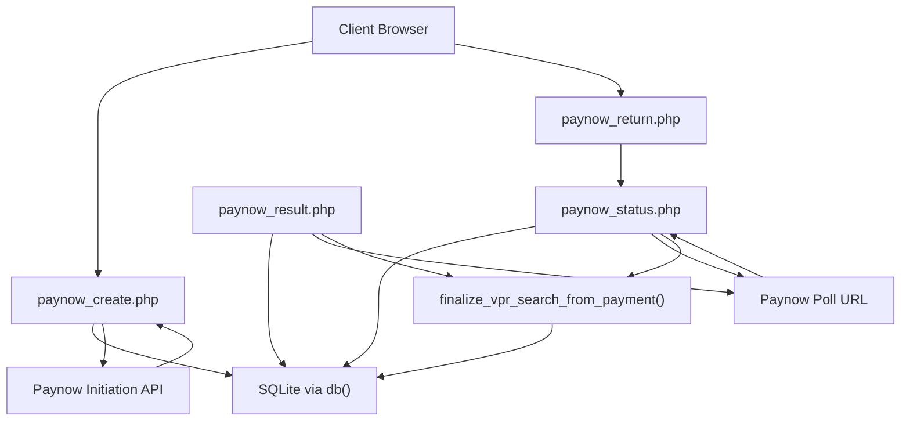
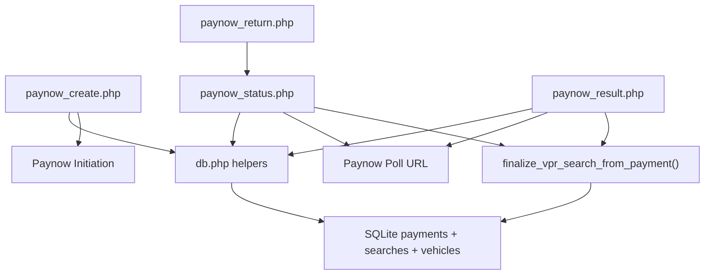

# Paynow USD Payment Integration

<cite>
**Referenced Files in This Document**
- [paynow_create.php](file://paynow_create.php)
- [paynow_status.php](file://paynow_status.php)
- [paynow_result.php](file://paynow_result.php)
- [paynow_return.php](file://paynow_return.php)
- [db.php](file://db.php)
</cite>

## Table of Contents
1. [Introduction](#introduction)
2. [Project Structure](#project-structure)
3. [Core Components](#core-components)
4. [Architecture Overview](#architecture-overview)
5. [Detailed Component Analysis](#detailed-component-analysis)
6. [Dependency Analysis](#dependency-analysis)
7. [Performance Considerations](#performance-considerations)
8. [Troubleshooting Guide](#troubleshooting-guide)
9. [Conclusion](#conclusion)

## Introduction
This document explains the server-side Paynow USD payment integration for VPR version 14.2. It covers how a paid vehicle interest search is initiated, how Paynow callbacks and polling are verified, how reference and amount checks protect against tampering, and how duplicate callbacks are handled so that only one certificate is released per payment.

The authoritative design rules are:
- Only the server-side USD flow may release a certificate. Popup closure, return-to-site navigation, or the generic USD payment link constant must never be treated as proof of payment.
- All Paynow-originated data used to update state must pass SHA-512 signature verification before being trusted.
- The final search creation is atomic and guarded against duplicate callback execution.
- Live prices come from the `settings` table; a price of zero bypasses Paynow entirely.

## Project Structure
The Paynow integration spans four public endpoints and shared helpers in the database layer:

| File | Responsibility |
|---|---|
| `paynow_create.php` | Accepts client input, records a pending payment, signs the request, calls Paynow, validates the signed response, and returns the browser URL. |
| `paynow_status.php` | Polling endpoint used by the client UI; it can refresh Paynow status, update amounts/status, and trigger finalization when paid. |
| `paynow_result.php` | Signed callback endpoint from Paynow; verifies the hash, polls the real status, updates the record, and triggers finalization when paid. |
| `paynow_return.php` | Lightweight redirect page returned to the user after Paynow redirects back; it asks `paynow_status.php` whether the payment is finalized. |
| `db.php` | Database connection, security headers, Paynow signing/parsing/HTTP helpers, amount validation, and the atomic search finalizer. |



**Diagram sources**
- [paynow_create.php:36-144](file://paynow_create.php#L36-L144)
- [paynow_status.php:10-55](file://paynow_status.php#L10-L55)
- [paynow_result.php:7-40](file://paynow_result.php#L7-L40)
- [paynow_return.php:10-26](file://paynow_return.php#L10-L26)
- [db.php:24-41](file://db.php#L24-L41)
- [db.php:339-355](file://db.php#L339-L355)
- [db.php:357-442](file://db.php#L357-L442)

**Section sources**
- [paynow_create.php:1-145](file://paynow_create.php#L1-L145)
- [paynow_status.php:1-56](file://paynow_status.php#L1-L56)
- [paynow_result.php:1-41](file://paynow_result.php#L1-L41)
- [paynow_return.php:1-27](file://paynow_return.php#L1-L27)
- [db.php:1-627](file://db.php#L1-L627)

## Core Components

### SHA-512 Hash Signing and Verification
Paynow uses an HMAC-style SHA-512 signature built from all fields except `HASH`, appended with the integration key. The same routine is used to create outgoing hashes and verify incoming ones.

Key behaviors:
- Outgoing hash concatenates every field value except `HASH`, then appends the integration key and computes uppercase SHA-512.
- Incoming hash extraction finds the `HASH` field, recomputes the expected hash using the same routine, and compares it with constant-time equality.
- Field lookup is case-insensitive through a helper that matches lowercase keys.

Security implications:
- Tampering with any signed field changes the computed hash.
- Signature comparison avoids timing attacks through constant-time equality.
- The integration key must remain secret in configuration.

**Section sources**
- [db.php:245-266](file://db.php#L245-L266)
- [db.php:268-279](file://db.php#L268-L279)

### Amount Verification
Amount verification compares the normalized two-decimal representation of the received amount with the configured USD search fee.

Important notes:
- The live USD price is read from the `settings` table via the price helper, falling back to a PHP constant if needed.
- A price of zero means free; such requests should not reach Paynow.
- If the amount does not match, the status is forced to `AmountMismatch`.
- Finalization also rechecks both paid status and amount correctness.

**Section sources**
- [db.php:18-22](file://db.php#L18-L22)
- [db.php:349-355](file://db.php#L349-L355)

### Atomic Search Finalization Against Duplicate Callbacks
`finalize_vpr_search_from_payment` is the gatekeeper that converts a paid payment into a searchable certificate.

Protection layers:
- Early exit if no payment exists, status is not paid, or amount is invalid.
- Early exit if a search is already linked to the payment.
- Transaction start followed by a second lookup on the same merchant reference to prevent concurrent duplicate searches.
- Vehicle lookup or creation, interest snapshot, search insertion, certificate generation, access token assignment, and payment linkage happen inside one transaction.
- Rollback occurs on failure; commit occurs only after successful linkage.

Concurrency model:
- SQLite WAL mode improves concurrency but does not replace explicit locking.
- The double-check pattern inside the transaction prevents race conditions between multiple callbacks or poll attempts arriving simultaneously.

**Section sources**
- [db.php:357-442](file://db.php#L357-L442)
- [db.php:24-41](file://db.php#L24-L41)

## Architecture Overview

### End-to-End USD Payment Flow
```mermaid
sequenceDiagram
participant Client as "Client Browser"
participant Create as "paynow_create.php"
participant DB as "SQLite payments"
participant Paynow as "Paynow API"
participant Result as "paynow_result.php"
participant Status as "paynow_status.php"
participant Return as "paynow_return.php"
participant Finalize as "finalize_vpr_search_from_payment()"
Client->>Create : POST registration, brand, model, chassis
Create->>DB : Insert pending payment
Create->>Paynow : Initiate USD payment with signed hash
Paynow-->>Create : Signed response with browserurl and pollurl
Create->>DB : Update pollurl and status
Create-->>Client : JSON with reference, token, browserurl
Client->>Return : Redirected back with ref and token
Return->>Status : Fetch payment status
Status->>DB : Read payment
Status->>Paynow : Poll pollurl (signed)
Paynow-->>Status : Confirmed status and amount
Status->>DB : Update paynow_reference, amount, status, paid_at
alt Paid and amount valid
Status->>Finalize : Finalize search atomically
Finalize->>DB : Create vehicle/search/certificate
DB-->>Status : search_id
Status-->>Return : paid=true with certificate_url
Return-->>Client : Open certificate page
else Not paid yet
Status-->>Return : paid=false
Return-->>Client : Waiting message
end
Note over Paynow,Result : Paynow may call result callback independently
Paynow->>Result : POST signed callback with reference
Result->>Paynow : Poll pollurl (signed)
Paynow-->>Result : Confirmed status and amount
Result->>DB : Update payment and finalize if paid
```

**Diagram sources**
- [paynow_create.php:36-144](file://paynow_create.php#L36-L144)
- [paynow_result.php:7-40](file://paynow_result.php#L7-L40)
- [paynow_status.php:10-55](file://paynow_status.php#L10-L55)
- [paynow_return.php:10-26](file://paynow_return.php#L10-L26)
- [db.php:339-355](file://db.php#L339-L355)
- [db.php:357-442](file://db.php#L357-L442)

## Detailed Component Analysis

### paynow_create.php
This endpoint creates a USD payment request and returns the Paynow browser URL.

Processing steps:
1. Enforce JSON output and fatal error handling.
2. Require POST and USD currency.
3. Normalize and validate registration, brand, model, and chassis.
4. Generate a unique merchant reference and a per-payment return token.
5. Build return and result URLs pointing back to this site.
6. Verify the `payments` table exists.
7. Insert a pending payment row with status `Created`.
8. Build the Paynow field set and compute the SHA-512 hash.
9. Call Paynow initiation, parse the response, check status, and verify the signature.
10. Validate that both browser URL and poll URL are present.
11. Update the stored poll URL and change status to `Initiated`.
12. Return JSON with reference, token, and browser URL.
13. On gateway errors, mark the payment `InitiationError` and return HTTP 502.

Security and validation highlights:
- Registration format is enforced.
- Currency is explicitly checked.
- Paynow response signature is verified before trusting browser or poll URLs.
- Errors are captured without leaking sensitive internals beyond a technical class name.

**Section sources**
- [paynow_create.php:5-34](file://paynow_create.php#L5-L34)
- [paynow_create.php:36-144](file://paynow_create.php#L36-L144)

### paynow_result.php
This endpoint handles Paynow’s signed callback.

Processing steps:
1. Require a reference parameter.
2. Reject requests without a valid Paynow signature.
3. Compare the signed reference with the URL reference.
4. Look up the payment by merchant reference.
5. Poll the Paynow poll URL and verify its signature.
6. Confirm the confirmed reference matches the expected reference.
7. Extract status, amount, and Paynow reference.
8. Force `AmountMismatch` if the amount is invalid.
9. Set `paid_at` only when the status is considered paid.
10. Update the payment record.
11. Trigger finalization if the payment is paid.
12. Always return HTTP 200 to acknowledge receipt.

Security and validation highlights:
- Signature verification rejects untrusted callbacks.
- Reference mismatch rejects replay or cross-reference attacks.
- Amount mismatch prevents releasing certificates for wrong amounts.
- Finalization is idempotent because duplicate callbacks find an existing search.

**Section sources**
- [paynow_result.php:1-41](file://paynow_result.php#L1-L41)

### paynow_status.php
This endpoint supports client-side polling and can proactively reconcile Paynow status.

Processing steps:
1. Require reference and token.
2. Load the payment by merchant reference.
3. Validate the token using constant-time comparison.
4. If the payment has a poll URL and is not already paid, poll Paynow.
5. Confirm the confirmed reference matches the stored reference.
6. Update Paynow reference, amount, status, and paid timestamp.
7. Force `AmountMismatch` when the amount is invalid.
8. Trigger finalization if the updated status is paid.
9. Join with the searches table to determine whether a certificate is available.
10. Return paid status and certificate URL when applicable.

Security and validation highlights:
- Token binding prevents unauthorized status queries.
- Polling is skipped for already-paid records unless reconciliation is needed.
- Certificate URL is only exposed when the payment is paid and a search exists.

**Section sources**
- [paynow_status.php:1-56](file://paynow_status.php#L1-L56)

### paynow_return.php
This endpoint is a user-facing redirect wrapper.

Processing steps:
1. Load reference and token from query parameters.
2. Render a small HTML page.
3. Use JavaScript to call `paynow_status.php` with the same reference and token.
4. Notify the opener window via `postMessage`.
5. If the payment is paid and a certificate URL exists, navigate to the certificate page.
6. Otherwise, show a waiting message and close the popup after a short delay.

Operational intent:
- It is not proof of payment itself.
- It delegates trust to `paynow_status.php`, which performs server-side verification and finalization.

**Section sources**
- [paynow_return.php:1-27](file://paynow_return.php#L1-L27)

### Paynow Helpers in db.php

#### HTTP Transport and Response Parsing
- `paynow_http_post` prefers cURL with strict SSL verification and timeouts, falling back to `file_get_contents` when cURL is unavailable.
- Non-2xx responses and network failures throw exceptions.
- `paynow_parse_response` parses form-encoded Paynow responses into arrays.

**Section sources**
- [db.php:281-337](file://db.php#L281-L337)
- [db.php:275-279](file://db.php#L275-L279)

#### Polling Helper
- `paynow_poll_status` requires a poll URL, posts to it, parses the response, and verifies the signature before returning data.

**Section sources**
- [db.php:339-347](file://db.php#L339-L347)

#### Paid-State and Amount Helpers
- `paynow_is_paid` treats `paid`, `awaiting delivery`, and `delivered` as paid states.
- `payment_amount_ok` compares normalized amounts against the configured USD fee.

**Section sources**
- [db.php:349-355](file://db.php#L349-L355)

#### Database Schema and Payments Table
- `ensure_v6_schema` creates core tables, indexes, and migrations.
- The `payments` table stores merchant reference, Paynow reference, amount, currency, status, poll URL, return token, vehicle details, search linkage, timestamps, and last error.
- Migrations add missing columns and normalize defaults.
- Indexes support lookups by status and registration number.

**Section sources**
- [db.php:458-609](file://db.php#L458-L609)

## Dependency Analysis



**Diagram sources**
- [paynow_create.php:36-144](file://paynow_create.php#L36-L144)
- [paynow_status.php:10-55](file://paynow_status.php#L10-L55)
- [paynow_result.php:7-40](file://paynow_result.php#L7-L40)
- [paynow_return.php:10-26](file://paynow_return.php#L10-L26)
- [db.php:245-355](file://db.php#L245-L355)
- [db.php:357-442](file://db.php#L357-L442)

Coupling observations:
- All three server-side endpoints depend on `db.php` for configuration, security headers, Paynow helpers, and database access.
- `paynow_return.php` depends on `paynow_status.php` rather than directly on Paynow.
- Finalization is centralized in `db.php`, keeping business logic out of the HTTP handlers.
- External coupling is limited to Paynow initiation and polling endpoints.

**Section sources**
- [paynow_create.php:36-144](file://paynow_create.php#L36-L144)
- [paynow_status.php:10-55](file://paynow_status.php#L10-L55)
- [paynow_result.php:7-40](file://paynow_result.php#L7-L40)
- [paynow_return.php:10-26](file://paynow_return.php#L10-L26)
- [db.php:245-442](file://db.php#L245-L442)

## Performance Considerations
- SQLite WAL mode allows readers and writers to operate concurrently with reduced blocking.
- Busy timeout reduces transient lock contention under load.
- Foreign keys are enabled to maintain referential integrity.
- Temporary storage is moved to memory where possible.
- Checkpoint operations are wrapped in non-fatal error handling so normal requests continue even if checkpointing fails.
- Polling and callback processing avoid unnecessary work by checking existing paid status and existing search linkage.

[No sources needed since this section provides general guidance]

## Troubleshooting Guide

### Common Failure Modes

| Symptom | Likely Cause | Where to Inspect |
|---|---|---|
| Empty or malformed Paynow response | Network failure, invalid URL, or provider issue | `paynow_create.php` initialization block |
| Signature verification failed | Wrong integration key, modified fields, or untrusted payload | `db.php` hash helpers and callback handlers |
| Amount mismatch | Price changed, callback contains different amount, or manual tampering | `payment_amount_ok()` and status/result updates |
| Duplicate search created | Race condition between callbacks or polling | `finalize_vpr_search_from_payment()` transaction and double-check |
| No certificate released | Payment not paid, amount invalid, or callback never reached server | `paynow_status.php`, `paynow_result.php`, and `payments.status` |
| Popup closes without certificate | Return page polled before finalization completed | `paynow_return.php` and `paynow_status.php` |

### Debugging Checklist
1. Confirm the `payments` table exists and contains the merchant reference.
2. Confirm the payment status is `Paid`, `Awaiting Delivery`, or `Delivered`.
3. Confirm the stored amount matches the configured USD fee.
4. Confirm `search_id` is populated after finalization.
5. Confirm the certificate URL includes a valid search ID and access token.
6. Review `last_error` for gateway or polling failures.
7. Verify Paynow callbacks actually reach `paynow_result.php` and are not blocked by firewall or reverse proxy rules.

**Section sources**
- [paynow_create.php:95-139](file://paynow_create.php#L95-L139)
- [paynow_status.php:18-38](file://paynow_status.php#L18-L38)
- [paynow_result.php:19-39](file://paynow_result.php#L19-L39)
- [db.php:357-442](file://db.php#L357-L442)

## Conclusion
The VPR Paynow USD integration follows a defensive, server-trusted design:
- Client-initiated creation records a pending payment and obtains a signed Paynow response.
- Both polling and callback paths verify signatures, references, and amounts before updating state.
- Finalization is centralized, idempotent, and protected by a transaction plus double-check pattern.
- Only a successfully finalized search may expose a certificate URL.
- The return page and popup closure are user experience aids, not payment proofs.

For production safety, keep configuration secrets isolated, ensure HTTPS is enforced, monitor `payments.last_error`, and treat any unsigned or mismatched Paynow payload as rejected.