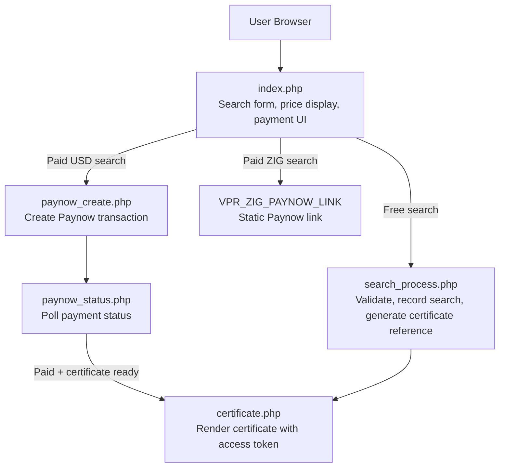
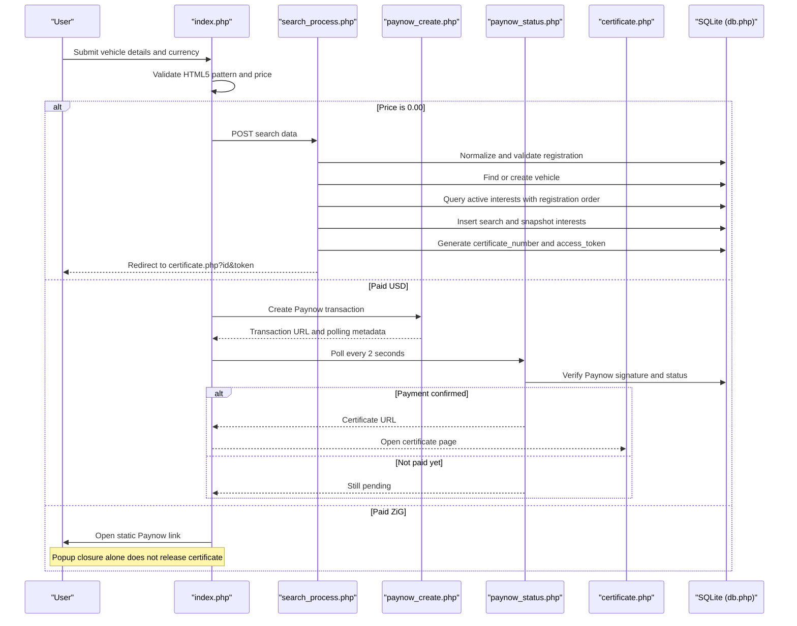
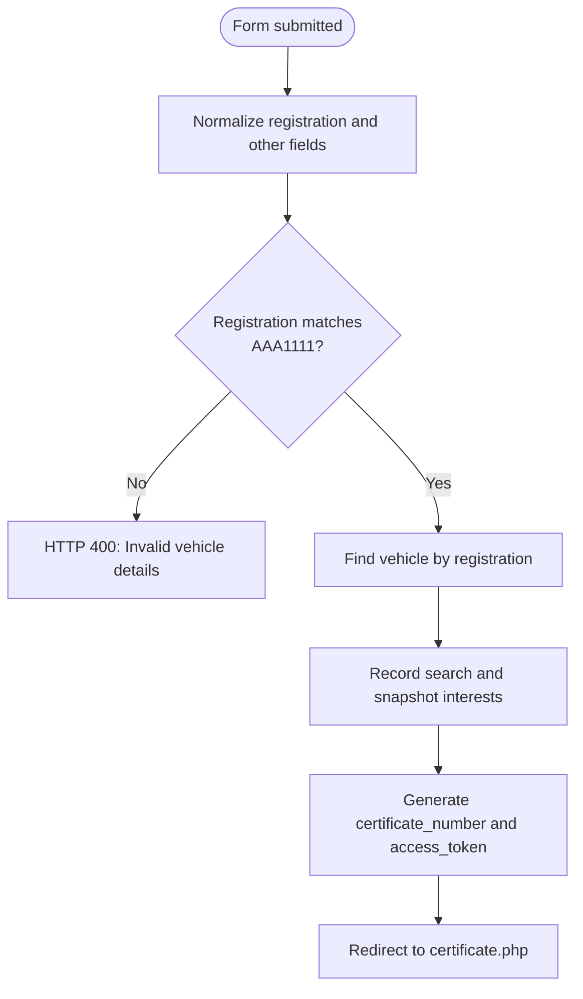
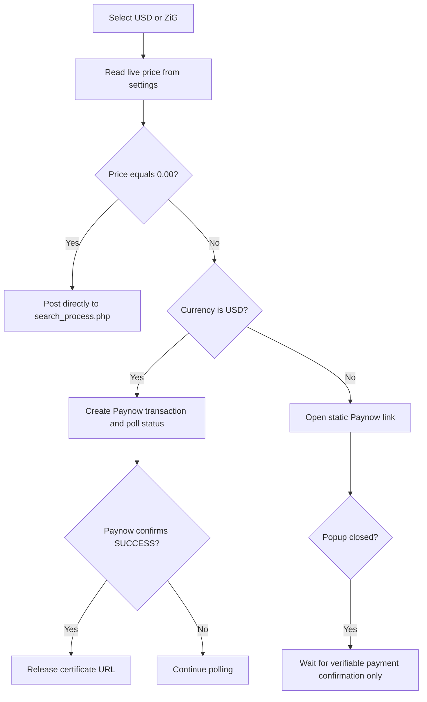
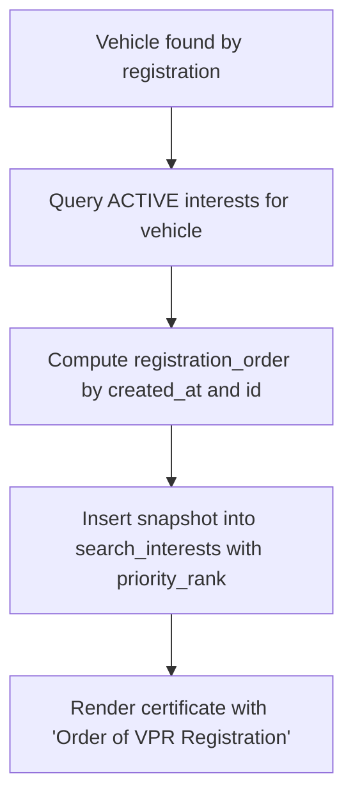
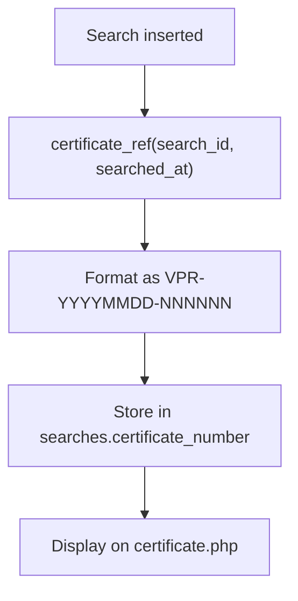
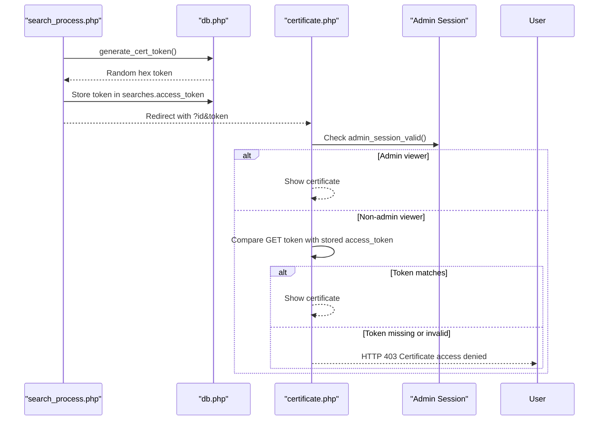
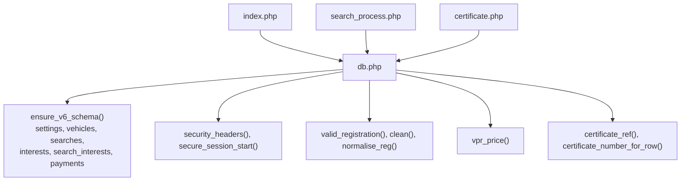

# Public Search and Certificate Flow

<cite>
**Referenced Files in This Document**
- [index.php](file://index.php)
- [search_process.php](file://search_process.php)
- [certificate.php](file://certificate.php)
- [db.php](file://db.php)
</cite>

## Table of Contents
1. [Introduction](#introduction)
2. [Project Structure](#project-structure)
3. [Core Components](#core-components)
4. [Architecture Overview](#architecture-overview)
5. [Detailed Component Analysis](#detailed-component-analysis)
6. [Dependency Analysis](#dependency-analysis)
7. [Performance Considerations](#performance-considerations)
8. [Troubleshooting Guide](#troubleshooting-guide)
9. [Conclusion](#conclusion)

## Introduction
This document explains the public-facing search-to-certificate flow implemented by `index.php`, `search_process.php`, and `certificate.php`. It focuses on:
- Input validation for the registration number in the AAA1111 format.
- Free versus paid path selection based on live VPR pricing.
- Interest ranking displayed as “Order of VPR Registration”.
- Certificate numbering using the `VPR-YYYYMMDD-NNNNNN` scheme.
- Access tokens used to protect certificate URLs.

The flow is intentionally conservative: a zero-price search proceeds directly, while paid searches require Paynow confirmation before a certificate can be released.

## Project Structure
At the user-visible surface, the flow consists of three PHP entry points plus shared database utilities:

**Diagram sources**
- [index.php:198-284](file://index.php#L198-L284)
- [search_process.php:5-78](file://search_process.php#L5-L78)
- [certificate.php:6-42](file://certificate.php#L6-L42)
- [db.php:357-442](file://db.php#L357-L442)

**Section sources**
- [index.php:1-290](file://index.php#L1-L290)
- [search_process.php:1-79](file://search_process.php#L1-L79)
- [certificate.php:1-155](file://certificate.php#L1-L155)
- [db.php:1-627](file://db.php#L1-L627)

## Core Components
- **Input validation**: The registration number must match exactly three uppercase letters followed by four digits. The form enforces this pattern client-side; server-side processing normalizes and validates it again.
- **Free vs paid path selection**: Live prices are read from the `settings` table via `vpr_price()`. A price of `0.00` means free and bypasses Paynow entirely.
- **Interest ranking**: Active interests are ordered by creation time and ID, then numbered starting at 1. The certificate displays this as “Order of VPR Registration #N”.
- **Certificate numbering**: Each search receives a stable certificate reference in the form `VPR-YYYYMMDD-NNNNNN`, where the date comes from the search timestamp and the numeric suffix is a zero-padded six-digit search ID.
- **Access tokens**: Every search gets a random access token stored in the database. Non-admin viewers must supply the matching token in the URL to view the certificate.

**Section sources**
- [db.php:153-159](file://db.php#L153-L159)
- [db.php:18-22](file://db.php#L18-L22)
- [db.php:617-625](file://db.php#L617-L625)
- [search_process.php:10-17](file://search_process.php#L10-L17)
- [search_process.php:40-77](file://search_process.php#L40-L77)
- [certificate.php:20-42](file://certificate.php#L20-L42)
- [certificate.php:119-132](file://certificate.php#L119-L132)

## Architecture Overview
The public search flow has two main branches after the user submits the form:

1. **Free branch**: If the selected currency’s price is zero, the browser posts directly to `search_process.php`.
2. **Paid branch**:
   - **ZiG**: Opens a static Paynow payment link. Closure of that popup does not release a certificate.
   - **USD**: Creates a Paynow transaction, opens a Paynow popup, and polls `paynow_status.php` until Paynow confirms payment. Only then is the certificate generated and opened.

**Diagram sources**
- [index.php:198-284](file://index.php#L198-L284)
- [search_process.php:10-77](file://search_process.php#L10-L77)
- [db.php:357-442](file://db.php#L357-L442)
- [certificate.php:6-42](file://certificate.php#L6-L42)

## Detailed Component Analysis

### Input Validation and Normalization
The registration number is the primary key for vehicle lookup and interest ranking. Validation occurs in two layers:

- **Client-side**: The HTML input uses `pattern="[A-Za-z]{3}[0-9]{4}"` and a title hint explaining the AAA1111 format.
- **Server-side**: `normalise_reg()` uppercases and removes spaces; `valid_registration()` requires exactly three uppercase letters followed by four digits. Other fields are trimmed through `clean()`.

If any required field is missing or the registration fails validation, `search_process.php` returns HTTP 400 with an explanatory message.

**Diagram sources**
- [index.php:58-60](file://index.php#L58-L60)
- [search_process.php:10-17](file://search_process.php#L10-L17)
- [db.php:444-456](file://db.php#L444-L456)
- [db.php:157-159](file://db.php#L157-L159)

**Section sources**
- [index.php:58-60](file://index.php#L58-L60)
- [search_process.php:10-17](file://search_process.php#L10-L17)
- [db.php:444-456](file://db.php#L444-L456)
- [db.php:157-159](file://db.php#L157-L159)

### Free vs Paid Path Selection
The selected currency determines both the displayed price and the execution path:

- Prices are loaded from the `settings` table using `vpr_price($pdo, 'USD')` and `vpr_price($pdo, 'ZIG')`.
- If the selected currency’s price is zero, the JavaScript immediately posts to `search_process.php`.
- For non-zero USD payments, the frontend calls `paynow_create.php`, opens a Paynow popup, and polls `paynow_status.php`.
- For ZiG, the frontend opens the static `VPR_ZIG_PAYNOW_LINK`; closing the popup does not trigger certificate generation.

**Diagram sources**
- [index.php:5-6](file://index.php#L5-L6)
- [index.php:131-137](file://index.php#L131-L137)
- [index.php:198-284](file://index.php#L198-L284)
- [db.php:18-22](file://db.php#L18-L22)

**Section sources**
- [index.php:5-6](file://index.php#L5-L6)
- [index.php:131-137](file://index.php#L131-L137)
- [index.php:198-284](file://index.php#L198-L284)
- [db.php:18-22](file://db.php#L18-L22)

### Interest Ranking as “Order of VPR Registration”
Active interests are queried per vehicle and ranked by chronological creation, breaking ties by row ID. The query computes a `registration_order` value representing the position among active interests. This value is snapshotted into `search_interests.priority_rank` so the certificate reflects the state at search time rather than later changes.

On the certificate page, each interest is rendered with a badge reading “Order of VPR Registration #N”. If no snapshot exists for legacy searches, the page falls back to current active interests but still orders them consistently.

**Diagram sources**
- [search_process.php:40-75](file://search_process.php#L40-L75)
- [certificate.php:29-39](file://certificate.php#L29-L39)
- [certificate.php:119-132](file://certificate.php#L119-L132)

**Section sources**
- [search_process.php:40-75](file://search_process.php#L40-L75)
- [certificate.php:29-39](file://certificate.php#L29-L39)
- [certificate.php:119-132](file://certificate.php#L119-L132)

### Certificate Numbering: `VPR-YYYYMMDD-NNNNNN`
Every search receives a certificate reference generated by `certificate_ref()`:
- Prefix: `VPR-`
- Date part: `YYYYMMDD` derived from the search timestamp.
- Numeric part: Zero-padded six-digit search ID.

The reference is stored in `searches.certificate_number`, and the same function is used when finalizing searches from successful USD payments. When rendering, `certificate_number_for_row()` prefers the stored reference and falls back to recomputation using the search ID and timestamp.

**Diagram sources**
- [search_process.php:59-62](file://search_process.php#L59-L62)
- [db.php:617-625](file://db.php#L617-L625)
- [certificate.php:41-42](file://certificate.php#L41-L42)

**Section sources**
- [search_process.php:59-62](file://search_process.php#L59-L62)
- [db.php:617-625](file://db.php#L617-L625)
- [certificate.php:41-42](file://certificate.php#L41-L42)

### Access Tokens and Certificate Access Control
Each search receives a random access token generated by `generate_cert_token()`. The token is stored in `searches.access_token` and appended to the certificate redirect URL.

When viewing the certificate:
- Admin users with a valid admin session bypass the token check.
- Regular users must provide a matching token in the URL; otherwise, they receive HTTP 403 “Certificate access denied.”

**Diagram sources**
- [search_process.php:59-62](file://search_process.php#L59-L62)
- [certificate.php:20-27](file://certificate.php#L20-L27)
- [db.php:153-155](file://db.php#L153-L155)
- [db.php:135-144](file://db.php#L135-L144)

**Section sources**
- [search_process.php:59-62](file://search_process.php#L59-L62)
- [certificate.php:20-27](file://certificate.php#L20-L27)
- [db.php:153-155](file://db.php#L153-L155)
- [db.php:135-144](file://db.php#L135-L144)

## Dependency Analysis
The three public pages depend on shared database functions for security, validation, pricing, schema management, and certificate generation.

**Diagram sources**
- [index.php:2-6](file://index.php#L2-L6)
- [search_process.php:1-17](file://search_process.php#L1-L17)
- [certificate.php:1-27](file://certificate.php#L1-L27)
- [db.php:70-114](file://db.php#L70-L114)
- [db.php:153-159](file://db.php#L153-L159)
- [db.php:18-22](file://db.php#L18-L22)
- [db.php:458-609](file://db.php#L458-L609)
- [db.php:617-625](file://db.php#L617-L625)

**Section sources**
- [index.php:1-290](file://index.php#L1-L290)
- [search_process.php:1-79](file://search_process.php#L1-L79)
- [certificate.php:1-155](file://certificate.php#L1-L155)
- [db.php:1-627](file://db.php#L1-L627)

## Performance Considerations
- SQLite WAL mode, synchronous NORMAL, busy timeout, foreign keys enabled, and memory temp storage are configured once per process in `db()`.
- Unique indexes exist on vehicle registration numbers, certificate numbers, and access tokens to prevent duplicates and support fast lookups.
- Interest ranking queries use indexed columns (`created_at`, `id`) and compute rank per vehicle.
- The bundled SQLite file predates newer schema elements; `ensure_v6_schema()` self-heals the database on first use.

[No sources needed since this section provides general guidance]

## Troubleshooting Guide
- **Invalid registration format**: Ensure the input is exactly three letters followed by four digits. Server-side validation rejects anything else with HTTP 400.
- **Certificate not found**: The certificate page requires a positive integer `id`; otherwise it returns HTTP 404.
- **Certificate access denied**: Non-admin users must include the correct `token` parameter. Mismatched or missing tokens return HTTP 403.
- **Free search not working**: Confirm the selected currency’s price is actually `0.00` in the `settings` table. A zero price bypasses Paynow entirely.
- **Paid USD certificate not released**: Only Paynow confirmation releases the certificate. Closing the Paynow popup or returning to the site without a verified payment does not grant access.
- **ZiG payment not releasing certificate automatically**: ZiG uses a static Paynow link and cannot auto-release certificates until provider integration exists.
- **Legacy certificate numbering**: Existing searches without a stored certificate reference are retroactively assigned one using their search ID and timestamp.

**Section sources**
- [search_process.php:14-17](file://search_process.php#L14-L17)
- [certificate.php:6-8](file://certificate.php#L6-L8)
- [certificate.php:20-27](file://certificate.php#L20-L27)
- [index.php:202-207](file://index.php#L202-L207)
- [index.php:245-256](file://index.php#L245-L256)
- [db.php:603-609](file://db.php#L603-L609)

## Conclusion
The public search and certificate flow enforces strict registration validation, separates free and paid paths based on live pricing, snapshots interest rankings as “Order of VPR Registration”, generates stable `VPR-YYYYMMDD-NNNNNN` certificate references, and protects certificate access with random tokens. The design ensures that only verified USD payments and direct free searches produce certificates, while ZiG payments remain intentionally manual until future API integration.