# Security Model

<cite>
**Referenced Files in This Document**   
- [.htaccess](file://.htaccess)
- [data/.htaccess](file://data/.htaccess)
- [db.php](file://db.php)
- [admin2000.php](file://admin2000.php)
- [index.php](file://index.php)
- [paynow_create.php](file://paynow_create.php)
- [paynow_result.php](file://paynow_result.php)
- [paynow_status.php](file://paynow_status.php)
- [certificate.php](file://certificate.php)
</cite>

## Table of Contents
1. [Introduction](#introduction)
2. [Project Structure](#project-structure)
3. [Core Components](#core-components)
4. [Architecture Overview](#architecture-overview)
5. [Detailed Component Analysis](#detailed-component-analysis)
6. [Dependency Analysis](#dependency-analysis)
7. [Performance Considerations](#performance-considerations)
8. [Troubleshooting Guide](#troubleshooting-guide)
9. [Conclusion](#conclusion)

## Introduction
This document describes the defense-in-depth security model for VPR version 14.2. It focuses on:

- Web server and PHP-level hardening through `.htaccess` and `security_headers()`.
- Content Security Policy that restricts form submissions to the site itself and Paynow.
- Secure session configuration, CSRF protection, and admin login throttling.
- HMAC-hashed IP storage instead of raw client IPs.
- Audit logging for administrative actions.
- Certificate access tokens protecting search results.
- Secrets handling via a gitignored `config.php`.
- Payment-to-certificate release controls ensuring only verified Paynow USD flows can issue certificates.

The project author’s notes are authoritative: live prices come from the database settings table, only the server-side USD flow may release certificates, ZiG payments open a static link without auto-release, and `config.php` must never be committed because it contains secrets.

## Project Structure
The security-relevant surface is small but critical:

| Area | Primary files | Purpose |
|---|---|---|
| Web server hardening | `.htaccess`, `data/.htaccess` | HTTPS upgrade, directory denial, sensitive file blocking, request limits, HTTP headers |
| Shared security utilities | `db.php` | Security headers, sessions, CSRF, HMAC IPs, audit log, payment helpers, schema migration |
| Public entry point | `index.php` | Search form, zero-fee bypass, Paynow popup or ZiG link flow |
| Payment initiation | `paynow_create.php` | Creates Paynow transaction, stores return token, validates inputs |
| Payment callback | `paynow_result.php` | Verifies Paynow signature, polls status, updates payment record |
| Client polling | `paynow_status.php` | Returns payment state and certificate URL with return-token binding |
| Certificate viewer | `certificate.php` | Requires either admin session or valid access token |
| Admin interface | `admin2000.php` | Login, throttling, CSRF, audit logging, pricing management |

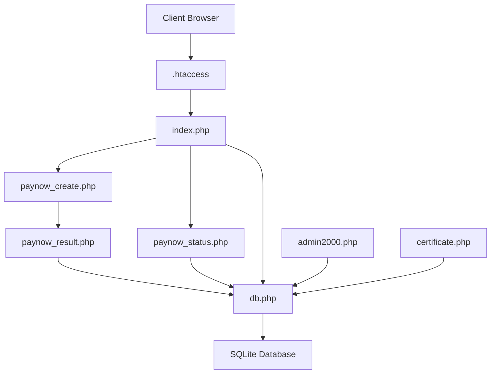

**Diagram sources**
- [.htaccess:1-50](file://.htaccess#L1-L50)
- [index.php:1-10](file://index.php#L1-L10)
- [paynow_create.php:1-40](file://paynow_create.php#L1-L40)
- [paynow_result.php:1-20](file://paynow_result.php#L1-L20)
- [paynow_status.php:1-20](file://paynow_status.php#L1-L20)
- [certificate.php:1-10](file://certificate.php#L1-L10)
- [admin2000.php:1-10](file://admin2000.php#L1-L10)
- [db.php:1-40](file://db.php#L1-L40)

**Section sources**
- [.htaccess:1-50](file://.htaccess#L1-L50)
- [data/.htaccess:1-3](file://data/.htaccess#L1-L3)
- [db.php:1-40](file://db.php#L1-L40)
- [index.php:1-10](file://index.php#L1-L10)
- [admin2000.php:1-10](file://admin2000.php#L1-L10)

## Core Components
The security model is implemented across three layers:

1. **Web server layer**: `.htaccess` enforces HTTPS-only upgrades, denies direct access to `data/`, blocks dotfiles, denies sensitive file extensions, limits request size, restricts HTTP methods, and sets strong HTTP headers.
2. **Application layer**: `db.php` centralizes security headers, secure session configuration, CSRF token generation and verification, HMAC-based IP hashing, admin session validation, audit logging, recovery tokens, and Paynow integration helpers.
3. **Page layer**: Public and admin pages call `security_headers()` and `secure_session_start()` early, validate CSRF where needed, and enforce authorization before releasing sensitive data.

Key responsibilities:

| Component | Responsibility |
|---|---|
| `.htaccess` | TLS enforcement, directory/file exposure control, HTTP header defaults, method and payload limits |
| `security_headers()` | Application-level CSP, HSTS, frame, MIME, referrer, permissions, and cross-origin policies |
| `secure_session_start()` | Strict mode, cookie-only sessions, no trans-sid, HttpOnly, SameSite=Strict, HTTPS-aware secure flag |
| CSRF functions | Session-bound random token generation and constant-time verification |
| `protected_ip_value()` | HMAC-SHA256 hash of the client IP using `VPR_IP_HASH_KEY` |
| `audit_admin()` | Inserts action, truncated details, and hashed IP into `admin_audit` |
| `generate_cert_token()` | Random 24-byte hex token stored per search |
| `finalize_vpr_search_from_payment()` | Only path that creates searches, certificates, and access tokens after verified payment |

**Section sources**
- [.htaccess:1-50](file://.htaccess#L1-L50)
- [db.php:70-155](file://db.php#L70-L155)
- [db.php:458-609](file://db.php#L458-L609)

## Architecture Overview
The security architecture follows layered defense:

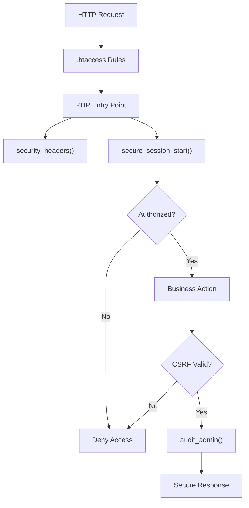

**Diagram sources**
- [.htaccess:1-50](file://.htaccess#L1-L50)
- [db.php:70-155](file://db.php#L70-L155)
- [admin2000.php:108-169](file://admin2000.php#L108-L169)

## Detailed Component Analysis

### .htaccess Defense-in-Depth
The root `.htaccess` provides the first line of defense:

- Disables directory indexing and server signature disclosure.
- Forces HTTP to HTTPS with a 301 redirect, including proxy-aware detection via `X-Forwarded-Proto`.
- Blocks web access to the `data/` directory and any hidden files.
- Sets security-related HTTP headers when `mod_headers` is available.
- Applies stricter cache-control and robots directives to sensitive admin and utility scripts.
- Denies direct access to configuration, database, backup, secret, and key files.
- Limits request body size and HTTP methods.

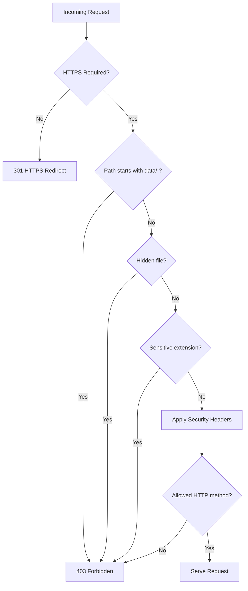

**Diagram sources**
- [.htaccess:1-50](file://.htaccess#L1-L50)

Important behaviors:

- The `data/` directory is blocked at the web server level, while `data/.htaccess` also explicitly denies all access as an additional safeguard.
- Sensitive file patterns include `config.php`, `db.php`, SQLite databases, backups, logs, environment files, and cryptographic material.
- Only GET, POST, and HEAD are allowed by default; other methods are denied.
- The maximum request body is limited to approximately 25 MB.

**Section sources**
- [.htaccess:1-50](file://.htaccess#L1-L50)
- [data/.htaccess:1-3](file://data/.htaccess#L1-L3)

### Content Security Policy and Form Actions
Both `.htaccess` and `security_headers()` set a restrictive CSP:

- Default source is self.
- Images allow self and inline data URIs.
- Styles and scripts allow self and inline content.
- Network connections are restricted to self.
- Forms may submit to self and `https://www.paynow.co.zw`.
- Frame ancestors are denied.
- Base URI is restricted to self.
- Object embedding is disabled.
- Insecure requests are upgraded.

This CSP ensures that forms cannot post to arbitrary third-party sites unless they are explicitly Paynow. It also prevents framing of the application, reducing clickjacking risk.

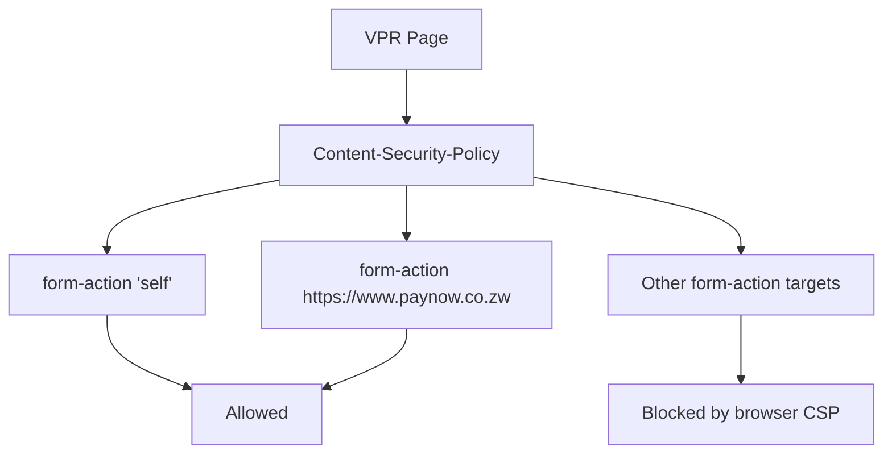

**Diagram sources**
- [.htaccess:17-27](file://.htaccess#L17-L27)
- [db.php:70-94](file://db.php#L70-L94)

**Section sources**
- [.htaccess:17-27](file://.htaccess#L17-L27)
- [db.php:70-94](file://db.php#L70-L94)

### Session Hardening
`secure_session_start()` configures PHP sessions with strong defaults:

- Strict session mode enabled.
- Sessions use cookies only.
- Transparent SID rewriting is disabled.
- Session cookies are HttpOnly.
- Session ID length and entropy are increased.
- Cookie scope is site-wide.
- Secure flag is applied when the connection is HTTPS.
- SameSite is set to Strict.

Admin sessions add an extra timeout: if `vpr_admin_last` exceeds `VPR_ADMIN_SESSION_TIMEOUT`, the session is cleared and treated as invalid. On successful login, the session ID is regenerated to prevent fixation.

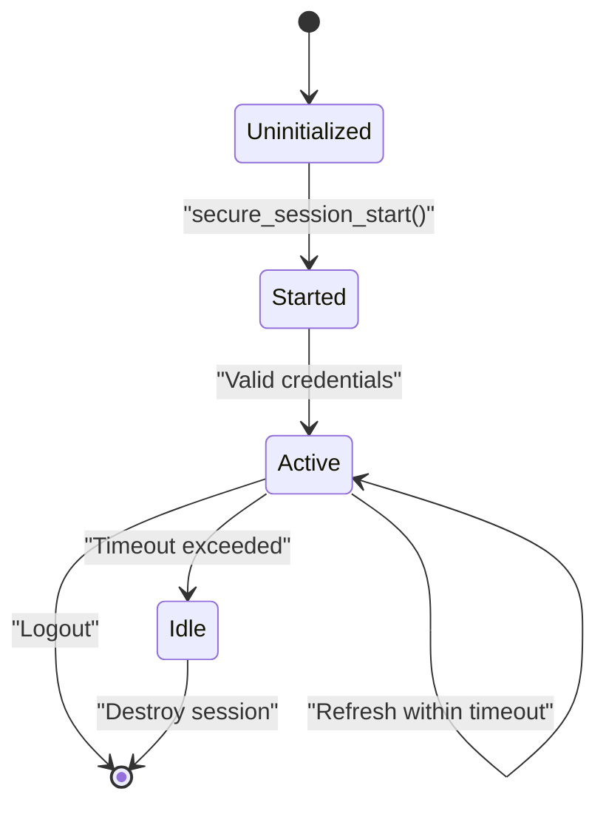

**Diagram sources**
- [db.php:96-114](file://db.php#L96-L114)
- [db.php:135-144](file://db.php#L135-L144)
- [admin2000.php:19-47](file://admin2000.php#L19-L47)

**Section sources**
- [db.php:96-114](file://db.php#L96-L114)
- [db.php:135-144](file://db.php#L135-L144)
- [admin2000.php:19-47](file://admin2000.php#L19-L47)

### CSRF Protection
CSRF protection is implemented through a session-bound token:

- `csrf_token()` generates a 32-byte random value stored in `$_SESSION['vpr_csrf']`.
- `verify_csrf()` compares the submitted token with the session token using constant-time comparison.
- Admin forms embed the token as a hidden field.
- POST mutations in the admin interface reject requests without a valid token.

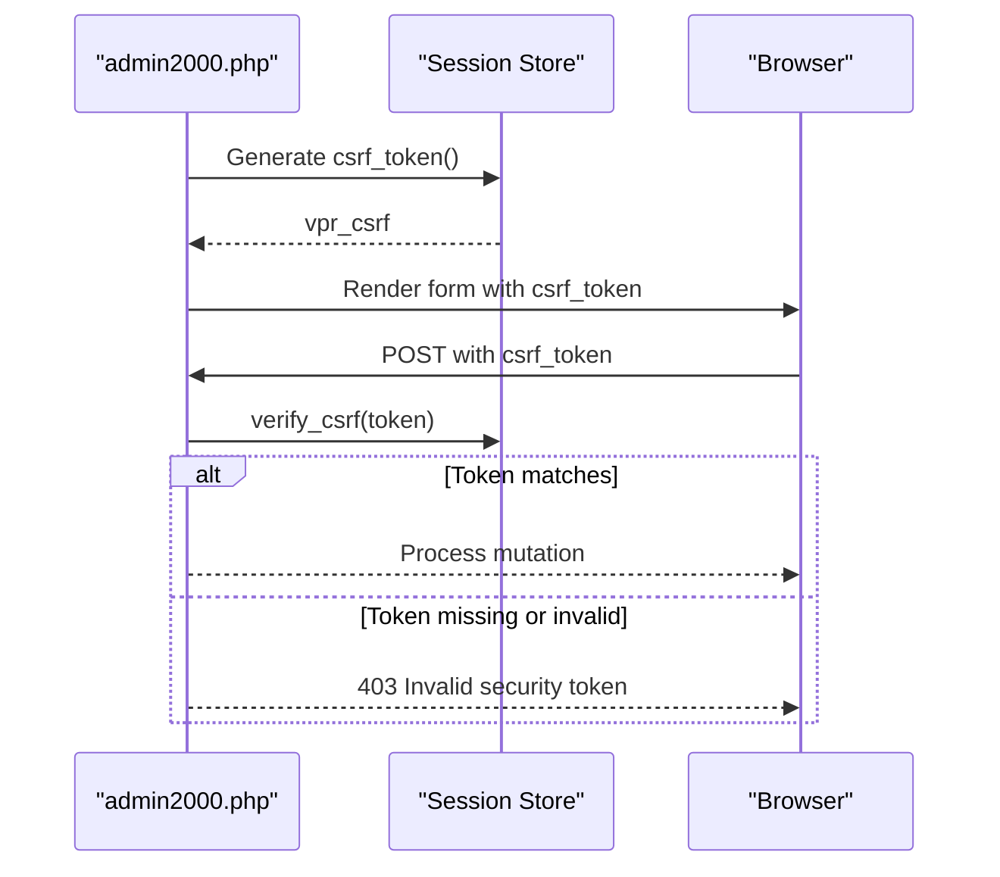

**Diagram sources**
- [db.php:116-125](file://db.php#L116-L125)
- [admin2000.php:110-114](file://admin2000.php#L110-L114)
- [admin2000.php:272-290](file://admin2000.php#L272-L290)

**Section sources**
- [db.php:116-125](file://db.php#L116-L125)
- [admin2000.php:110-114](file://admin2000.php#L110-L114)

### HMAC-Hashed IPs
Raw client IPs are not stored in audit or login attempt records. Instead:

- `client_ip()` returns `REMOTE_ADDR` or `unknown`.
- `protected_ip_value()` computes an HMAC-SHA256 digest of the IP using `VPR_IP_HASH_KEY`.
- Audit entries store the HMAC hash.
- Login attempts are keyed by the same HMAC hash.
- Security emails include the protected IP fingerprint rather than the raw address.

This reduces privacy exposure and makes brute-force correlation harder if the database is leaked.

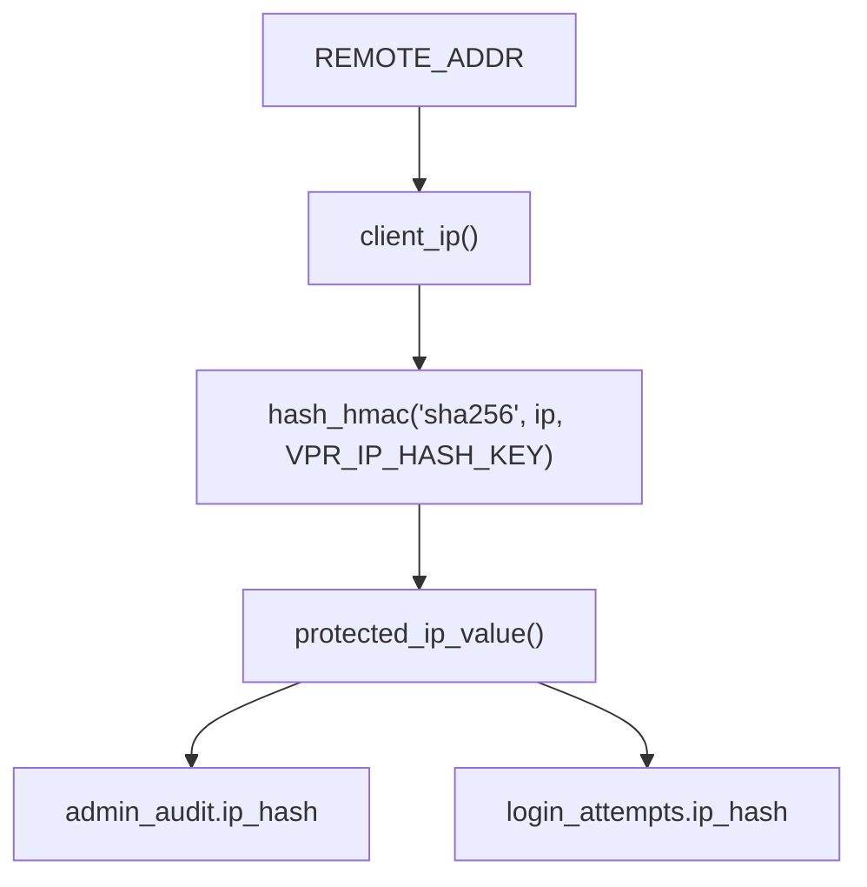

**Diagram sources**
- [db.php:127-133](file://db.php#L127-L133)
- [db.php:146-151](file://db.php#L146-L151)
- [admin2000.php:21-30](file://admin2000.php#L21-L30)

**Section sources**
- [db.php:127-133](file://db.php#L127-L133)
- [db.php:146-151](file://db.php#L146-L151)
- [admin2000.php:21-30](file://admin2000.php#L21-L30)

### Admin Login Throttling
Admin login attempts are tracked per HMAC-hashed IP:

- Failed attempts increment a counter in `login_attempts`.
- After reaching `VPR_MAX_LOGIN_ATTEMPTS` within `VPR_LOGIN_BLOCK_SECONDS`, further attempts are rejected.
- Successful login clears the attempt counter and regenerates the session ID.
- At three failed attempts, a security email is sent even before full blockout.
- Blocked attempts are audited.

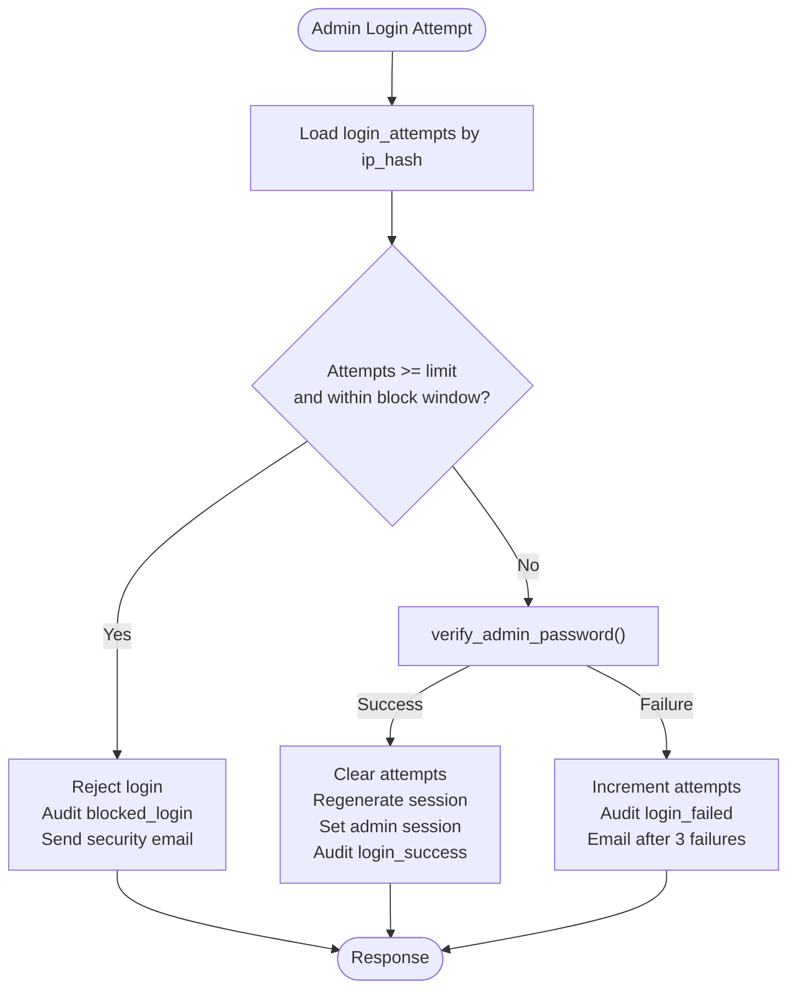

**Diagram sources**
- [admin2000.php:19-68](file://admin2000.php#L19-L68)
- [db.php:463-468](file://db.php#L463-L468)

**Section sources**
- [admin2000.php:19-68](file://admin2000.php#L19-L68)
- [db.php:463-468](file://db.php#L463-L468)

### Audit Log
Administrative actions are recorded in the `admin_audit` table:

- Fields include action, truncated details, HMAC-hashed IP, and timestamp.
- Events include login success, login failure, blocked login, logout, pricing updates, interest additions, and interest clearing.
- Errors during audit insertion are silently ignored so operational failures do not break user workflows.

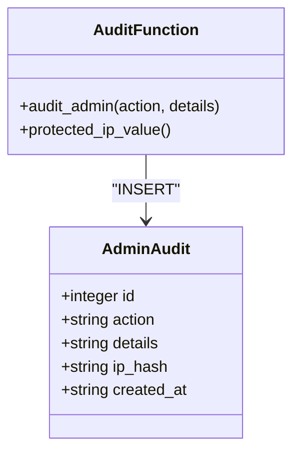

**Diagram sources**
- [db.php:146-151](file://db.php#L146-L151)
- [db.php:469-475](file://db.php#L469-L475)
- [admin2000.php:12-17](file://admin2000.php#L12-L17)
- [admin2000.php:124-167](file://admin2000.php#L124-L167)

**Section sources**
- [db.php:146-151](file://db.php#L146-L151)
- [db.php:469-475](file://db.php#L469-L475)
- [admin2000.php:12-17](file://admin2000.php#L12-L17)
- [admin2000.php:124-167](file://admin2000.php#L124-L167)

### Certificate Access Tokens
Certificates are protected by two mechanisms:

1. A deterministic-looking certificate number generated from the search ID and date.
2. A random `access_token` stored per search row.

When viewing a certificate:

- If the requester has a valid admin session, access is granted.
- Otherwise, the `token` query parameter must match the stored `access_token` using constant-time comparison.
- Missing or invalid tokens return 403.
- The public client receives the certificate URL only after the payment status endpoint confirms payment and includes the access token.

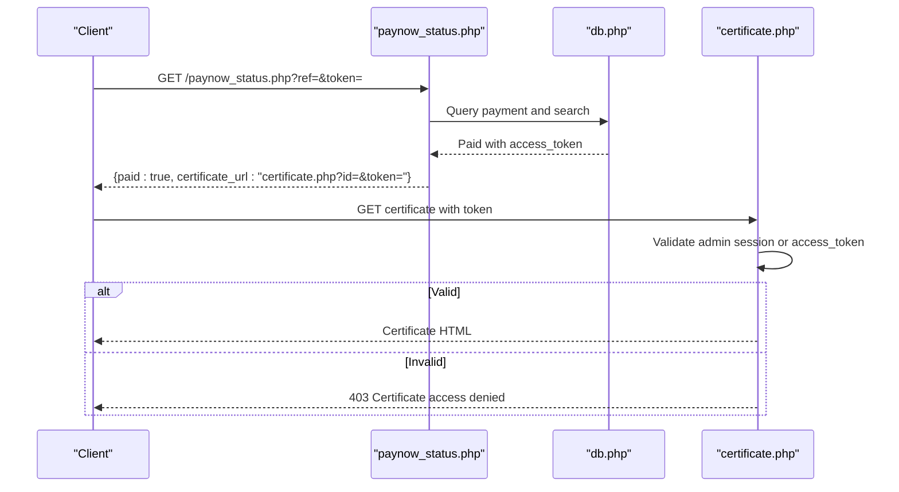

**Diagram sources**
- [paynow_status.php:40-55](file://paynow_status.php#L40-L55)
- [certificate.php:6-27](file://certificate.php#L6-L27)
- [db.php:153-155](file://db.php#L153-L155)
- [db.php:416-418](file://db.php#L416-L418)

**Section sources**
- [certificate.php:6-27](file://certificate.php#L6-L27)
- [paynow_status.php:40-55](file://paynow_status.php#L40-L55)
- [db.php:153-155](file://db.php#L153-L155)
- [db.php:416-418](file://db.php#L416-L418)

### Secrets Handling
Secrets are expected to reside in `config.php`:

- `config.php` is gitignored and should contain the admin password, Paynow integration key, hashing keys, mail sender, and other runtime configuration.
- `db.php` requires `config.php` at startup.
- The bundled SQLite database predates later schema versions and is self-healed on first request.
- Live prices are read from the `settings` table, not directly from `config.php` constants.
- Security-sensitive values such as `VPR_PAYNOW_INTEGRATION_KEY` and `VPR_IP_HASH_KEY` are used for signing and hashing but are never echoed into responses.

Operational guidance:

- Never commit `config.php`.
- Rotate `VPR_ADMIN_PASSWORD`, `VPR_PAYNOW_INTEGRATION_KEY`, and `VPR_IP_HASH_KEY` according to organizational policy.
- Restrict filesystem access to `config.php` and `data/admin_auth.json`.
- Treat the bundled `data/vpr.sqlite` as legacy; the intended schema is created or migrated by `ensure_v6_schema`.

**Section sources**
- [db.php:1-2](file://db.php#L1-L2)
- [db.php:458-609](file://db.php#L458-L609)
- [db.php:245-254](file://db.php#L245-L254)
- [db.php:131-133](file://db.php#L131-L133)

### Payment Flow and Certificate Release Controls
Only the server-side USD payment flow may release a certificate. The public UI supports both USD and ZiG, but their security models differ:

- Zero-fee searches bypass Paynow entirely and proceed directly to search processing.
- USD searches create a Paynow transaction, open a browser popup, and poll `paynow_status.php`.
- ZiG payments open a static Paynow link and intentionally cannot auto-release certificates.
- Certificate release happens only inside `finalize_vpr_search_from_payment`, which checks paid status and amount.

```mermaid
sequenceDiagram
participant User as "User"
participant Index as "index.php"
participant Create as "paynow_create.php"
participant Paynow as "Paynow Gateway"
participant Result as "paynow_result.php"
participant Status as "paynow_status.php"
participant Finalize as "finalize_vpr_search_from_payment"
participant Cert as "certificate.php"
User->>Index : Submit vehicle check
alt Price == 0.00
Index->>Index : Bypass Paynow
Index-->>User : Direct search result
else USD payment required
Index->>Create : POST vehicle data
Create->>Paynow : Initialize payment
Paynow-->>Create : browserurl, pollurl, signed response
Create-->>Index : Payment reference and token
Index->>User : Open Paynow popup
User->>Paynow : Complete payment
Paynow->>Result : Callback with signature
Result->>Result : Validate hash and reference
Result->>Result : Poll status and update payment
Result->>Finalize : If paid and amount OK
Finalize->>Finalize : Create search, certificate, access_token
User->>Status : Poll payment status
Status-->>User : paid=true, certificate_url with token
User->>Cert : View certificate with token
Cert-->>User : Certificate if token valid
else ZiG payment
Index->>User : Open static ZiG Paynow link
Note over Index,Cert : No automatic certificate release
end
```

**Diagram sources**
- [index.php:198-278](file://index.php#L198-L278)
- [paynow_create.php:36-139](file://paynow_create.php#L36-L139)
- [paynow_result.php:1-41](file://paynow_result.php#L1-L41)
- [paynow_status.php:1-56](file://paynow_status.php#L1-L56)
- [db.php:357-442](file://db.php#L357-L442)

Critical safeguards:

- `paynow_create.php` accepts only USD.
- Paynow callbacks are validated by signature and merchant reference.
- Amount mismatches force a non-paid status.
- `paynow_is_paid()` only treats specific statuses as paid.
- `payment_amount_ok()` compares the confirmed amount against the configured fee.
- `finalize_vpr_search_from_payment()` uses a transaction and re-checks for duplicate search creation.
- The returned certificate URL includes the access token.

**Section sources**
- [index.php:198-278](file://index.php#L198-L278)
- [paynow_create.php:36-139](file://paynow_create.php#L36-L139)
- [paynow_result.php:1-41](file://paynow_result.php#L1-L41)
- [paynow_status.php:1-56](file://paynow_status.php#L1-L56)
- [db.php:357-442](file://db.php#L357-L442)

## Dependency Analysis
Security dependencies are concentrated in `db.php`, which is required by most application files:

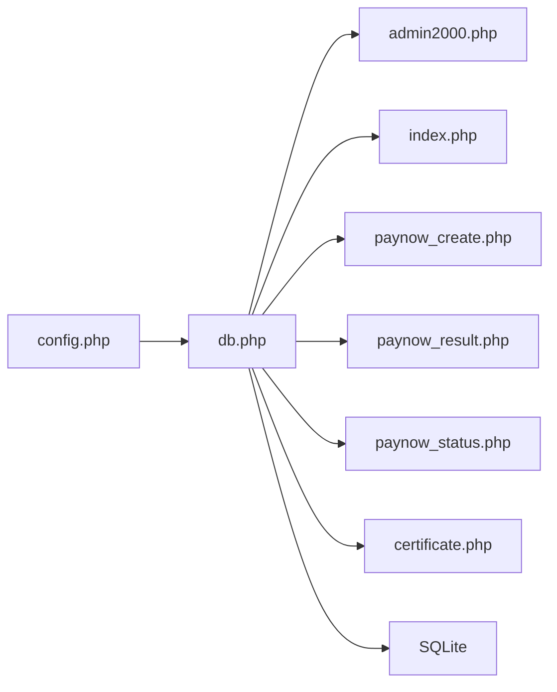

**Diagram sources**
- [db.php:1-2](file://db.php#L1-L2)
- [admin2000.php:1-2](file://admin2000.php#L1-L2)
- [index.php:1-2](file://index.php#L1-L2)
- [paynow_create.php:36-38](file://paynow_create.php#L36-L38)
- [paynow_result.php:1-2](file://paynow_result.php#L1-L2)
- [paynow_status.php:1-2](file://paynow_status.php#L1-L2)
- [certificate.php:1-2](file://certificate.php#L1-L2)

Coupling observations:

- High cohesion: security logic is centralized in `db.php`.
- Low coupling between page controllers and low-level crypto helpers.
- External dependency on Paynow is isolated behind helper functions.
- Database schema evolution is centralized in `ensure_v6_schema`.

Potential risks:

- Any change to `db.php` affects all major endpoints.
- Configuration errors in `config.php` can disable signing, hashing, or outbound connectivity.
- Reliance on `REMOTE_ADDR` assumes correct proxy configuration.

**Section sources**
- [db.php:1-40](file://db.php#L1-L40)
- [db.php:245-337](file://db.php#L245-L337)
- [db.php:458-609](file://db.php#L458-L609)

## Performance Considerations
Security features have performance implications:

- WAL mode, synchronous normal, busy timeout, and foreign keys improve concurrency and integrity for concurrent searches.
- Audit logging adds write overhead but is wrapped in error suppression to avoid breaking normal requests.
- HMAC hashing and constant-time comparisons are inexpensive relative to network I/O.
- Paynow polling introduces repeated outbound HTTPS calls; this is necessary for payment confirmation but should not be rate-limited aggressively.
- Certificate access token checks are lightweight database lookups.

[No sources needed since this section provides general guidance]

## Troubleshooting Guide
Common security-related issues and diagnostics:

| Symptom | Likely Cause | Recommended Check |
|---|---|---|
| Admin login repeatedly blocked | Too many failed attempts within block window | Review `login_attempts` table and `VPR_MAX_LOGIN_ATTEMPTS` / `VPR_LOGIN_BLOCK_SECONDS` |
| CSRF rejection on admin mutations | Missing or expired CSRF token | Ensure forms include `csrf_token` and session is active |
| CSP blocking form submission | Form target not `self` or `https://www.paynow.co.zw` | Inspect browser console and CSP header |
| Certificate access denied | Missing or wrong `token` parameter | Use the URL returned by `paynow_status.php` |
| Paynow callback fails signature | Mismatched integration key or modified payload | Verify `VPR_PAYNOW_INTEGRATION_KEY` and Paynow configuration |
| Certificate not released after payment | Payment status not recognized or amount mismatch | Check `payments.status`, `amount`, and `paynow_is_paid()` accepted statuses |
| Outbound Paynow requests fail | cURL disabled or SSL verification failure | Confirm cURL availability, OpenSSL, and CA bundle |
| Sensitive files exposed | `.htaccess` rules missing or overridden | Verify web server configuration and `Require all denied` rules |

**Section sources**
- [admin2000.php:19-68](file://admin2000.php#L19-L68)
- [db.php:281-337](file://db.php#L281-L337)
- [paynow_result.php:1-41](file://paynow_result.php#L1-L41)
- [.htaccess:13-49](file://.htaccess#L13-L49)

## Conclusion
VPR’s security model applies defense in depth across web server rules, application headers, session management, CSRF validation, IP hashing, audit logging, strict payment verification, and certificate access tokens. The most important boundary is that only a verified Paynow USD payment may trigger certificate issuance. All other paths—popup closure, return-to-site navigation, generic payment links, or client-side claims—are explicitly insufficient.

For ongoing operations:

- Keep `config.php` out of version control.
- Monitor `admin_audit` and `login_attempts`.
- Validate Paynow integration keys and outbound connectivity.
- Treat the database schema as evolving under `ensure_v6_schema`.
- Prefer URLs returned by `paynow_status.php` for certificate access.
- Enforce HTTPS deployment and preserve `.htaccess` protections.

[No sources needed since this section summarizes without analyzing specific files]