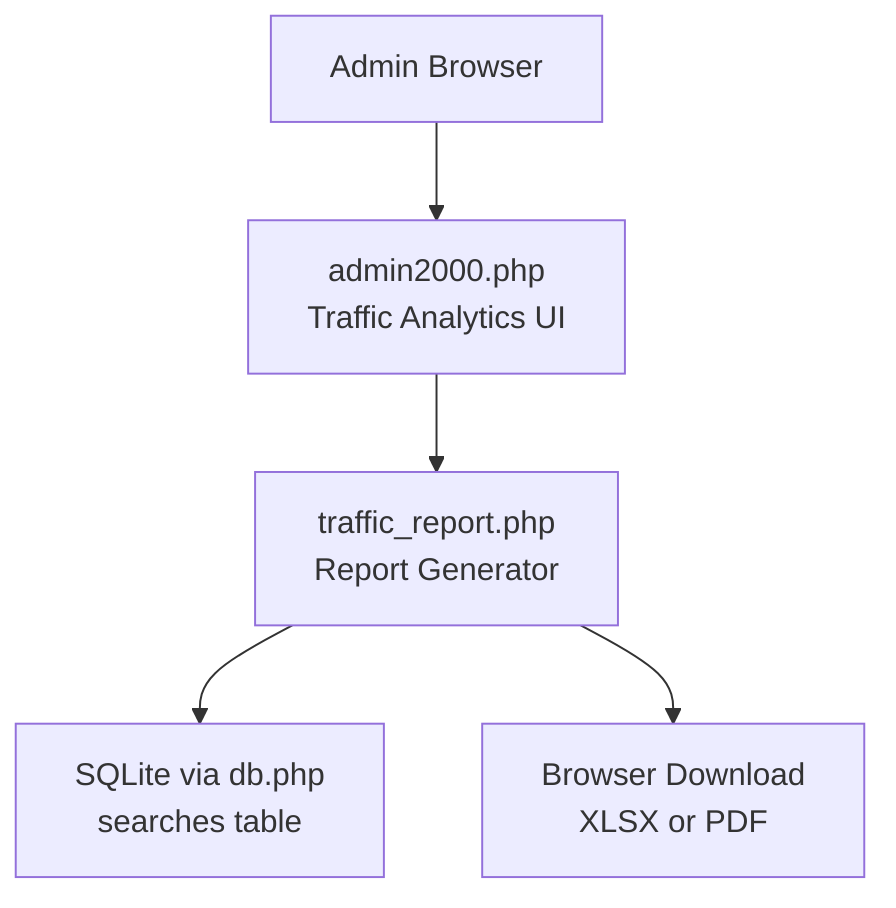
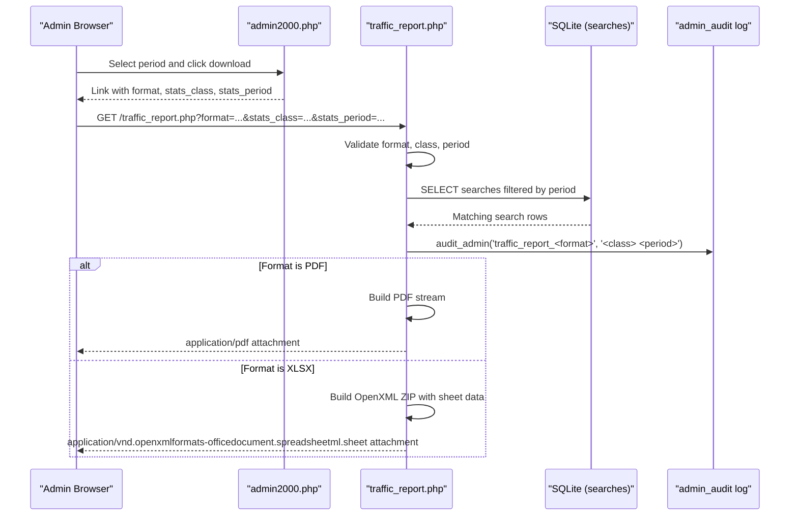
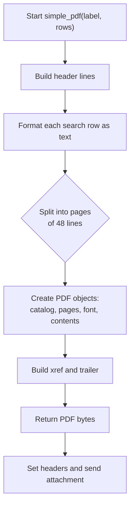
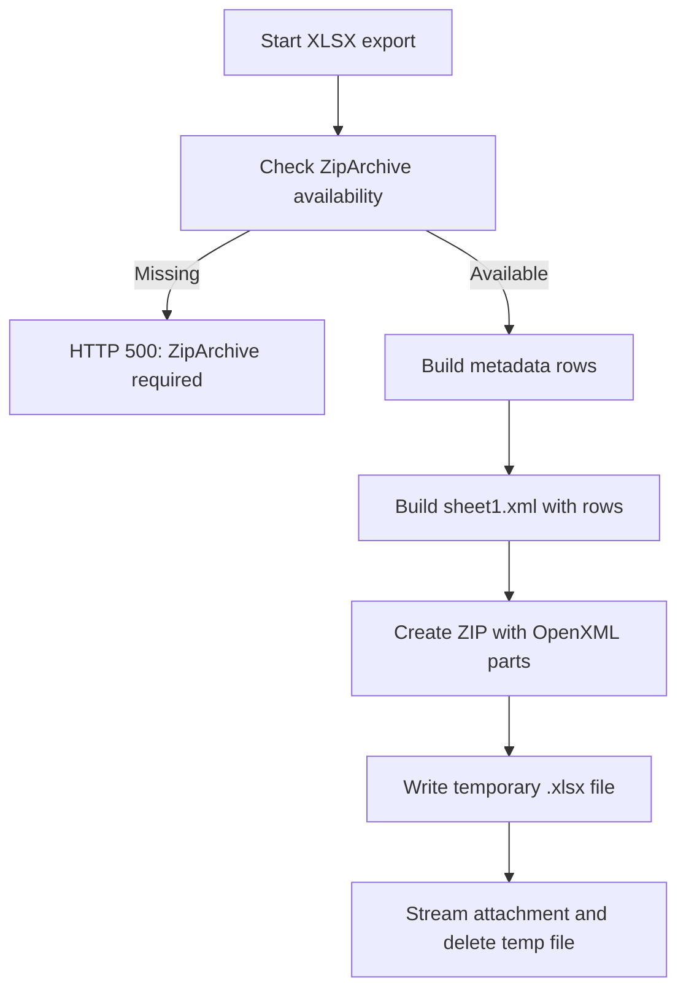
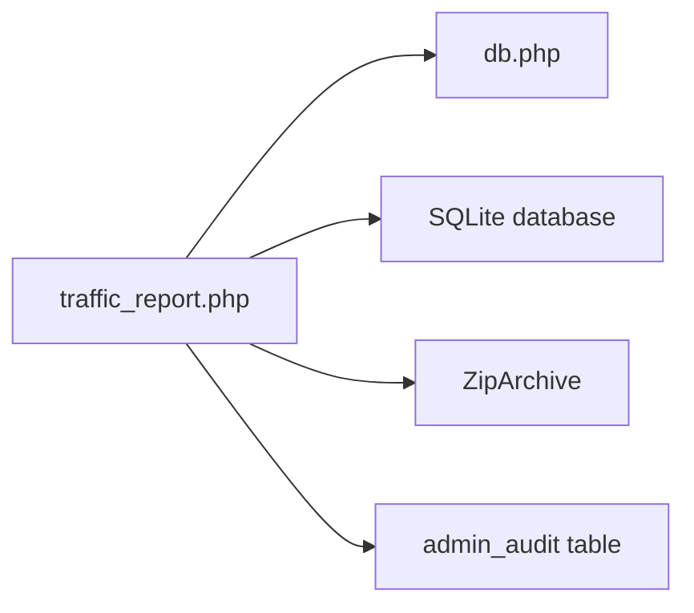

# Traffic Reports

<cite>
**Referenced Files in This Document**
- [traffic_report.php](file://traffic_report.php)
- [db.php](file://db.php)
- [admin2000.php](file://admin2000.php)
</cite>

## Table of Contents
1. [Introduction](#introduction)
2. [Project Structure](#project-structure)
3. [Core Components](#core-components)
4. [Architecture Overview](#architecture-overview)
5. [Detailed Component Analysis](#detailed-component-analysis)
6. [Dependency Analysis](#dependency-analysis)
7. [Performance Considerations](#performance-considerations)
8. [Troubleshooting Guide](#troubleshooting-guide)
9. [Conclusion](#conclusion)

## Introduction
This document explains the traffic reporting capability exposed by `traffic_report.php`. It provides authenticated administrators with day, week, and month search statistics and supports two dependency-free export formats:

- XLSX: a minimal OpenXML spreadsheet built with PHP’s standard `ZipArchive`.
- PDF: a hand-crafted PDF-1.4 document using only PHP string operations.

The page is intended for administrative use and is also linked from the VPR admin dashboard as the destination for Excel and PDF report downloads.

## Project Structure
`traffic_report.php` is a single-purpose script that:

1. Loads shared database and security helpers from `db.php`.
2. Enforces an active admin session.
3. Accepts query parameters to select the report format, period class, and period value.
4. Queries the `searches` table for matching records.
5. Audits the action.
6. Streams either an XLSX or PDF file directly to the browser.

**Diagram sources**
- [admin2000.php:295-324](file://admin2000.php#L295-L324)
- [traffic_report.php:1-79](file://traffic_report.php#L1-L79)
- [db.php:24-41](file://db.php#L24-L41)

**Section sources**
- [traffic_report.php:1-79](file://traffic_report.php#L1-L79)
- [admin2000.php:295-324](file://admin2000.php#L295-L324)

## Core Components
The traffic report functionality centers on three responsibilities:

| Responsibility | Implementation | Notes |
|---|---|---|
| Authentication and security | `security_headers()`, `secure_session_start()`, `admin_session_valid()` | Requires a valid admin session; otherwise returns HTTP 403. |
| Period parsing and filtering | Query-time logic based on `stats_class` and `stats_period` | Supports `day`, `week`, and `month`; defaults are applied when input is missing or invalid. |
| Export generation | `simple_pdf()` and inline XLSX builder | No external libraries; XLSX requires `ZipArchive`. |

Key behaviors:

- The default format is XLSX.
- Invalid `stats_class` values fall back to `day`.
- Missing or malformed periods are normalized to the current day, ISO week, or current month.
- Every report download is recorded through `audit_admin()`.

**Section sources**
- [traffic_report.php:1-26](file://traffic_report.php#L1-L26)
- [db.php:70-151](file://db.php#L70-L151)

## Architecture Overview
The traffic report flow is request-driven and stateless after authentication.

**Diagram sources**
- [traffic_report.php:7-78](file://traffic_report.php#L7-L78)
- [db.php:146-151](file://db.php#L146-L151)
- [admin2000.php:321-324](file://admin2000.php#L321-L324)

## Detailed Component Analysis

### Request Handling and Security
On every request, the script:

- Includes `db.php`.
- Applies security headers.
- Starts a secure session.
- Checks admin session validity.
- Rejects unauthenticated requests with HTTP 403.

This means the report endpoint cannot be used directly without first authenticating through the admin login flow.

**Section sources**
- [traffic_report.php:1-5](file://traffic_report.php#L1-L5)
- [db.php:70-114](file://db.php#L70-L114)
- [db.php:135-144](file://db.php#L135-L144)

### Input Parameters and Validation
The script accepts three query parameters:

| Parameter | Default | Valid Values | Behavior |
|---|---:|---|---|
| `format` | `xlsx` | `xlsx`, `pdf` | Determines output type. Lowercased before comparison. |
| `stats_class` | `day` | `day`, `week`, `month` | Controls date grouping logic. Invalid values reset to `day`. |
| `stats_period` | Current time-based value | Depends on class | Normalized per class rules below. |

Period normalization rules:

| Class | Expected Input | Fallback | SQL Filter Used | Label |
|---|---|---|---|---|
| `day` | `YYYY-MM-DD` | Today | `date(searched_at)=?` | Formatted date such as `DD Mon YYYY`. |
| `week` | ISO week `YYYY-WWW` | Current ISO week | `date(searched_at) BETWEEN ? AND ?` | Week number plus start/end dates. |
| `month` | `YYYY-MM` | Current month | `strftime('%Y-%m', searched_at)=?` | Month and year label. |

**Section sources**
- [traffic_report.php:7-23](file://traffic_report.php#L7-L23)

### Data Query
The report queries the `searches` table for six fields:

- `certificate_number`
- `registration_number`
- `vehicle_brand`
- `vehicle_model`
- `result`
- `searched_at`

Rows are ordered by descending datetime and descending ID, so the most recent searches appear first.

The resulting row count is included in both XLSX and PDF reports as “Total Searches”.

**Section sources**
- [traffic_report.php:24-25](file://traffic_report.php#L24-L25)

### Audit Logging
After fetching rows, the script logs the report action:

- Action: `traffic_report_xlsx` or `traffic_report_pdf`.
- Details: `<stats_class> <stats_period>`.

The audit entry stores an IP hash rather than raw client IP.

**Section sources**
- [traffic_report.php:26](file://traffic_report.php#L26)
- [db.php:146-151](file://db.php#L146-L151)

### PDF Generation
The PDF generator builds a minimal PDF-1.4 document without any external library.

Processing steps:

1. Create header lines including title, period label, generated timestamp, and total search count.
2. Add a column header row.
3. Convert each search row into a fixed-width text line.
4. Split lines into pages of up to 48 rows.
5. Construct PDF objects for catalog, pages, fonts, page content streams, and cross-reference table.
6. Escape parentheses in text to avoid breaking PDF text rendering.
7. Stream the result with `application/pdf` and an attachment filename derived from the class and period.

Important characteristics:

- Uses Helvetica Type1 font.
- Page size is A4-like dimensions.
- Long lines are truncated with an ellipsis marker.
- No images, no embedded fonts beyond Helvetica, no encryption.

**Diagram sources**
- [traffic_report.php:28-58](file://traffic_report.php#L28-L58)

**Section sources**
- [traffic_report.php:28-58](file://traffic_report.php#L28-L58)

### XLSX Generation
The XLSX generator creates a minimal OpenXML SpreadsheetML workbook using `ZipArchive`.

Required components:

- `[Content_Types].xml`
- `_rels/.rels`
- `xl/workbook.xml`
- `xl/_rels/workbook.xml.rels`
- `xl/worksheets/sheet1.xml`

The worksheet contains:

- A metadata section with report title, period class, selected period, generated timestamp, and total search count.
- A header row: Date/Time, Registration Number, Vehicle Brand, Vehicle Model, Result, Certificate Number.
- One row per search.

Data handling:

- XML strings are escaped using `htmlspecialchars` with `ENT_XML1` and UTF-8.
- Column references are computed manually instead of using a library.
- Temporary files are created in the system temp directory and deleted after streaming.

Error behavior:

- If `ZipArchive` is not available, the script returns HTTP 500 with a message indicating the extension is required.

**Diagram sources**
- [traffic_report.php:61-78](file://traffic_report.php#L61-L78)

**Section sources**
- [traffic_report.php:61-78](file://traffic_report.php#L61-L78)

### Admin Dashboard Integration
The admin interface provides:

- A form to choose period class and period.
- A displayed count for the selected period.
- Links to download the same period as XLSX or PDF.

This means administrators do not need to construct URLs manually; the dashboard generates them with proper URL encoding.

**Section sources**
- [admin2000.php:295-324](file://admin2000.php#L295-L324)

## Dependency Analysis
The traffic report has very few runtime dependencies:

| Dependency | Purpose | Required For |
|---|---|---|
| `db.php` | Database connection, security helpers, admin session validation, audit logging | Always |
| SQLite PDO driver | Reads search history | Always |
| `ZipArchive` | Builds XLSX files | XLSX export only |
| PHP string/date functions | Period parsing and PDF/XLSX construction | Always |

There are no third-party libraries, Composer packages, or external report generators involved.

**Diagram sources**
- [traffic_report.php:1-78](file://traffic_report.php#L1-L78)
- [db.php:24-41](file://db.php#L24-L41)
- [db.php:146-151](file://db.php#L146-L151)

**Section sources**
- [traffic_report.php:1-78](file://traffic_report.php#L1-L78)
- [db.php:24-41](file://db.php#L24-L41)

## Performance Considerations
- The query selects only the columns needed for the report.
- Results are ordered by `searched_at` and `id`, which benefits from the schema migration index on `searched_at`.
- PDF generation processes all rows in memory and splits them into pages.
- XLSX generation writes a temporary file to the system temp directory and deletes it after streaming.
- Large historical exports may consume noticeable memory because the full result set is held while building the report.

Recommendations for large datasets:

- Prefer narrower date ranges.
- Monitor server memory usage during large exports.
- Consider adding pagination at the application layer if future requirements demand very large reports.
- Ensure the web server timeout is sufficient for large PDF/XLSX generation.

[No sources needed since this section provides general guidance]

## Troubleshooting Guide

### Unauthenticated Access
**Symptom:** HTTP 403 response with “Admin login required.”  
**Cause:** The admin session is missing or expired.  
**Resolution:** Log in through the admin login page before accessing the report.

**Section sources**
- [traffic_report.php:3-5](file://traffic_report.php#L3-L5)
- [db.php:135-144](file://db.php#L135-L144)

### Invalid Period Class
**Symptom:** Report always shows daily data even when week or month is requested.  
**Cause:** An unsupported `stats_class` value was passed.  
**Resolution:** Use `day`, `week`, or `month`.

**Section sources**
- [traffic_report.php:9-10](file://traffic_report.php#L9-L10)

### Malformed Period Value
**Symptom:** Report uses today, current week, or current month instead of the requested period.  
**Cause:** The period does not match the expected pattern for the selected class.  
**Resolution:** Use:

- Day: `YYYY-MM-DD`
- Week: `YYYY-WWW`
- Month: `YYYY-MM`

**Section sources**
- [traffic_report.php:13-23](file://traffic_report.php#L13-L23)

### XLSX Export Fails with Extension Error
**Symptom:** HTTP 500 with message about `ZipArchive`.  
**Cause:** The PHP environment lacks the `ZipArchive` extension.  
**Resolution:** Enable `ZipArchive` or use PDF export until the extension is available.

**Section sources**
- [traffic_report.php:61](file://traffic_report.php#L61)

### Empty Report
**Symptom:** Download succeeds but contains zero search rows.  
**Cause:** No searches exist for the selected period.  
**Resolution:** Verify the period and check whether searches have been recorded.

**Section sources**
- [traffic_report.php:24-25](file://traffic_report.php#L24-L25)

### Audit Log Not Visible
**Symptom:** No record of the report download appears in admin audit tables.  
**Cause:** Audit insertion failures are silently ignored.  
**Resolution:** Check database connectivity and permissions for the `admin_audit` table.

**Section sources**
- [traffic_report.php:26](file://traffic_report.php#L26)
- [db.php:146-151](file://db.php#L146-L151)

## Conclusion
`traffic_report.php` implements a lightweight, dependency-minimal traffic reporting feature for the VPR application. It supports day, week, and month search statistics and produces downloadable XLSX and PDF reports without requiring external libraries. The script enforces admin authentication, validates inputs, normalizes periods, queries the `searches` table, audits access, and streams the appropriate output format.

For administrators, the recommended workflow is:

1. Log in to the VPR admin dashboard.
2. Choose the desired period class and period.
3. Review the displayed search count.
4. Download the Excel or PDF report for the selected period.