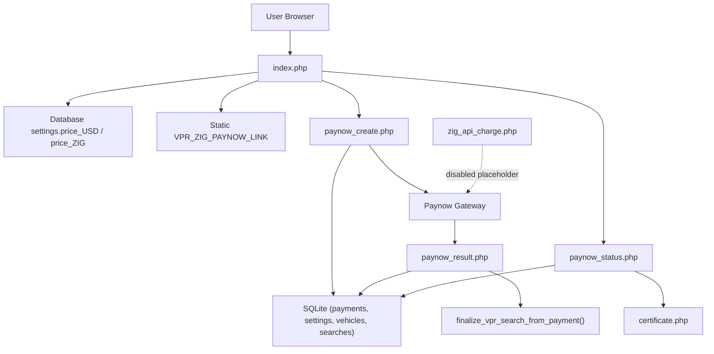
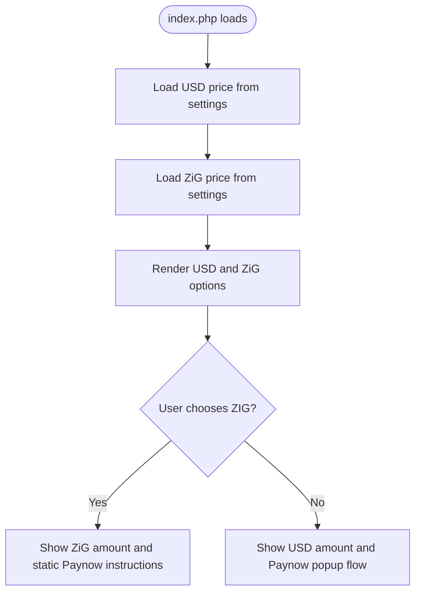
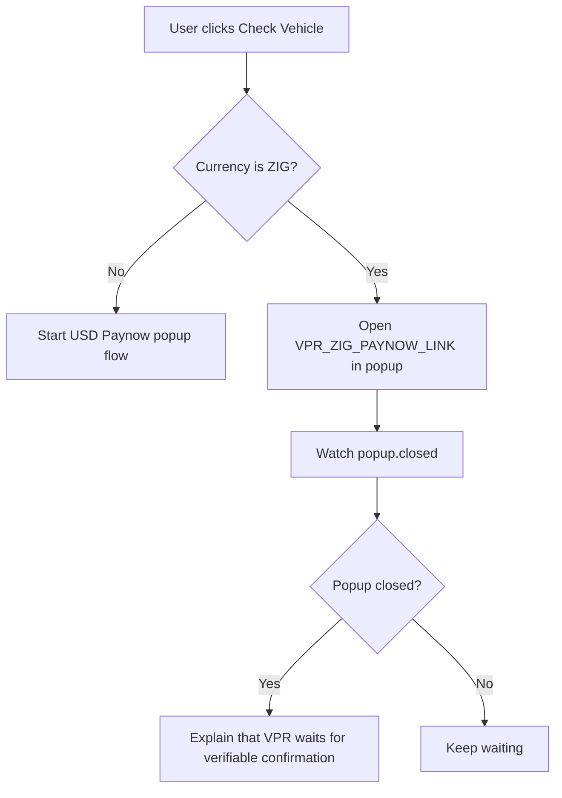
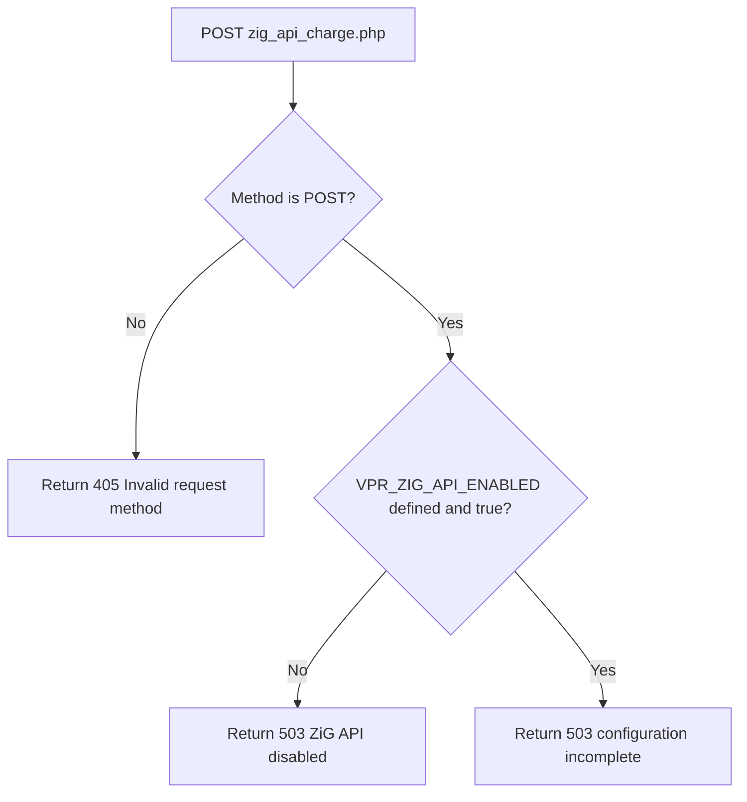
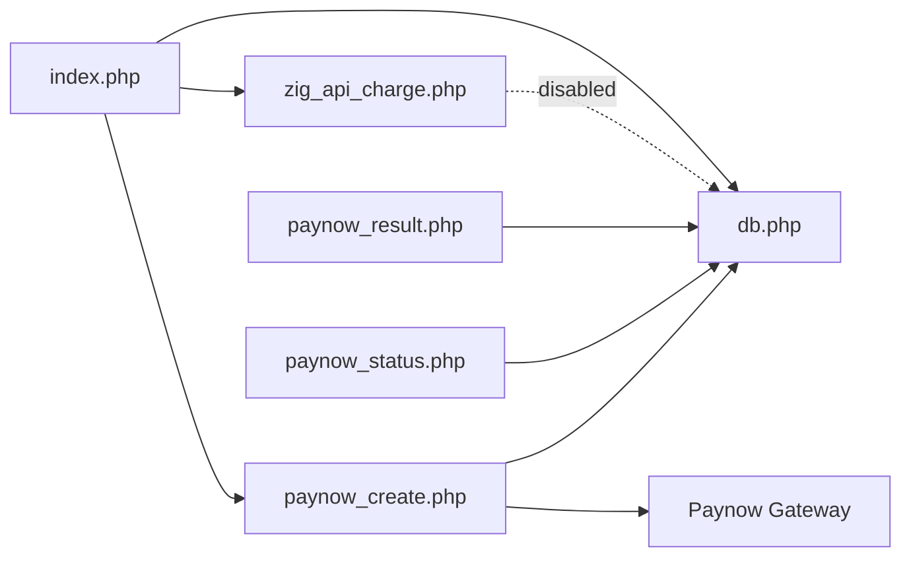

# ZiG Payment Path

<cite>
**Referenced Files in This Document**
- [index.php](file://index.php)
- [paynow_create.php](file://paynow_create.php)
- [paynow_result.php](file://paynow_result.php)
- [paynow_status.php](file://paynow_status.php)
- [zig_api_charge.php](file://zig_api_charge.php)
- [db.php](file://db.php)
</cite>

## Table of Contents
1. [Introduction](#introduction)
2. [Project Structure](#project-structure)
3. [Core Components](#core-components)
4. [Architecture Overview](#architecture-overview)
5. [Detailed Component Analysis](#detailed-component-analysis)
6. [Dependency Analysis](#dependency-analysis)
7. [Performance Considerations](#performance-considerations)
8. [Troubleshooting Guide](#troubleshooting-guide)
9. [Conclusion](#conclusion)

## Introduction
This document explains how the VPR application handles pricing and payment for vehicle interest searches, with special focus on the ZiG payment path. It answers three questions:

- How ZiG pricing is determined and displayed.
- Why opening a static Paynow link for ZiG cannot auto-release a certificate.
- Why `zig_api_charge.php` exists but remains deliberately disabled until a real ZiG charge API is available.

The USD flow uses an active server-side Paynow integration that can create a transaction, poll its status, and release a certificate after confirmation. The current ZiG flow intentionally does not have equivalent automation.

## Project Structure
The ZiG payment path touches only a small subset of the repository:

| File | Role in this document |
|---|---|
| `index.php` | Displays USD and ZiG prices from the database, opens the static ZiG Paynow link, and drives the USD Paynow popup flow. |
| `paynow_create.php` | Creates a USD-only Paynow transaction and records it in the payments table. |
| `paynow_result.php` | Receives Paynow’s signed result callback, polls status, updates the payment, and releases the certificate when paid. |
| `paynow_status.php` | Lets the browser poll the latest payment state and returns the certificate URL once finalized. |
| `zig_api_charge.php` | Placeholder endpoint for a future ZiG charge API; currently always returns disabled. |
| `db.php` | Central database helper, schema migration, Paynow helpers, price lookup, and the certificate-releasing function. |



**Diagram sources**
- [index.php:5-6](file://index.php#L5-L6)
- [index.php:131-137](file://index.php#L131-L137)
- [index.php:243-273](file://index.php#L243-L273)
- [paynow_create.php:40-45](file://paynow_create.php#L40-L45)
- [paynow_result.php:35-35](file://paynow_result.php#L35-L35)
- [paynow_status.php:44-48](file://paynow_status.php#L44-L48)
- [zig_api_charge.php:5-8](file://zig_api_charge.php#L5-L8)
- [db.php:18-22](file://db.php#L18-L22)
- [db.php:357-442](file://db.php#L357-L442)

**Section sources**
- [index.php:1-153](file://index.php#L1-L153)
- [paynow_create.php:1-145](file://paynow_create.php#L1-L145)
- [paynow_result.php:1-41](file://paynow_result.php#L1-L41)
- [paynow_status.php:1-56](file://paynow_status.php#L1-L56)
- [zig_api_charge.php:1-9](file://zig_api_charge.php#L1-L9)
- [db.php:1-627](file://db.php#L1-L627)

## Core Components
### Pricing Source
Live search prices are stored in the `settings` table under keys such as `price_USD` and `price_ZIG`. The `vpr_price()` function reads these values and falls back to config constants only if no setting exists. A price of `0.00` means free: the UI bypasses Paynow entirely and submits the search directly.

Key behavior:
- Prices come from the database, not just hardcoded defaults.
- Both USD and ZiG prices are shown in the currency selector.
- Zero-price searches do not open any Paynow window.

**Section sources**
- [db.php:5-22](file://db.php#L5-L22)
- [index.php:5-6](file://index.php#L5-L6)
- [index.php:131-137](file://index.php#L131-L137)
- [index.php:200-208](file://index.php#L200-L208)

### USD Payment Flow
The USD flow is fully automated:

1. The user selects USD and clicks “Check Vehicle”.
2. The frontend calls `paynow_create.php` with the search data.
3. `paynow_create.php` creates a Paynow transaction, stores a payment record, and returns a browser URL.
4. The browser opens the Paynow popup and polls `paynow_status.php`.
5. When Paynow confirms payment, `paynow_result.php` or the status poll finalizes the search and sets a certificate URL.
6. The frontend redirects to the certificate page.

Only this server-side USD flow may release a certificate. Popup closure, return-to-site navigation, or a generic payment link must never be treated as proof of payment.

**Section sources**
- [index.php:243-273](file://index.php#L243-L273)
- [paynow_create.php:40-127](file://paynow_create.php#L40-L127)
- [paynow_status.php:18-33](file://paynow_status.php#L18-L33)
- [paynow_status.php:44-48](file://paynow_status.php#L44-L48)
- [paynow_result.php:19-35](file://paynow_result.php#L19-L35)

### Certificate Release Logic
Certificate release happens inside `finalize_vpr_search_from_payment()`. It:

- Loads the payment by merchant reference.
- Requires a paid status and a matching amount.
- Avoids duplicate search generation using a transaction and re-check.
- Ensures the vehicle exists, creating or updating it as needed.
- Records the search result based on whether active interests exist.
- Generates a certificate number and access token.
- Links the search to the payment.

This function is called only after verified Paynow payment confirmation.

**Section sources**
- [db.php:357-442](file://db.php#L357-L442)
- [paynow_result.php:35-35](file://paynow_result.php#L35-L35)
- [paynow_status.php:32-32](file://paynow_status.php#L32-L32)

## Architecture Overview
The system separates three concerns:

1. **Pricing display:** `index.php` loads USD and ZiG prices from the database.
2. **USD automation:** `paynow_create.php`, `paynow_result.php`, and `paynow_status.php` coordinate with Paynow and release certificates.
3. **ZiG placeholder:** `zig_api_charge.php` is intentionally disabled and does not participate in certificate release.

```mermaid
sequenceDiagram
participant User as "User Browser"
participant Index as "index.php"
participant Create as "paynow_create.php"
participant Paynow as "Paynow Gateway"
participant Result as "paynow_result.php"
participant Status as "paynow_status.php"
participant DB as "SQLite"
participant Cert as "certificate.php"
User->>Index : Select USD and submit search
Index->>Create : POST search + USD
Create->>DB : Insert payment record
Create->>Paynow : Initialize transaction
Paynow-->>Create : Return browser URL
Create-->>Index : Reference, token, browser URL
Index->>User : Open Paynow popup
User->>Paynow : Complete payment
Paynow->>Result : Signed result callback
Result->>DB : Update payment status
Result->>DB : finalize_vpr_search_from_payment()
User->>Status : Poll payment status
Status->>DB : Read payment and linked search
Status-->>Index : paid=true + certificate_url
Index->>Cert : Redirect to certificate
```

**Diagram sources**
- [index.php:243-273](file://index.php#L243-L273)
- [paynow_create.php:62-127](file://paynow_create.php#L62-L127)
- [paynow_result.php:19-35](file://paynow_result.php#L19-L35)
- [paynow_status.php:18-48](file://paynow_status.php#L18-L48)
- [db.php:357-442](file://db.php#L357-L442)

## Detailed Component Analysis

### ZiG Pricing Display
`index.php` loads both currencies at startup:

- `$usdPrice = vpr_price($pdo, 'USD');`
- `$zigPrice = vpr_price($pdo, 'ZIG');`

These values populate the currency selector options so users see the live fee before choosing a payment method.



**Diagram sources**
- [index.php:5-6](file://index.php#L5-L6)
- [index.php:131-137](file://index.php#L131-L137)

**Section sources**
- [index.php:5-6](file://index.php#L5-L6)
- [index.php:131-137](file://index.php#L131-L137)
- [db.php:18-22](file://db.php#L18-L22)

### Static ZiG Paynow Link Behavior
When the user selects ZiG and clicks the payment button, `index.php`:

1. Reads the static configuration value `VPR_ZIG_PAYNOW_LINK`.
2. Opens that URL in a new popup window.
3. Watches whether the popup closes.
4. If the popup closes, it tells the user that VPR cannot safely release the search from popup closure alone.

There is no backend call to start a ZiG transaction, no polling endpoint for ZiG, and no automatic certificate release triggered by closing the window.



**Diagram sources**
- [index.php:243-256](file://index.php#L243-L256)

**Section sources**
- [index.php:243-256](file://index.php#L243-L256)

### Why the Static Paynow Link Cannot Auto-Release Certificates
A static Paynow link is a one-way redirect into the Paynow checkout experience. It does not give VPR enough information to:

- Identify which VPR search belongs to the payer.
- Verify that the correct registration number was used.
- Confirm that the exact expected amount was paid.
- Receive a cryptographically signed confirmation from Paynow.
- Safely generate and expose a certificate.

For those reasons, the code explicitly avoids releasing a certificate when the ZiG popup closes. Only the server-side USD flow, which records a payment reference, validates signatures, and calls `finalize_vpr_search_from_payment()`, may release a certificate.

**Section sources**
- [index.php:243-256](file://index.php#L243-L256)
- [paynow_result.php:7-35](file://paynow_result.php#L7-L35)
- [paynow_status.php:10-33](file://paynow_status.php#L10-L33)
- [db.php:357-442](file://db.php#L357-L442)

### Deliberately Disabled `zig_api_charge.php`
The file `zig_api_charge.php` is a JSON endpoint skeleton intended for a future ZiG provider API. Its current behavior is:

- Accept only POST requests.
- Require `VPR_ZIG_API_ENABLED` to be defined and true.
- Return HTTP 503 with a message stating the ZiG API is prepared but disabled until the provider supplies the complete charge request schema, production URL, and payment confirmation method.
- Even if enabled, the current implementation still returns a disabled response because the rest of the configuration is incomplete.

This design ensures that enabling the constant alone does not accidentally expose a non-functional or unsafe charging endpoint.



**Diagram sources**
- [zig_api_charge.php:4-8](file://zig_api_charge.php#L4-L8)

**Section sources**
- [zig_api_charge.php:1-9](file://zig_api_charge.php#L1-L9)

### USD vs ZiG Endpoint Contract
| Aspect | USD | ZiG |
|---|---|---|
| Entry point | Frontend calls `paynow_create.php` via AJAX. | Frontend opens static `VPR_ZIG_PAYNOW_LINK`. |
| Backend transaction creation | Yes, server-side. | No. |
| Signature verification | Yes, via Paynow hash validation. | Not implemented. |
| Amount verification | Yes, against configured fee. | Not implemented. |
| Certificate release | Yes, through `finalize_vpr_search_from_payment()`. | No. |
| Current endpoint | Active. | `zig_api_charge.php` is disabled. |

**Section sources**
- [paynow_create.php:40-45](file://paynow_create.php#L40-L45)
- [paynow_create.php:84-127](file://paynow_create.php#L84-L127)
- [paynow_result.php:7-35](file://paynow_result.php#L7-L35)
- [paynow_status.php:18-48](file://paynow_status.php#L18-L48)
- [zig_api_charge.php:4-8](file://zig_api_charge.php#L4-L8)

## Dependency Analysis
The ZiG payment path depends on shared infrastructure in `db.php`, but it does not reuse the USD automation path.



**Diagram sources**
- [index.php:1-6](file://index.php#L1-L6)
- [index.php:243-273](file://index.php#L243-L273)
- [paynow_create.php:36-38](file://paynow_create.php#L36-L38)
- [paynow_result.php:1-2](file://paynow_result.php#L1-L2)
- [paynow_status.php:1-3](file://paynow_status.php#L1-L3)
- [zig_api_charge.php:3-3](file://zig_api_charge.php#L3-L3)

**Section sources**
- [index.php:1-6](file://index.php#L1-L6)
- [index.php:243-273](file://index.php#L243-L273)
- [paynow_create.php:36-38](file://paynow_create.php#L36-L38)
- [paynow_result.php:1-2](file://paynow_result.php#L1-L2)
- [paynow_status.php:1-3](file://paynow_status.php#L1-L3)
- [zig_api_charge.php:3-3](file://zig_api_charge.php#L3-L3)

## Performance Considerations
- The SQLite connection enables WAL mode, normal synchronous behavior, a busy timeout, foreign key enforcement, and memory-backed temporary storage. These settings improve concurrency between readers and writers during search and payment processing.
- The USD flow polls `paynow_status.php` every two seconds while the Paynow popup is open. This is lightweight but should not be abused; the endpoint validates the payment reference and return token before returning data.
- Certificate finalization runs inside a database transaction and includes duplicate-protection logic to avoid generating multiple searches for the same payment.

[No sources needed since this section provides general guidance]

## Troubleshooting Guide
### ZiG Payment Shows a Link But No Certificate Appears
This is expected. The current ZiG path opens a static Paynow link and does not automatically verify payment or release a certificate. Users must rely on manual verification or wait for a future automated ZiG integration.

**Section sources**
- [index.php:243-256](file://index.php#L243-L256)

### `zig_api_charge.php` Returns 503
The endpoint is intentionally disabled. It requires:

- A real ZiG provider charge API.
- A complete charge request schema.
- A production URL.
- A payment confirmation method.
- `VPR_ZIG_API_ENABLED` enabled.

Until those pieces exist, the endpoint will not process charges.

**Section sources**
- [zig_api_charge.php:5-8](file://zig_api_charge.php#L5-L8)

### USD Payment Never Releases a Certificate
Check the following:

1. Was the payment created through `paynow_create.php`?
2. Did Paynow send a signed result to `paynow_result.php`?
3. Does `paynow_is_paid()` recognize the returned status?
4. Does the amount match the configured USD fee?
5. Did `finalize_vpr_search_from_payment()` run without error?
6. Does `paynow_status.php` return `paid=true` and a `certificate_url`?

If the popup was closed without a confirmed payment, the system correctly does not release the certificate.

**Section sources**
- [paynow_create.php:95-127](file://paynow_create.php#L95-L127)
- [paynow_result.php:19-35](file://paynow_result.php#L19-L35)
- [paynow_status.php:18-48](file://paynow_status.php#L18-L48)
- [db.php:349-355](file://db.php#L349-L355)
- [db.php:357-442](file://db.php#L357-L442)

## Conclusion
ZiG pricing is displayed dynamically from the database, but the current ZiG payment path is intentionally limited to opening a static Paynow link. It cannot auto-release certificates because it lacks a backend transaction, signature verification, amount validation, and a payment confirmation mechanism.

The USD flow is the only automated path that can release a certificate, and it does so only after Paynow confirms payment through signed callbacks and server-side verification.

`zig_api_charge.php` is a deliberate placeholder. It is disabled until a real ZiG provider API is supplied with a complete charge schema, production endpoint, and confirmation method. Until then, administrators should treat the ZiG option as a manual payment path and the USD flow as the only automated certificate-releasing path.